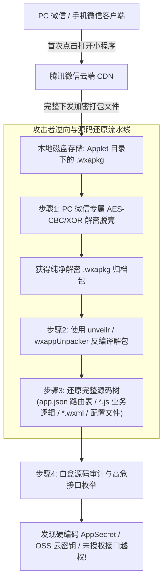

# 微信与支付宝小程序安全：wxapkg包逆向脱壳、源码还原与接口越权挖掘

---

## 0. 基础前置知识扫盲：小程序到底是什么？

> [!NOTE] 模块前置语言与工具清单
> - **前置通关必备**：零基础读者强烈建议先通读全局导航 **[[01-零基础入门前置指南与黑话工具字典]]**，掌握安全法律红线、终端命令行、HTTP 报文骨架与黑话字典！
> - **环境依赖**：具备基础 Web 浏览器（Chrome/Firefox）抓包认知或轻量 Python 脚本执行能力。


在当今企业级渗透测试与 SRC（安全应急响应中心）漏洞挖掘中，许多经验老道的白帽子都会把**微信小程序/支付宝小程序**作为第一突破口。
为什么主站 Web 防守森严（上云 WAF、动态混淆、行为验证码），而小程序却往往一击即溃？

### 1. 通俗生活类比：中央厨房与“密封自热快餐盒”
- **传统 Web 网站**：像**传统餐厅堂食**。你点一道菜，后厨做一道菜端给你（每次点击发送 HTTP 请求，服务端返回渲染好的 HTML/数据）。后厨的代码和逻辑都在服务器端，攻击者很难看到全貌。
- **微信小程序**：像**打包带回家的自热快餐盒（`.wxapkg` 文件）**！
  - 微信小程序本质上并不是原生 Android/iOS 代码，而是**一套被封装在微信客户端原生壳子里的混合 Web 应用程序**（前端由类似 HTML 的 WXML、类似 CSS 的 WXSS 和标准的 JavaScript 编写）；
  - 当你在手机或电脑上打开一个小程序时，微信所做的第一件事就是：**把开发者写好的整套前端源码包（`.wxapkg`）一股脑儿完整下载到你的电脑/手机本地磁盘中**！
  - **白帽子的绝对主动权**：
    既然代码包已经下载到了我们自己的电脑硬盘上，那我们就拥有了绝对的“主场优势”——我们可以把它解压、脱壳、反编译，**将整套前端项目结构 100% 完整还原出来进行白盒审计**！



---

## 1. 小程序本地抓取、解密脱壳与反编译流水线

### 1.1 定位本地缓存的 `.wxapkg` 包
在 Windows PC 端微信中打开目标小程序，随便点击几个页面使其完整缓存。
- **Windows 本地默认存储路径**：
  `C:\Users\<你的Windows用户名>\Documents\WeChat Files\Applet\<小程序AppID>\`
  或者新版本微信路径：
  `C:\Users\<你的Windows用户名>\AppData\Roaming\Tencent\WeChat\XPlugin\plugins\RadiumWMPF\runtime\...`
- 目录下通常包含一个形如 `__APP__.wxapkg` 或以数字命名的 `.wxapkg` 文件。

---

### 1.2 PC 端微信对 `wxapkg` 的混淆加密机制与解密算法
自微信 2.7+ 版本起，PC 微信为了防止被直接解包，对下载的 `wxapkg` 实施了本地加密保护：
- **文件头结构**：文件前 6 个字节固定为标志字符 `V1MMWX`；
- **加密算法**：采用 **AES-128-CBC** 算法加密；
- **密钥生成规则**：以小程序的唯一标识符 **`AppID`** 作为密码种子，通过 **PBKDF2** 派生出解密密钥，IV 向量固定为固定的 16 字节，且从第 1024 字节后采用异或混淆。

#### 自动化解密脱壳 Python 脚本（`pc_wxapkg_decrypt.py`）：

```python
#!/usr/bin/env python3
# -*- coding: utf-8 -*-
import sys
from Crypto.Cipher import AES
import hashlib

def decrypt_wxapkg(wxapkg_path, appid, output_path):
    with open(wxapkg_path, 'rb') as f:
        data = f.read()
    
    # 检查 PC 微信加密标识头
    if data[0:6] != b'V1MMWX':
        print("[-] 该文件并非 PC 微信加密格式，可能无需解密，直接解包即可。")
        return False
        
    print(f"[*] 发现有效加密头 V1MMWX，正在使用 AppID: {appid} 进行解密...")
    
    # 基于 AppID 通过 PBKDF2 生成 AES 密钥与 IV
    salt = b'saltiest'
    key = hashlib.pbkdf2_hmac('sha1', appid.encode('utf-8'), salt, 1000, dklen=32)
    iv = b'the iv: 16 bytes'
    
    # 提取加密数据区 (跳过文件头并解密前 1024 字节)
    cipher = AES.new(key[:16], AES.MODE_CBC, iv)
    decrypted_header = cipher.decrypt(data[6:1024+6])
    
    # 后续数据采用异或解密
    xor_key = ord(appid[-2]) if len(appid) >= 2 else 0x66
    xor_data = bytearray(data[1024+6:])
    for i in range(len(xor_data)):
        xor_data[i] ^= xor_key
        
    final_data = decrypted_header + bytes(xor_data)
    
    with open(output_path, 'wb') as f:
        f.write(final_data)
    print(f"[+] 解密成功! 纯净包已保存至: {output_path}")
    return True

if __name__ == "__main__":
    if len(sys.argv) < 4:
        print("用法: python pc_wxapkg_decrypt.py <加密文件.wxapkg> <wx_appid> <解密后输出.wxapkg>")
        sys.exit(1)
    decrypt_wxapkg(sys.argv[1], sys.argv[2], sys.argv[3])
```

---

### 1.3 使用开源工具还原前端完整项目代码树

获得纯净的 `wxapkg` 之后，使用现代高容错解包工具（如基于 Node.js 的 **`unveilr`** 或经典的 **`wxappUnpacker`**）：

```bash
# 全局安装现代极速反编译工具 unveilr
npm install -g @unveilr/cli

# 一键反编译纯净的 wxapkg 文件
unveilr decrypted.wxapkg -o ./source_code/
```

#### 反编译产出成果：
进入 `source_code/` 目录，你将拥有整套未混淆的小程序前端工程：
- **`app.json`**：**最关键的地图文件**。列出了小程序所有注册的页面路由（包括大量未对外展示的内部管理、未上线模块路径）；
- **`app.js` / `utils/`**：包含全局网络请求封装函数（`wx.request`）、Token 存储机制；
- **`pages/`**：每一个具体功能页面的业务交互逻辑与表单提交代码。

---

## 2. 小程序代码审计高危漏洞挖掘三大战役

在拿到完整的源码后，渗透测试人员不再需要盲目猜测输入框，而是可以直接开启**白盒审计**：

### 2.1 第一战役：敏感凭据与硬编码密钥地毯式检索

开发人员在赶进度时，经常误将云端最高权限凭据直接写死在前端 JS 文件中。使用 VS Code 或命令行全局检索以下关键字：

| 关键搜索词 | 对应高危风险 | 战果与危害 |
| :--- | :--- | :--- |
| `AppSecret` / `secret` | **微信小程序管理私钥** | 配合 AppID 直接调用微信官方接口获取全局接口调用凭据 `access_token`，可窃取全量微信用户手机号、解密敏感数据！ |
| `ak` / `sk` / `accessKeyId` | **阿里云 / 腾讯云 OSS 访问密钥** | 直接利用云存储管理工具（如 ossutil）连接，接管企业全量云端数据存储桶！ |
| `jwt` / `secretKey` | **本地签名密钥** | 伪造任意身份的 JWT Token，直接接管管理员账户。 |
| `jdbc:` / `password` | 数据库直连密码 | 后台配置泄露。 |

```bash
# 快速检索敏感关键字的 Linux / PowerShell 命令
grep -E -r -i "(appsecret|secretKey|accessKey|secret_key|password)" ./source_code/
```

---

### 2.2 第二战役：隐藏路由与未授权后台管理接口（`app.json` 寻宝）

打开反编译出来的 `app.json`，查看其 `pages` 数组配置：
```json
{
  "pages": [
    "pages/index/index",
    "pages/mall/goods",
    "pages/user/profile",
    "pages/admin/dashboard",       <-- 【宝藏】管理员控制台!
    "pages/manage/finance_audit",  <-- 【宝藏】财务审计内部页面!
    "pages/test/swagger_doc"       <-- 【宝藏】测试开发遗留接口文档!
  ]
}
```
- **漏洞原因**：前端虽然在首页隐藏了“管理员入口”按钮，但是**小程序底层的路由跳转引擎（`wx.navigateTo`）并未做严格的权限校验**！
- **利用方式**：在抓包工具或使用微信开发者工具控制台直接输入 `wx.navigateTo({url: '/pages/admin/dashboard'})`，页面直接强制跳转进入管理后台！

---

### 2.3 第三战役：未授权接口越权与 IDOR（平行越权与垂直越权）

翻阅 `pages/user/profile.js`，定位到更新用户个人信息的函数：
```javascript
// 脆弱代码片段
updateUser: function(data) {
    wx.request({
        url: 'https://api.victim.com/v1/user/update',
        method: 'POST',
        header: { 'Authorization': wx.getStorageSync('token') },
        data: {
            uid: 10086,          // 致命点：直接在请求体传递用户 ID!
            phone: '13800000000',
            role: 'normal_user'
        }
    });
}
```
- **漏洞利用**：后端服务器在校验时，仅验证了 Token 是否合法，但**没有核对 Token 归属的用户是否与请求体中的 `uid: 10086` 一致**！
- 攻击者通过 Burp Suite 拦截该请求，将 `uid` 修改为 `10001`（系统管理员），并添加 `role: "admin"`，直接越权篡改管理员手机号并接管账号！

---

## 3. PC 端微信小程序全流量抓包实战配置

很多初学者会遇到在 PC 端打开小程序但 **Burp Suite 抓不到任何流量** 的情况。这是因为微信小程序在 Windows 下默认不走系统 IE 代理。

### 3.1 绝配组合：Proxifier + Burp Suite 强制全局透明代理
1. **启动 Burp Suite**：监听本地端口 `127.0.0.1:8080`；
2. **配置 Proxifier（代理客户端）**：
   - 添加代理服务器（Proxy Server）：`127.0.0.1:8080`（HTTP 类型）；
   - 添加代理规则（Proxification Rules）：
     - 目标应用程序（Applications）：填写微信小程序专用渲染进程名称：
       `WeChatAppEx.exe; WeChat.exe`
     - 动作（Action）：选择刚才添加的 Burp Suite 代理节点；
3. **打开小程序测试**：
   只要在 PC 微信中点击小程序，所有的 HTTPS 请求流瞬间整齐划一地呈现在 Burp Suite 的 HTTP History 历史记录中！

---

## 4. CTF / 实战挖掘演练：从前端硬编码打穿某连锁超市积分系统

### 赛题背景：
- 目标：某连锁便利店“积分换好礼”微信小程序；
- 挑战目标：获取存储在积分兑换系统后台核心服务器的 Flag。

### 进攻全流程：

#### 步骤 1：脱壳解包
在 PC 微信打开小程序，定位到缓存目录提取 `__APP__.wxapkg`，执行解密脚本后使用 `unveilr` 成功反编译还原前端工程。

#### 步骤 2：代码审计截获未公开 API 与云存储密钥
在 `config/appConfig.js` 中直接挖出核心配置：
```javascript
module.exports = {
    BASE_API: "https://mall-api.supermarket.local",
    OSS_CONFIG: {
        region: "oss-cn-beijing",
        accessKeyId: "LTAI5t7SecretKeyId...",
        accessKeySecret: "vY9uRealSecretKey...",
        bucket: "market-private-data"
    }
};
```

#### 步骤 3：云存储接管与利用
使用阿里云官方 `ossbrowser` 工具，输入泄漏的 `AccessKeyId` 与 `AccessKeySecret` 成功连入云存储桶：
- 在 `market-private-data` 桶中发现 `backup/db_export.sql.gz`；
- 下载解压数据库备份文件，成功提取到管理员最高权限明文密码与 Flag：
  `flag{WeChat_Wxapkg_Unp4ck_OSS_L34k_2026}`！

---

## 5. 蓝队企业级纵深防御与小程序加固规范

1. **绝对杜绝前端硬编码任何敏感密钥**：
   - 严禁将微信 `AppSecret`、第三方支付私钥、云存储 AK/SK 写死在前端代码中；
   - 所有的敏感请求必须由**企业自己的后端服务器中转**，前端只负责向企业后端发送普通的业务业务参数，由后端服务器统一鉴权并安全调用微信 API。
2. **核心业务代码开启深度混淆（Code Obfuscation）**：
   - 在微信开发者工具构建生产版本时，强制开启代码压缩与混淆；
   - 对核心加解密与验签逻辑采用专业的前端混淆器（如 JavaScript Obfuscator），重命名所有函数与变量为十六进制乱码，提高逆向破解门槛。
3. **后端强制落实纵深鉴权与 IDOR 防御**：
   - 坚决杜绝依赖客户端传来的 `uid` 或 `user_id`；
   - 后端在处理任何涉及修改、查看个人数据的请求时，**必须以服务端解密 Token 得出的当前登录用户身份为准**，严禁未经验证信任客户端的参数。
