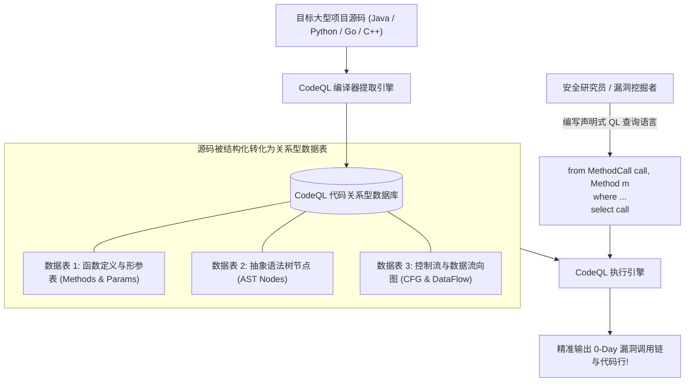

# CodeQL底层架构与声明式QL查询语法从入门到精通

---

## 0. 基础前置知识扫盲：从“大海捞针”到“用SQL查代码”

> [!NOTE] 模块前置语言与工具清单
> - **前置通关必备**：零基础读者强烈建议先通读全局导航 **[[01-零基础入门前置指南与黑话工具字典]]**，掌握安全法律红线、终端命令行、HTTP 报文骨架与黑话字典！
> - **环境依赖**：具备基础 Web 浏览器（Chrome/Firefox）抓包认知或轻量 Python 脚本执行能力。


在渗透测试的演进之路上，所有高手最终都会跨越一条分水岭：
- **黑盒测试阶段**：把目标看作一个黑盒子，在外部抓包、测试各种畸形参数、猜测后端逻辑（“盲人摸象”）；
- **白盒审计阶段**：直接拿到目标系统的上万行甚至上百万行源码，从代码逻辑的最深处精准找出 0-Day 漏洞（“上帝视角”）。

然而，面对一个拥有几十万行 Java/Python 代码的大型企业系统，如果你纯靠肉眼一行一行看，或者用 `Ctrl + F`（正则搜索）去搜索关键词（如搜 `exec(`、搜 `select`），你会被成千上万个合法的开发函数彻底淹没！

### 1. 传统正则扫描工具的致命硬伤
- **传统的静态代码分析工具（如 SonarQube、早期的 Fortify）**：
  本质上是基于**抽象语法树（AST）规则匹配或高级正则表达式**。
- **通俗生活类比：图警犬与破案神探**：
  - **传统正则扫描器**：像一只只认“毒药”这个词的警犬。你在代码里但凡写了 `exec`、`select`、`file`，它就狂吠报警。结果 99% 的报警都是开发人员写的合法内部工具方法，**误报率高达 90% 以上**，把审计人员累得半死。
  - **CodeQL（语义分析破案神探）**：
    CodeQL 根本不看死板的单词匹配！它像一位精通刑侦的逻辑神探。
    神探关注的是一条**完整的犯罪链条（数据流 Data Flow）**：
    “这一瓶毒药（恶意输入），究竟是不是从外部用户（HTTP 请求）手中递进来的？它在流经第 10 个函数时有没有被稀释过滤（净化器 Sanitizer）？最后它有没有真正流入受害者的咖啡杯（命令执行函数 Sink）里？”
    只有证据链完整闭合，CodeQL 才会发出致命警报！



---

## 1. CodeQL 底层架构：如何把代码变成“数据库”？

CodeQL（由 GitHub / 微软官方维护主导）的核心创新在于：**把“源代码分析问题”直接转换成了“数据库查询问题”**！

### 1.1 代码数据库生成全流程实操

在使用 CodeQL 之前，第一步必须是将目标源代码编译转化为 CodeQL 数据库：

#### 编译型语言（Java、C/C++、Go、C#）：
因为编译型语言需要解析强类型与依赖符号，CodeQL 会在实际编译过程中“监控”编译器的行为（如 `javac`、`gcc`、`mvn`）：
```bash
# 语法模板：
# codeql database create <数据库输出路径> --language=<语言> --command="<构建命令>"

# 实战编译生成一个 Java Maven 项目的代码数据库：
codeql database create ./my_java_db --language=java --command="mvn clean package -DskipTests"
```

#### 解释型语言（Python、JavaScript、Ruby）：
解释型语言无需编译构建，CodeQL 直接通过词法语法解析器提取：
```bash
# 提取一个 Python 项目的代码数据库：
codeql database create ./my_python_db --language=python --source-root=./src/
```

---

## 2. QL 声明式查询语言核心语法逐行解析

CodeQL 的查询语言称为 **QL**。它是一种**面向对象、静态类型的声明式查询语言**（语法风格与 SQL 和 Java 的合体极为相似）。

### 2.1 QL 标准查询三部曲结构

```ql
import java // 1. 导入目标语言的核心建模标准库

from /* 声明待查询的变量与类型 (类似 SQL 的 FROM) */
where /* 过滤逻辑与约束条件 (类似 SQL 的 WHERE) */
select /* 最终要高亮展示的结果与描述 (类似 SQL 的 SELECT) */
```

### 2.2 核心面向对象语法构件深度剖析

#### 1. 变量声明与 AST 节点类型
在 Java 标准库中，CodeQL 将语法树节点高度抽象成了类：
- `Method`：代表代码中的一个方法定义（如 `public void login()`）；
- `MethodCall`：代表代码中对某个方法的**调用表达式**（如 `stmt.executeQuery(sql)`）；
- `Parameter`：方法的入参形参；
- `Expr`：通用的表达式节点；
- `BinaryExpr`：二元运算表达式（如字符串加法拼接 `a + b`）。

#### 2. 谓词（Predicate，逻辑函数封装）
谓词是 QL 中的函数，用于封装可复用的逻辑判断，返回布尔值或结果集：
```ql
// 定义一个判断某个方法是否属于敏感命令执行的谓词
predicate isDangerousExecution(Method m) {
    m.hasName("exec") and
    m.getDeclaringType().hasQualifiedName("java.lang", "Runtime")
}
```

#### 3. 自定义类与特征继承（Class & Inheritance）
通过面向对象继承，精确刻画一类特定的代码元素：
```ql
// 定义一个专门表示“危险 SQL 语句执行调用”的自定义类
class DangerousSqlCall extends MethodCall {
    DangerousSqlCall() {
        // 特征约束：该调用的方法名必须是 execute 或 executeQuery
        this.getMethod().hasName(["execute", "executeQuery"]) and
        // 且该方法声明在 java.sql.Statement 接口中
        this.getMethod().getDeclaringType().hasQualifiedName("java.sql", "Statement")
    }
}
```

---

## 3. 实战编写第一个 QL 规则：定位危险命令执行调用

让我们从最基础的实战出发：编写一段 QL 脚本，在数百万行代码中，精准找出所有调用了 `Runtime.getRuntime().exec(...)` 或 `ProcessBuilder.start(...)` 的代码行。

### 3.1 编写查询脚本（`FindDangerousExec.ql`）

```ql
/**
 * @name 危险系统命令执行调用点排查
 * @description 寻找项目中所有调用了 Runtime.exec 的潜在危险位置
 * @kind problem
 * @problem.severity warning
 * @id java/find-dangerous-exec
 */

import java

from MethodCall call, Method targetMethod
where
    // 1. 获取本次调用所指向的目标方法定义
    call.getMethod() = targetMethod and
    // 2. 约束目标方法名必须为 exec
    targetMethod.hasName("exec") and
    // 3. 约束该方法归属于 java.lang.Runtime 类
    targetMethod.getDeclaringType().hasQualifiedName("java.lang", "Runtime")
select 
    call, 
    "发现调用了系统底层的危险命令执行方法: " + targetMethod.getName()
```

### 3.2 在 VS Code CodeQL 扩展中执行查询
1. 在 VS Code 中安装官方扩展 **CodeQL**；
2. 在左侧面板点击 `Choose Database from Folder`，加载刚才生成的 `my_java_db`；
3. 打开 `FindDangerousExec.ql`，右键点击 **CodeQL: Run Query on Selected Database**；
4. 几秒钟内，下方面板整整齐齐地列出全项目中所有的匹配项，**点击即可瞬间跳转到对应的 Java 源码所在行**！

---

## 4. 迈向高阶：控制流图（CFG）与局部数据流（Local Data Flow）

简单的语法结构匹配只是第一步。真正的白盒漏洞往往涉及**变量在代码内部的传递**。

### 4.1 什么是局部数据流？
如果代码中是这样写的：
```java
String cmd = request.getParameter("c"); // 步骤 1
String fullCmd = "/bin/sh -c " + cmd;   // 步骤 2
Runtime.getRuntime().exec(fullCmd);     // 步骤 3
```
- 如果只匹配第 3 行，我们根本不知道 `fullCmd` 到底是从哪儿来的；
- **局部数据流（Local Data Flow）** 能够在同一个方法内部，**自动化追踪变量从步骤 1 $\to$ 步骤 2 $\to$ 步骤 3 的每一次赋值、拼接与传递过程**！

```ql
import java
import semmle.code.java.dataflow.DataFlow

from DataFlow::Node sourceNode, DataFlow::Node sinkNode
where
    // 追踪方法内部的数据流向
    DataFlow::localFlow(sourceNode, sinkNode) and
    // 约束：源头是一个形参，终点流入了某个方法的参数
    sourceNode.asParameter().getName() = "userInput"
select sinkNode, "该节点接收到了来自参数 userInput 的数据流传递!"
```

---

## 5. 蓝队企业级 DevSecOps 流水线落地规范

在现代企业安全工程中，CodeQL 已经成为顶级 CI/CD 自动化安全流水线的核心发动机：

1. **GitHub Advanced Security（GHAS）原生集成**：
   - 开发者每次提交 Pull Request，GitHub Actions 自动调用 CodeQL 执行扫描；
   - 一旦命中高危 QL 规则，**直接在 PR 对应的代码行留下告警评论，自动阻断不安全代码合并入主分支**！
2. **零误报定制化规则库积累**：
   - 企业安全团队应当持续维护一套专属的内部 QL 规则仓库（`internal-codeql-pack`）；
   - 针对公司内部的自研 RPC 框架、自研加解密工具类编写专用的规则，实现对企业专属技术栈的自动化 0-Day 巡检。
