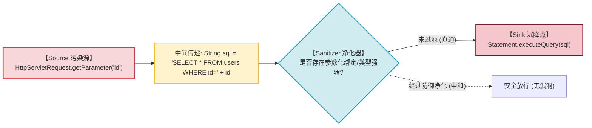

# 现代污点分析实战：自定义Source、Sanitizer与Sink闭环挖掘0-Day漏洞

---

## 0. 基础前置知识扫盲：什么是污点分析？

> [!NOTE] 模块前置语言与工具清单
> - **前置通关必备**：零基础读者强烈建议先通读全局导航 **[[01-零基础入门前置指南与黑话工具字典]]**，掌握安全法律红线、终端命令行、HTTP 报文骨架与黑话字典！
> - **环境依赖**：具备基础 Web 浏览器（Chrome/Firefox）抓包认知或轻量 Python 脚本执行能力。


在上一篇笔记中，我们学会了用 CodeQL 查询语法去定位孤立的危险方法（如 `Runtime.exec`）。
但在真正的企业级代码中，如果一个函数内部写着 `Runtime.getRuntime().exec("ping 127.0.0.1")`，它虽然调用了危险方法，但参数是写死的固定常量，**根本不构成任何安全漏洞**！

真正的安全漏洞，必须满足一个严格的物理因果链条：
$$\text{外部不可信输入 (Source)} \xrightarrow{\text{未被过滤净化}} \text{最终流入危险执行函数 (Sink)}$$

这种在程序内部追踪“不可信数据流向”的技术，就是现代静态代码分析的核心之王——**污点分析（Taint Tracking）**。

### 1. 通俗生活类比：自来水管网中的“荧光染料追踪”
- **污染源（Source - 投毒水龙头）**：
  外部不可信数据的源头。例如用户在网页表单中提交的 `request.getParameter("username")`、HTTP 请求头中的 `Cookie`、上传的文件名。这就像有人把一滴**有毒的绿色荧光染料**倒进了自来水管道。
- **污点传播（Taint Steps - 水流蔓延）**：
  染料顺着管道流动。无论程序员把这个变量赋值给变量 B，还是用 `String.format()` 拼接成新句子，只要这滴染料混合在里面，**新的数据就依然带有绿色荧光（处于被污染状态）**！
- **净化器 / 屏障（Sanitizer / Barrier - 净水过滤网）**：
  如果这股水流经过了一个高效的过滤器（例如程序员调用了 `Integer.parseInt(id)` 强转为整数，或者使用了预编译 SQL 参数绑定），染料被彻底吸附过滤，水流恢复纯净（**污点被中和，不再被视为威胁**）。
- **沉降触发点（Sink - 最终饮用水龙头）**：
  执行高危操作的核心系统函数（如 `Statement.executeQuery()` 查数据库、`Runtime.exec()` 跑命令、`ObjectInputStream.readObject()` 反序列化）。
- **漏洞闭环（0-Day 诞生时刻）**：
  只要 CodeQL 发现**一滴荧光染料在没有经过任何净化器的情况下，一路畅通无阻地直接流入了最终饮用水龙头**——一个货真价实的 **0-Day 漏洞调用链** 就被精准捕获了！



---

## 1. CodeQL 污点追踪体系双版本规范（现代 API vs 经典 API）

随着 CodeQL 的技术演进，语法经历了重构。初学者在阅读社区公开规则时，必须同时掌握两种架构写法：

### 1.1 现代推荐架构（Modern API, CodeQL v2.11+ 模块签名模式）
现代 CodeQL 废弃了繁重的抽象类继承，改用基于 **`DataFlow::ConfigSig` 接口** 与 **泛型模块实例化 `TaintTracking::Global`**：

```ql
/**
 * @name 命令执行污点追踪查询 (现代 API)
 * @kind path-problem // 关键元数据: 声明此查询输出可交互的漏洞调用路径图!
 */

import java
import semmle.code.java.dataflow.DataFlow
import semmle.code.java.dataflow.TaintTracking

// 1. 定义污点配置签名模块
module MyRceConfig implements DataFlow::ConfigSig {
  // 定义源头: 继承官方内置的全部远程不可信输入 (Spring Controller/Servlet等)
  predicate isSource(DataFlow::Node source) {
    source instanceof RemoteFlowSource
  }

  // 定义汇点: 流向了 Runtime.exec 的参数
  predicate isSink(DataFlow::Node sink) {
    exists(MethodCall call |
      call.getMethod().hasName("exec") and
      call.getMethod().getDeclaringType().hasQualifiedName("java.lang", "Runtime") and
      sink.asExpr() = call.getArgument(0)
    )
  }

  // 定义净化器: 经过了白名单过滤函数则阻断
  predicate isBarrier(DataFlow::Node node) {
    exists(MethodCall call |
      call.getMethod().hasName("sanitizeCommand") and
      node.asExpr() = call.getArgument(0)
    )
  }
}

// 2. 实例化全局污点追踪引擎
module MyRceFlow = TaintTracking::Global<MyRceConfig>;
import MyRceFlow::PathGraph // 导入路径图构建器

// 3. 终极查询: 寻找从 Source 到 Sink 的完整路径链条
from MyRceFlow::PathNode source, MyRceFlow::PathNode sink
where MyRceFlow::flowPath(source, sink)
select 
  sink.getNode(), source, sink, 
  "发现致命命令执行 0-Day: 外部不可信数据从 $@ 流入此危险执行点!", 
  source.getNode(), "用户输入参数"
```

---

### 1.2 经典架构（Legacy API, 继承 `TaintTracking::Configuration`）
在很多历史漏洞规则库中，经常见到重写基类的写法：
```ql
class LegacyRceConfig extends TaintTracking::Configuration {
  LegacyRceConfig() { this = "LegacyRceConfig" }

  override predicate isSource(DataFlow::Node source) { ... }
  override predicate isSink(DataFlow::Node sink) { ... }
  override predicate isSanitizer(DataFlow::Node node) { ... }
}
```

---

## 2. 破解实战难题：处理“断流”（`isAdditionalFlowStep` 搭桥术）

在真实的企业级复杂系统（如大规模微服务、自研框架）中进行白盒审计时，90% 的审计人员都会遇到一个极其崩溃的痛点——**“明明肉眼看到有漏洞，为什么 CodeQL 就是报不出来？”**

### 2.1 为什么会发生“污点断流（Taint Break）”？
CodeQL 默认只内置了 Java 标准类库的数据传递逻辑。如果目标代码中存在以下“黑盒转换”，污点流向会在该点**被物理掐断**：
1. **使用了对象属性拷贝工具**：如 `BeanUtils.copyProperties(sourceDto, targetEntity);`；
2. **自定义的 Base64 解码器或数据拆包包装类**；
3. **框架内部的非标准反射与事件总线调用**。

### 2.2 核心救命绝技：编写 `isAdditionalFlowStep` 手动搭桥

通过在配置中重写 `isAdditionalFlowStep` 谓词，告诉 CodeQL：“当数据进入函数 A 时，强制将其传递给函数 B”：

```ql
module MyRceConfig implements DataFlow::ConfigSig {
  ...

  // 自定义补充污点传递步进
  predicate isAdditionalFlowStep(DataFlow::Node pred, DataFlow::Node succ) {
    exists(MethodCall call |
      // 如果遇到了系统内部自研的数据解密/转换工具类
      call.getMethod().hasName("decryptAndUnpack") and
      // 污点流入了该方法的第 0 个参数 (输入)
      pred.asExpr() = call.getArgument(0) and
      // 污点强制流向该方法的返回值 (输出)!
      succ.asExpr() = call
    )
  }
}
```
通过编写搭桥规则，被掐断的数据流瞬间重新贯通，原本被隐藏在复杂封装底层的深层 0-Day 调用链全线现形！

---

## 3. 漏洞变种分析（Variant Analysis）实战：从已知 1-Day 批量挖掘 0-Day

**变种分析（Variant Analysis）** 是全球顶级漏洞赏金猎人和国家级 APT 分析员最高效的生产力武器：
> **“软件工程是由人写出来的，程序员在一个地方犯的错误，必然会在项目的其他地方重复犯下三到五次！”**

### 3.1 真实实战场景复盘：
1. **捕获历史补丁**：某开源内容管理系统（CMS）发布了安全更新，修复了一个位于 `UserController.java` 中的 SQL 注入（CVE-202X）；
2. **提炼抽象特征**：
   - 查看补丁发现：开发者在处理 `@GetMapping` 时，使用了拼接字符串构造 MyBatis 原生查询；
   - 提取该漏洞的 **Source 特征**：带有特定 `@ApiRoute` 注解的方法参数；
   - 提取该漏洞的 **Sink 特征**：流向了 `org.apache.ibatis.session.SqlSession.selectList` 的第一个参数；
3. **编写定制 QL 规则并在全库执行**：
   运行定制的 CodeQL 查询，扫描该 CMS 包含的另外 200 个 Controller；
4. **震撼产出**：
   **CodeQL 在 15 秒钟内，直接在 `OrderController`、`ExportService`、`AuditLogHandler` 中同时命中了 4 条完全相同的未修复调用链！**
   安全研究人员直接凭借同一份 QL 规则，一次性斩获 4 个全新的高危 0-Day CVE 编号！

---

## 4. 蓝队企业级 CI/CD 自动化集成与 DevSecOps 基线

为了从研发源头杜绝高危漏洞流入生产环境，企业安全架构必须推进 CodeQL 工业化落地：

1. **GitHub Actions 自动化门禁设置**：
   在代码仓库配置 `.github/workflows/codeql-analysis.yml`，设置策略：
   - 只要扫描出严重等级为 `High` 或 `Critical` 的污点流，**直接锁定该分支，严禁任何代码部署到生产环境**！
2. **规则库分层治理**：
   - **基础层（Official Core Pack）**：启用官方经过深度调优的 `codeql/java-queries`，覆盖标准 OWASP Top 10；
   - **业务层（Custom Extended Pack）**：针对内部自研微服务框架，专门定义企业专属的 `isSource`（识别内部网关 Header 认证注入）与 `isBarrier`（识别内部统一数据清洗网关）。
