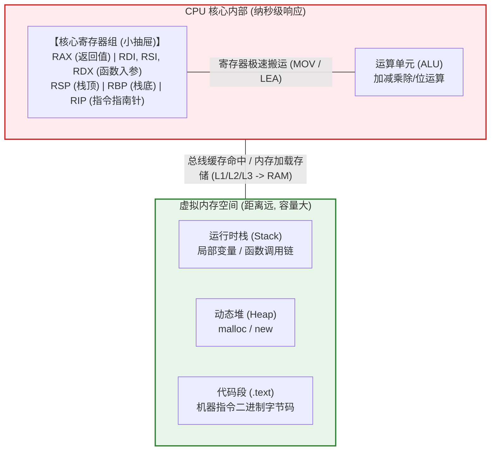
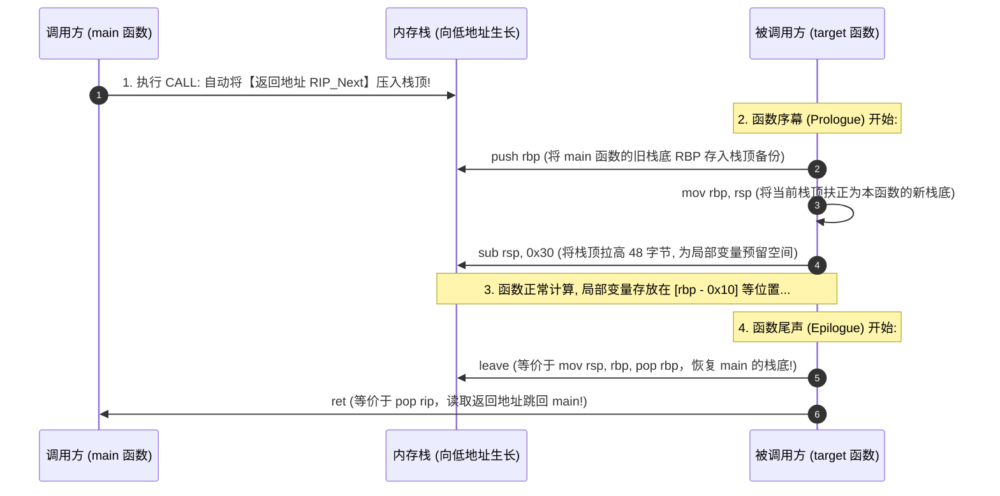

# 汇编与逆向极简心智模型：x64寄存器、函数调用栈帧与指令执行本质

---

## 0. 拒绝教科书废话：为什么学逆向不需要去背 8086 实模式？

> [!NOTE] 模块前置语言与工具清单
> - **前置通关必备**：零基础读者强烈建议先通读全局导航 **[[01-零基础入门前置指南与黑话工具字典]]**，掌握安全法律红线、终端命令行、HTTP 报文骨架与黑话字典！
> - **环境依赖**：具备基础 Web 浏览器（Chrome/Firefox）抓包认知或轻量 Python 脚本执行能力。


几乎所有大学计算机体系结构或汇编语言教材，开篇都要花几个星期大讲特讲：
- 8086 芯片架构、16 位寻址；
- 段寄存器 `CS`、`DS`、`SS`、`ES`；
- 物理地址计算公式：`物理地址 = 段基址 * 16 + 偏移地址`。

**在现代 64 位操作系统（x86-64 / AMD64）与 CTF 逆向/二进制攻防中，这些全是干扰信息！**
现代操作系统全部工作在 **平坦虚拟内存模型（Flat Memory Model）** 下，硬件分页机制已经把底层的段式结构彻底抽象屏蔽。
逆向工程师和漏洞挖掘者眼中的 CPU 与内存，本质上极其简单，只有两样东西：
1. **CPU 身边几个触手可及的极速小抽屉（寄存器 Registers）**；
2. **离 CPU 稍远的一根连续的内存传送带（栈与堆 Memory）**。

---

## 1. 通俗生活类比：暴躁的流水线工人与小抽屉

把 CPU 想象成一个运算速度逆天（每秒计算 30 亿次），但患有“极度严重健忘症”的流水线工人：
- 他的工作台非常狭小，手里一次只能拿两三个零件；
- 离他 100 米远的地方是巨大的仓库（**物理内存 RAM**），如果每算一步都要跑去仓库取零件，工人会被活活累死（内存延迟高达数百个 CPU 时钟周期）；
- 于是，他在工作台手边打了十几个**专属抽屉（寄存器）**，取放零件只需要 0.3 纳秒！



---

## 2. 64 位核心寄存器图谱：攻防视角只记这几个

在 64 位 x86-64 架构下，寄存器前缀是 `R`（64位，8字节）；若取其低 32 位，前缀变成 `E`（4字节）；低 16 位去掉前缀；低 8 位带 `L`。
*(例如：`RAX` 64位 $\to$ `EAX` 32位 $\to$ `AX` 16位 $\to$ `AL` 8位)*

### 2.1 关键指针寄存器（命门所在）
1. **`RIP`（Instruction Pointer，指令指针寄存器）——【灵魂指南针】**：
   - 存着 CPU **下一条要执行的指令在内存中的绝对虚拟地址**；
   - **黑客攻防核心目标**：绝大多数二进制漏洞（栈溢出、ROP 链、UAF 劫持函数指针），最终目的只有一个——**把恶意构造的地址写进 `RIP`**！只要操控了 `RIP`，CPU 就会乖乖执行黑客指定的 Shellcode 或函数。
2. **`RSP`（Stack Pointer，栈顶指针）——【栈顶托盘】**：
   - 永远紧贴当前运行时栈的**最顶端**（注意：x86 栈向低地址生长，`push` 时 RSP 变小，`pop` 时 RSP 变大）。
3. **`RBP`（Base Pointer，基址指针）——【栈底锚点】**：
   - 指向当前函数活动栈帧的**底部基准线**。函数内部寻找局部变量（如 `[rbp-0x10]`）全靠以它为锚点做偏移寻址。

---

### 2.2 函数传参黄金法则：System V AMD64 ABI 约定

在 32 位老旧系统（cdecl 约定）中，调用函数传参全靠 `push` 压入栈中。
而在 **64 位 Linux（System V ABI）** 中，为了追求极致性能，前 6 个参数全部**直接装进寄存器传参**，只有第 7 个及以后的参数才溢出压栈：

| 参数顺序 | 承载寄存器 | 助记口诀与攻防场景 |
| :---: | :---: | :--- |
| **第 1 个参数** | **`RDI`** | 构造 `system("/bin/sh")` 时，`/bin/sh` 字符串地址必须放入 `RDI` |
| **第 2 个参数** | **`RSI`** | 构造 `read(0, buf, size)` 时，接收缓冲区的地址放入 `RSI` |
| **第 3 个参数** | **`RDX`** | 读取或写入的数据长度（字节数）放入 `RDX` |
| **第 4 个参数** | **`RCX`** | 第 4 个参数传递 |
| **第 5 个参数** | **`R8`** | 第 5 个参数传递 |
| **第 6 个参数** | **`R9`** | 第 6 个参数传递 |
| **函数返回值** | **`RAX`** | 函数 return 的结果必定存放在 `RAX`（如返回 0 或返回指针） |

> [!TIP] ROP 链攻击核心原理破密
> 在 Linux 64 位漏洞利用（ROP, Return-Oriented Programming）中，最经典的一环就是寻找汇编指令片段（Gadget）：
> `pop rdi ; ret`
> 它的物理作用就是：把栈顶黑客放好的 `"/bin/sh"` 字符串地址弹入 `RDI` 寄存器（填入第 1 个参数），随后 `ret` 跳入 `system()` 函数，直接弹 Shell！

---

## 3. 函数调用的物理真相：栈帧（Stack Frame）是如何创建与崩塌的

理解了函数调用过程，你就彻底搞懂了**栈溢出漏洞的本质**。

### 3.1 `CALL` 与 `RET` 底层动作还原

当你写了一句 C 语言代码 `vuln_func();` 时，底层汇编只有简简单单的两句：
1. **`CALL 0x401150`（进入新世界）**：
   CPU 底层瞬间原子化执行了两步：
   - **`push rip_next`**：把 `CALL` 下面那行代码的内存地址（返回地址 Return Address）硬生生压入栈顶保存！
   - **`jmp 0x401150`**：把 `RIP` 修改为目标函数的首地址。
2. **`RET`（返回原世界）**：
   目标函数执行完毕时执行 `RET`：
   - CPU 底层瞬间执行：**`pop rip`**！
   - 把栈顶保存的那个“返回地址”弹出来，重新塞回 `RIP`，CPU 瞬间跳回主函数继续执行！

---

### 3.2 栈帧生命周期全景图

当一个新函数被执行时，编译器生成的汇编标准“序幕（Prologue）”与“尾声（Epilogue）”如下：



---

### 3.3 经典栈溢出覆盖崩溃模型

如果该函数内部有一个 16 字节的局部缓冲区 `char buf[16]`，却使用了不检查长度的危险函数 `read(0, buf, 128)`：

```
栈底高地址方向 (High Address: 0x7fffffffe000)
┌──────────────────────────────────────────────┐
│  【函数返回地址 Return Address (Saved RIP)】   │ <── 黑客的目标：将其覆盖为恶意函数地址 (如 backdoor)!
├──────────────────────────────────────────────┤
│  【调用者基址 Saved RBP】                     │ <── 8 字节 (被溢出垃圾数据填满)
├──────────────────────────────────────────────┤
│  局部变量缓冲区 buffer [16 字节]             │ <── 输入从这里开始写入，持续向高地址溢出...
└──────────────────────────────────────────────┘
栈顶低地址方向 (Low Address:  0x7fffffffdfe0)
```

**漏洞触发瞬间**：
黑客传入 `16字节 (填充buf) + 8字节 (填充Saved RBP) + 8字节 (目标函数地址)`。
当该函数执行到 `ret`（`pop rip`）的那一瞬间，CPU 从栈顶捡起这最后的 8 字节塞入 `RIP`，控制流瞬间被黑客接管！

---

## 4. 逆向攻防高频指令极简清单（只记这 10 个）

不需要去啃数百页的 Intel 指令手册，CTF 逆向分析 95% 的逻辑全由以下 10 条指令构成：

### 4.1 数据搬运与计算
- **`mov dst, src`**：纯粹的值拷贝（把 `src` 的内容抄一份放进 `dst`）。
- **`lea dst, [addr]`（Load Effective Address）**：**只算地址，不读内容**！
  - `mov rax, [rbp-0x10]`：去内存地址为 `rbp-0x10` 的地方，把里面存的值读出来放到 `rax`。
  - `lea rax, [rbp-0x10]`：直接把 `rbp-0x10` 算出来的这个**地址本身**塞进 `rax`（相当于 C 语言的取指针 `&var`）。
- **`xor dst, src`**：异或操作。
  - 逆向常见 `xor eax, eax`：任何数与自身异或等于 0。编译器不用 `mov eax, 0`，因为 `xor` 生成的机器码更短（仅 2 字节）且执行速度更快。
- **`push val`**：`sub rsp, 8` $\to$ `mov [rsp], val`（入栈）。
- **`pop reg`**：`mov reg, [rsp]` $\to$ `add rsp, 8`（出栈）。

### 4.2 条件判断与逻辑跳转
- **`cmp a, b`**：本质上执行 `a - b`，但**不保存计算结果**，仅仅根据结果的正负、零值来设置 CPU 的 **标志寄存器（RFLAGS）**（如零标志位 `ZF`、符号标志位 `SF`）。
- **`test a, b`**：本质上执行 `a & b`（按位与），同样不保存结果，仅设置标志位。
  - 常见 `test eax, eax; jz 0x401000`：判断 `eax` 是否为 0，若为 0（`ZF=1`）则跳转。
- **`je / jz`**：相等（或结果为 0）时跳转。
- **`jne / jnz`**：不相等（或结果非 0）时跳转。
- **`jmp addr`**：无条件直接跳转（强制把 `addr` 写入 `RIP`）。

---

## 5. GDB/Pwndbg 动态调试实战：看透寄存器与栈内存

### 5.1 极简实战源码（`demo.c`）
```c
#include <stdio.h>

int add(int a, int b) {
    int c = a + b;
    return c;
}

int main() {
    int result = add(10, 20);
    printf("Result: %d\n", result);
    return 0;
}
```

编译命令（保留调试符号，关闭栈保护与优化）：
```bash
gcc -g -O0 -fno-stack-protector -no-pie demo.c -o demo
```

### 5.2 GDB 动态追踪下断点
```bash
gdb -q ./demo
(gdb) b add           # 在 add 函数入口下断点
(gdb) r               # 运行程序，命中断点停止
```

#### 检查寄存器状态与传参：
```bash
(gdb) info registers
# 观察前两个参数是否进入了 RDI 和 RSI：
# rdi            0xa                 10 (第 1 个入参)
# rsi            0x14                20 (第 2 个入参)
# rsp            0x7fffffffe318      当前栈顶指针
# rbp            0x7fffffffe340      当前栈底基址
# rip            0x401126            当前停留在 add 函数第一行
```

#### 查看栈内存（窥探返回地址）：
```bash
# 查看栈顶当前存放的内容（8 字节十六进制格式）：
(gdb) x/1gx $rsp
# 0x7fffffffe318:  0x000000000040115b  <-- 这个地址正是 main 函数中调用 add 后的下一行代码地址!
```

#### 单步执行直到返回：
```bash
(gdb) finish          # 运行到当前函数结束并返回
# Value returned is $1 = 30
# 检查 RAX 寄存器是否装入返回值 30 (0x1e):
(gdb) p $rax
$2 = 30
```

---

## 6. 逆向核心思维模型速查表

| 核心问题 | 底层物理本质 | 攻防/逆向对应利用手法 |
| :--- | :--- | :--- |
| **函数如何接收参数？** | Linux x64 优先使用 `RDI, RSI, RDX, RCX, R8, R9` 寄存器传递 | 构造 ROP Gadget 控制 `RDI` 传递 `/bin/sh` 参数 |
| **函数如何交出返回值？** | 计算结果固定存入 `RAX`（32位为 `EAX`） | 破解注册机验证时，Hook 关键跳转前的 `EAX` 强行改为 1 |
| **函数执行完如何回家？** | 执行 `ret`，将栈顶地址弹入 `RIP` | 栈溢出覆盖 Saved RIP 劫持程序控制流 |
| **局部变量存放在哪？** | 负偏移相对 `RBP` 寻址，如 `[rbp-0x20]` | 局部变量越界可直接覆写邻近变量或溢出覆盖 Saved RBP |
| **程序分支依据什么跳转？** | `cmp` / `test` 计算并设置 `RFLAGS`（ZF, SF 等状态） | 逆向破解将 `jz` 改为 `jnz` 或 `nop`（0x90）消除关键逻辑校验 |
