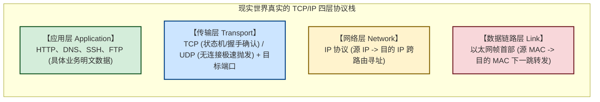
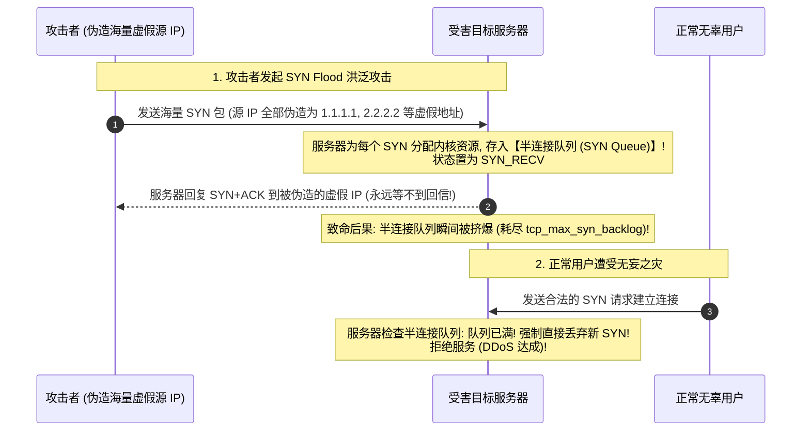
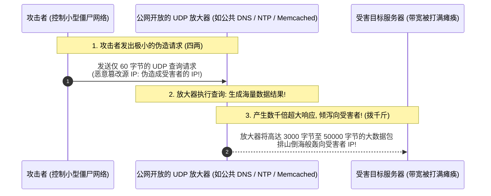

# TCP-IP攻防内幕：握手挥手真相、SYN-Flood与UDP放大反射DDoS

---


> [!TIP] 🛠️ 工具实操指引：hping3 极简安装与首个测试命令
> - **是什么**：面向 TCP/IP 协议栈的命令行网络报文构造与压测利器，可任意伪造源 IP、定制 TCP 标志位与发送速率。
> - **怎么装**：
>   * Linux (Kali / Ubuntu / Debian)：直接执行 `sudo apt update && sudo apt install -y hping3`
>   * macOS：执行 `brew install hping`
> - **第一个实操（合法授权实验）**：
>   * 发送带有 SYN 标志位的高速探测包测试防火墙响应：
>     ```bash
>     sudo hping3 -S -p 80 -c 5 127.0.0.1
>     ```
>   * 参数解析：`-S` 表示开启 TCP SYN 标志位；`-p 80` 指定探测端口为 80；`-c 5` 表示发送 5 个包后自动停止。

## 0. 拒绝教科书废话：把 OSI 七层模型扔进垃圾桶

> [!NOTE] 模块前置语言与工具清单
> - **前置通关必备**：零基础读者强烈建议先通读全局导航 **[[01-零基础入门前置指南与黑话工具字典]]**，掌握安全法律红线、终端命令行、HTTP 报文骨架与黑话字典！
> - **环境依赖**：具备基础 Web 浏览器（Chrome/Firefox）抓包认知或轻量 Python 脚本执行能力。


大学计算机网络教材最喜欢花整整两章去背诵“物理层、数据链路层、网络层、传输层、会话层、表示层、应用层”。
然而在真实的操作系统内核、网卡驱动和黑客攻防世界中：
**“会话层”和“表示层”纯属纸上谈兵的学术幻觉，现实世界中运转的只有纯粹的 TCP/IP 四层模型！**

### 1. 通俗生活类比：国际跨国网购快递
黑客看网络，只看这四层包裹（自下而上层层拆快递）：
1. **网络接口层（数据链路层 / MAC 地址）**：**快递运输车与中转站**。货车只负责把箱子拉到下一个集散中心，它只认物理车牌号（网卡 MAC 地址）。
2. **网络层（IP 协议）**：**快递包裹单上的最终收件人省市区地址**。负责跨越千山万水在全球互联网路由器之间寻址定位（如 `120.25.10.50`）。
3. **传输层（TCP / UDP 协议 + 端口）**：**收件大厦的具体门牌号与送货方式**。
   - 端口（Port）告诉电脑是交给 80 号房间的 Web 服务，还是 22 号房间的 SSH 服务；
   - **TCP（顺丰特快保价签收）**：必须先打电话确认你在家（三次握手），每送一个件必须签字确认，丢了立刻重发；
   - **UDP（路过往窗户里扔传单）**：根本不管你在不在家、收没收到，扔完就跑，极速但毫无保证。
4. **应用层（HTTP / DNS / SSH）**：**快递盒子里装的具体物品**（HTML 网页、密码数据、文件二进制流）。



---

## 1. TCP 三次握手与半连接队列：SYN Flood 的本质

几乎所有人都知道三次握手是：`SYN` $\to$ `SYN+ACK` $\to$ `ACK`。
但教科书往往不告诉你：**“为什么少一次不行？服务器在这几毫秒内分配了什么内核内存？黑客是如何利用这个机制发起洪水攻击的？”**

### 1.1 为什么必须是三次？（防止“历史幽灵连接”）
- 假设只需要两次握手（客户端发 SYN，服务端回 ACK 连接就建立）：
- 如果客户端发出的第一个 SYN 在网络拥堵的路由器里迷路了，超时后客户端放弃重发；
- 过了十分钟，这个老掉牙的过期 SYN 突然晃晃悠悠到达了服务端。服务端一收到，以为客户端想建立新连接，立刻分配内存并回复 ACK；
- 此时客户端根本不需要这个连接，直接忽略。**但服务端却白白挂着一个活活耗费内存的僵尸连接！**
- **三次握手的妙处**：第三次必须由客户端回传最终的 ACK，客户端看到过期的序列号直接拒收并发送 RST 断开，防止服务端被幽灵连接拖垮。

---

### 1.2 致命死穴：半连接队列（SYN Queue）与 SYN Flood 拒绝服务

在完成三次握手的过程中，服务器在内核中维护着两个至关重要的队列：



#### 攻击原理大白话：
- 像一个恶作剧团伙，给全城所有披萨店狂打电话，报虚假地址订餐；
- 披萨店接线员（**半连接队列**）全被占满，每一通电话都要苦苦等待 60 秒确认；
- **真实顾客打电话进来时，全部占线打不通（拒绝服务 DDoS）！**

#### 攻击工具实战（`hping3` 快速制造 SYN 洪流）：
```bash
# -S: 发送 SYN 标志包
# -p 80: 目标 Web 端口
# --flood: 以网卡极限速度发包，不等待回复
# --rand-source: 核心关键! 随机伪造源 IP 地址!
hping3 -S -p 80 --flood --rand-source 192.168.10.50
```

---

### 1.3 防御之神：SYN Cookie 机制（无内存抵御洪峰）

面对数百万每秒的 SYN 洪流，哪怕你把服务器的 `tcp_max_syn_backlog` 调到一千万，内存也终究会被耗尽。
Linux 内核给出的神级解法是——**SYN Cookie（`net.ipv4.tcp_syncookies = 1`）**。

#### SYN Cookie 的破局之道（“不交押金不给钥匙”）：
1. **收到 SYN 时，根本不分配任何内核内存！**（直接绕开半连接队列）；
2. 服务器利用客户端的 IP、端口、时间戳以及一个内核专用的秘密密钥（Secret Key），经过哈希计算得出一个特殊的 32 位数字，作为 `SYN+ACK` 中的 **初始序列号（ISN / Cookie）** 回发给客户端；
3. 如果是攻击者发来的伪造包，由于源 IP 虚假，永远不会有回信，**服务器没有任何内存损失**！
4. 如果是真实正常用户，客户端在第三次握手时必然会回传 `ACK`（其中的确认号就是刚才的 Cookie + 1）；
5. 服务器收到 `ACK`，**重新计算一次哈希算法逆向校验**。一旦数字吻合，证明对方确实收到了上一个包，**此时才正式分配内存建立连接！**

---

## 2. RST 标志位强杀连接：深度包检测（DPI）与网络阻断真相

在 TCP 报文头中，除了 `SYN`、`ACK`、`FIN`（挥手关闭），还有一个冷酷的标志位——**`RST`（Reset，强制重置）**。

### 2.1 RST 的设计初衷与黑客滥用
- **初衷**：用于异常处理。比如客户端突然断电重启，服务器发来数据时，客户端发现自己根本没有这个连接的记录，立刻回复一个 RST 报文：“我根本不认识你，立即终止连接！”
- **防火墙（如 GFW / 商业下一代防火墙 NGFW）的阻断机制**：
  - 防火墙串联或旁路监听在骨干网线路上；
  - 当它通过 DPI（深度包检测）从明文 HTTP 流量中嗅探到敏感关键词时；
  - 防火墙既不需要黑掉网站，也不需要切断物理网线，而是**同时向客户端和服务端双向发送伪造的伪造 `RST` 报文**！
  - 双方操作系统收到合法的 RST 报文后，TCP 协议栈底层**强制立即销毁连接**，用户的浏览器瞬间弹出：“连接已被重置（Connection Reset）”！

---

## 3. UDP 放大反射 DDoS（DrDoS）的“四两拨千斤”杠杆原理

很多新手会问：“既然 SYN Flood 这么厉害，为什么黑客打几百 Gbps 甚至几个 Tbps 的超级大流量时，普遍都用 **UDP 反射放大** 呢？”

### 3.1 为什么 TCP 绝对无法做“反射放大攻击”？
因为 TCP 必须三次握手！
如果攻击者伪造目标受害者的源 IP 发送 TCP 请求，目标服务器回传的 `SYN+ACK` 会发给受害者，而受害者根本不知道怎么回事直接丢弃，**TCP 连接根本建立不起来，服务器绝不会把海量的应用层数据吐出来**！

### 3.2 UDP 的协议原罪：无连接、不握手、允许任意伪造源 IP
UDP 协议像寄明信片，**在明信片上写谁的寄信人地址（源 IP），邮局（互联网路由器）就认为是谁寄的！**



---

### 3.3 经典三大 UDP 反射放大器倍率表

攻击者通过这种“四两拨千斤”的杠杆，能用自己的 100Mbps 小带宽，瞬间在受害者端聚合成 **100Gbps 甚至 1Tbps 的毁灭性洪流**：

| 反射放大协议 | 默认端口 | 攻击触发命令 / 请求特征 | 放大倍率（杠杆效应） |
| :--- | :---: | :--- | :---: |
| **DNS 反射** | 53 | 发送 `ANY` 记录全量解析查询请求（利用 DNSSEC 极长响应） | **28 ~ 54 倍** |
| **NTP 反射** | 123 | 发送 `monlist` 指令（请求该 NTP 服务器最近通信过的 600 个客户端 IP 列表） | **556 倍** |
| **Memcached 反射** | 11211 | 向未授权的 Memcached 发送获取超大缓存 Key 的请求 | **10,000 ~ 51,000 倍（核弹级！）** |

> [!CAUTION] **Memcached 历史核弹事件（Github 遭遇 1.35 Tbps 攻击）**：
> 2018 年，黑客向全球暴露在公网、未设防的 Memcached 数据库发送几字节的 UDP 请求，Memcached 回吐高达数十 KB 的数据包，直接掀起了互联网历史上规模最大的 1.35 Tbps DDoS 洪峰！

---

## 4. 总结速查表

| 攻防概念 | 底层网络原理 | 攻防实战意义 |
| :--- | :--- | :--- |
| **三次握手** | 序列号同步确认，防止历史失效连接占用内存 | 必须双向确认，第二步半开连接暂存半连接队列。 |
| **SYN Flood** | 伪造虚假源 IP，打爆服务器 `SYN Queue` 队列 | 造成正常用户无法建连；防御核心依赖 **SYN Cookie**。 |
| **RST 重置** | 强制异常终止连接标志位 | 防火墙利用伪造双向 RST 报文在传输层秒级阻断特定通信。 |
| **UDP 反射放大**| UDP 无状态不握手 + IP 地址伪造 + 响应数据远大于请求 | 四两拨千斤的 DDoS 杠杆；通过公网开放服务将攻击流量放大数千倍。 |
