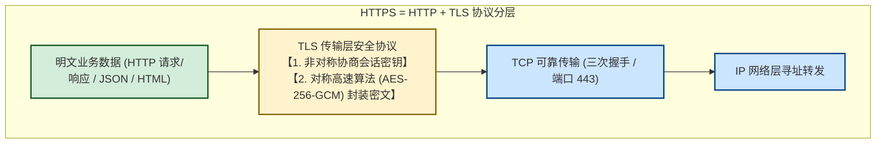
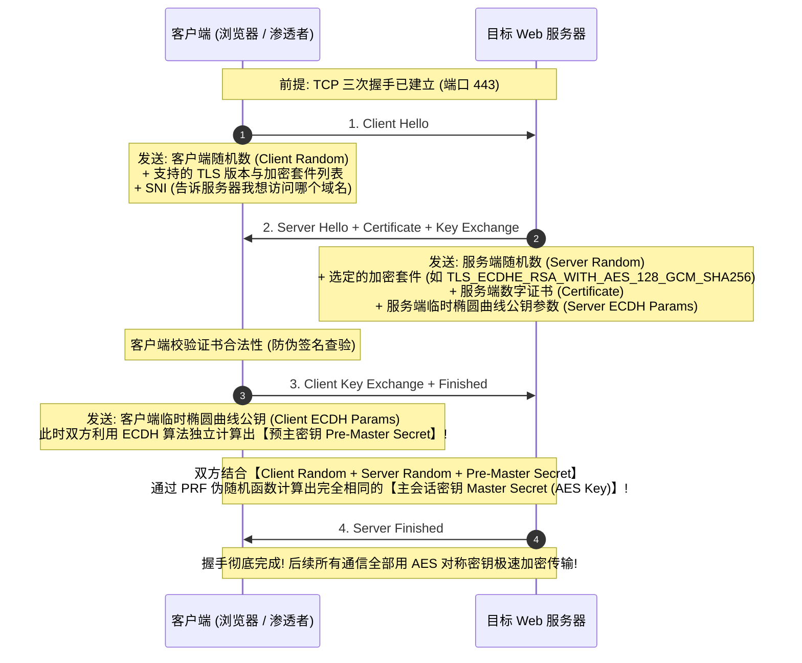
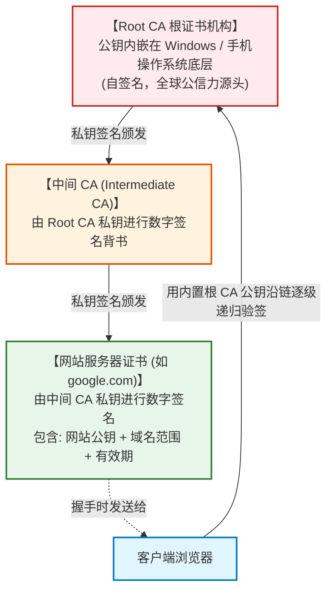
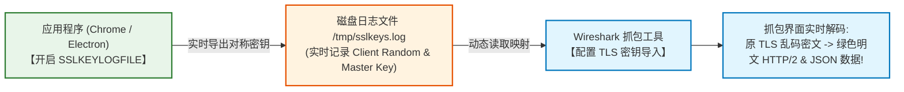
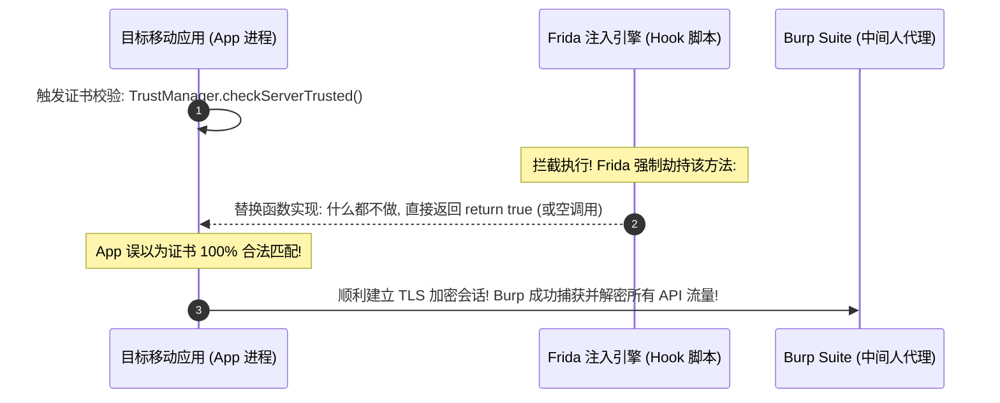

# HTTPS与TLS握手解密内幕：证书信任链、会话密钥协商与SSL-Pinning绕过

---

## 0. 拒绝教科书废话：不要再去硬背欧拉定理与大素数分解！

> [!NOTE] 模块前置语言与工具清单
> - **前置通关必备**：零基础读者强烈建议先通读全局导航 **[[01-零基础入门前置指南与黑话工具字典]]**，掌握安全法律红线、终端命令行、HTTP 报文骨架与黑话字典！
> - **环境依赖**：具备基础 Web 浏览器（Chrome/Firefox）抓包认知或轻量 Python 脚本执行能力。


几乎所有传统网络或密码学教材，讲到 HTTPS/SSL 时，开头必定是几十页的数学公式推导：
- 欧拉函数 $\phi(n)$、模反元素、大整数因数分解难题；
- 然后长篇大论讲 RSA 加密算法的数学证明。

但在真实的渗透测试、CTF 攻防和现代网络工程中：
**“根本没有任何一个工程师或黑客会在传输几百兆的网页/视频时直接使用 RSA 加密！”**
因为非对称加密的 CPU 计算开销比对称加密（AES/ChaCha20）慢了上千倍！如果在每个 HTTP 请求上都硬怼 RSA，哪怕全宇宙最好的服务器也会瞬间被 CPU 算力挤爆瘫痪。

### 1. 通俗生活类比：上锁铁盒与密室私语
- **非对称加密（RSA / ECC 椭圆曲线）——【大街上的送钥匙铁盒】**：
  公钥是公开的铁盒锁（谁都可以往盒子里塞东西并锁上），私钥是只有服务端持有的唯一开锁钥匙。它在 HTTPS 中**仅仅在最初的几毫秒内露个脸**，用来在众目睽睽的大街上安全递交一把临时的秘密钥匙。
- **对称加密（AES-GCM / ChaCha20）——【密室里的对讲暗号】**：
  双方拿到这把临时钥匙后，迅速躲进加密通道。之后传输的上千张图片、网页 HTML、账号密码，**全走极速对称加密**（现代 CPU 芯片自带 AES-NI 硬件指令集，加解密速度高达数 GB/s，性能损耗趋近于零！）。



---

## 1. TLS 握手真相：从协商到会话密钥的诞生

许多人只知道“HTTPS 是加密的”，却不知道它在 TCP 三次握手之后到底交流了什么。

### 1.1 握手全流程大白话（TLS 1.2 vs TLS 1.3）

以目前主流的现代 TLS 握手为例（ECDHE 临时椭圆曲线密钥交换）：



---

### 1.2 为什么老式抓包解密失败？完全前向保密（PFS, Perfect Forward Secrecy）

在很早期的旧版 TLS（使用静态 RSA 密钥交换）中：
客户端直接用服务器的 RSA 公钥加密 Pre-Master Secret 传过去。如果黑客把所有通信流量录像存盘，**只要半年后黑客偷到了服务器的 RSA 私钥，就能把过去半年的所有历史流量全盘解密还原！**

#### 现代 ECDHE 的防御降维打击：
现代加密套件强制要求支持 **完全前向保密（PFS）**：
- 客户端和服务端在每次握手时，临时生成一对椭圆曲线公私钥；
- 算出会话密钥后，**双方立刻在内存中销毁这对临时私钥（用完即焚）**；
- **致命后果**：哪怕明天服务器的证书私钥被黑客彻底盗走，黑客也**绝不可能解密昨天录下来的任何一段历史加密流量**！

---

## 2. CA 数字证书信任链：中间人攻击为什么会被识破？

既然握手过程是公开的，**黑客能不能在局域网搞 ARP 欺骗，然后伪造一个“假证书”冒充 `google.com` 呢？**

### 2.1 信任链体系：全球统一的“防伪印章”

操作系统（Windows / Linux / macOS）和移动设备（Android / iOS）在出厂安装时，内部都预置了一批 **“受信任的根证书颁发机构（Root CA）”**（如 DigiCert, GlobalSign, Let's Encrypt 等）。



#### 验签核心逻辑：
1. 黑客自己用 OpenSSL 随手生成一个 `google.com` 的证书；
2. 受害者浏览器收到后，发现这个假证书的签发者不是系统内置的任何一个受信任根 CA；
3. 浏览器瞬间弹出刺眼的红色全屏警报：**“您的连接不是私密连接（NET::ERR_CERT_AUTHORITY_INVALID）”**，强行阻断访问！

> [!NOTE] 为什么 Burp Suite 抓包必须导入 `cacert.der`？
> 当你在电脑上挂 Burp 抓自己的 HTTPS 流量时，Burp 本质上就是一个中间人（MitM）。为了不让浏览器报红警，你必须**手动把 Burp 的自签名根证书强行导入并安装到操作系统的“受信任的根证书颁发机构”存储区中**！

---

## 3. 渗透与取证绝技：`SSLKEYLOGFILE` 实时无证书解密 HTTPS 流量

在很多高级渗透、恶意软件逆向或者厚客户端（Electron、Python、Go 应用）测试中：
- 目标程序死活不走系统的 HTTP 代理；
- 目标程序由于安全限制无法安装自签名 CA 证书；
- Wireshark 抓下来的全是乱码的 `Application Data`。

**黑客级破局利器：利用 `SSLKEYLOGFILE` 环境变量倾倒会话密钥！**

### 3.1 核心原理
Chromium 内核（Chrome, Edge, Electron 桌面应用）、Firefox、Curl 以及 OpenSSL/BoringSSL 库，原生支持一个调试特性：
只要检测到系统环境变量中存在 `SSLKEYLOGFILE`，**应用程序在完成 TLS 握手算出 Master Secret 的那一瞬间，会自动将随机数与对称会话密钥以明文形式实时追加写入该文件！**

```
# SSLKEYLOGFILE 内容格式范例：
CLIENT_RANDOM 6a82...d91c 4b89...881a (Session Master Key)
```

---

### 3.2 实战操作闭环（无证书解密任意 HTTPS 流量）

#### 步骤 1：设置环境变量并启动被测程序
```bash
# Linux / macOS 终端
export SSLKEYLOGFILE="/tmp/sslkeys.log"
google-chrome --user-data-dir="/tmp/test_chrome" &

# Windows CMD 终端
set SSLKEYLOGFILE=C:\temp\sslkeys.log
start "" "C:\Program Files\Google\Chrome\Application\chrome.exe"
```

#### 步骤 2：启动 Wireshark 抓包并导入密钥文件
1. 打开 Wireshark，监听对应网卡；
2. 菜单栏点击：**Edit（编辑）** $\to$ **Preferences（首选项）**；
3. 左侧展开 **Protocols（协议）** $\to$ 找到 **TLS**（旧版 Wireshark 叫 SSL）；
4. 在右侧 **`(Pre)-Master-Secret log filename`** 选项中，点击 Browse 选中刚才的 `/tmp/sslkeys.log`；
5. 点击 OK 保存。



**效果震撼**：
Wireshark 界面中原来漆黑一片的 TLS 密文流，**瞬间被层层剥开，直接以纯文本形式显示出 HTTP/1.1、HTTP/2 请求头、POST 密码数据以及服务器返回的完整 JSON 响应！**

---

## 4. 移动端与客户端攻防对抗：SSL Pinning（证书绑定）与 Frida 动态绕过

### 4.1 什么是 SSL Pinning？为什么装了 Burp 证书也抓不到包？

许多安全要求极高的手机 App（金融银行、Twitter、Telegram）以及游戏客户端，在 Android 7.0 以上系统测试时经常出现：
- 手机已经 Root，且把 Burp 根证书装进了“系统证书目录”；
- 普通网页能正常抓包，但打开这个 App 就疯狂弹窗：**“网络连接失败”** 或 **“检测到不安全网络”**，Burp 历史记录里一片死寂。

#### 客户端证书绑定（Certificate / Public Key Pinning）本质：
App 开发者在编译打包时，把真实服务端的**证书公钥哈希值（SHA-256 Pin）** 强行硬编码写死在 APK 代码里：
```java
// Android 常见的 OkHttp 证书绑定代码：
CertificatePinner pinner = new CertificatePinner.Builder()
    .add("api.target.com", "sha256/AAAAAAAAAAAAAAAAAAAAAAAAAAAAAAAAAAAAAAAAAAA=")
    .build();
OkHttpClient client = new OkHttpClient.Builder()
    .certificatePinner(pinner)
    .build();
```
当握手发生时，App 压根不看系统证书库认不认 Burp，它直接对比 Burp 证书的公钥哈希：
> *“哈希值不对！这不是我写死的官方公钥，有人在搞中间人拦截！”* $\to$ **直接抛出 SSLHandshakeException 并强行掐断 TCP 连接！**

---

### 4.2 黑客对抗利器：Frida 动态内存 Hook 强行解绑

既然这是在客户端本地内存里执行的 Java/Native 校验函数，黑客在受控终端上就是绝对的上帝。
我们不需要逆向重新打包 APK，直接使用 **Frida（动态二进制插桩框架）**，在 App 内存运行到校验函数时将其“逻辑斩首”！



#### 极简武器化实操步骤：
1. 在 Android 测试机上启动 `frida-server`：
   ```bash
   adb shell "/data/local/tmp/frida-server &"
   ```
2. 使用社区标准通用绕过脚本一键启动目标 App：
   ```bash
   # -U: 目标为 USB 连接的设备
   # -f: 强制重启并挂钩目标包名
   # -l: 加载解绑脚本
   frida -U -f com.victim.financeapp -l universal-ssl-pinning-bypass.js --no-pause
   ```
3. 打开 Burp Suite，原本一片空白的 HTTP History 瞬间如泉涌般喷射出所有的敏感登录请求与 Token！

---

## 5. 加密通信与攻防思维模型速查表

| 技术概念 / 攻防场景 | 底层物理本质 | 核心安全风险 / 绕过战术 | 核心实战武器 |
| :--- | :--- | :--- | :--- |
| **混合加密体系** | 非对称（ECDHE）协商临时密钥 + 对称（AES）传输数据 | 若使用无前向保密的老旧 RSA 套件，历史流量可被事后私钥全面解密 | Wireshark TLS 分析 |
| **CA 证书信任链** | 操作系统内置根证书以公钥验证下级证书签名 | 中间人攻击必须诱导受害者导入恶意 Root CA 证书 | `certmgr.msc`, Burp Suite CA |
| **`SSLKEYLOGFILE`** | 现代网络运行库预置的会话密钥内存转储机制 | **无需伪造任何 CA 证书**，直接利用会话密钥明文还原所有流量 | Wireshark + 环境变量导出 |
| **SSL Pinning** | 客户端硬编码服务端公钥指纹，拒绝系统第三方 CA | 阻断传统中间人抓包分析，保护私有 API 协议 | OkHttp `CertificatePinner`, Network Security Config |
| **动态 Unpinning** | 运行时在进程虚拟内存中 Hook 证书校验逻辑返回假真值 | 逆向分析、接口越权挖掘与移动端渗透测试基石 | Frida, Objection (`android sslpinning disable`) |
